# এডব্লিউএস অবজেক্ট স্টোরেজ, সার্ভারলেস কম্পিউট এবং ম্যানেজড নো-এসকিউএল ডাটাবেস — ক্লাস ০৩ স্টাডি নোটস

**টপিক:** অ্যামাজন এস৩ আর্কিটেকচার ও স্টোরেজ ক্লাসেস, পাইথন বোটোথ্রি (Boto3) দিয়ে ক্লাউড অটোমেশন, সার্ভারলেস কম্পিউট (AWS Lambda), ম্যানেজড নো-এসকিউএল ডাটাবেস (Amazon DynamoDB), ক্লাউডওয়াচ অবজার্ভেবিলিটি এবং ডেটাবেস ডিজাস্টার রিকভারি ব্যাকআপ  
**যা যা কভার করা হয়েছে:** অবজেক্ট স্টোরেজ বনাম ব্লক ও ফাইল স্টোরেজ, এস৩ বাকেট নেমিং নীতিমালা ও গ্লোবাল ডিএনএস ইউনিকনেস, ১১টি ৯ এর ডিউরেবিলিটি ($99.999999999\%$) বনাম অ্যাভেইলেবিলিটি ($99.99\%$), এস৩ স্টোরেজ ক্লাস ও ক্লাউড ইকোনমিক্স (Standard, Intelligent-Tiering, Glacier Instant/Flexible/Deep Archive), এস৩ মাল্টিপার্ট আপলোড মেকানিজম, পাইথন Boto3 SDK ইন্টিগ্রেশন (`client` বনাম `resource`), সার্ভারলেস কম্পিউটিং মডেল (FaaS/PaaS), এডব্লিউএস ল্যামডার অভ্যন্তরীণ গঠন (`handler`, `event`, `context`, runtime, timeout, memory), ল্যামডা এক্সিকিউশন রোল (IAM), অ্যামাজন ক্লাউডওয়াচ লগস ও লগ রিটেনশন পলিসি, অ্যামাজন ডাইনামোডিবি আর্কিটেকচার (Tables, Items, Attributes, Partition Key বনাম Sort Key, On-Demand বনাম Provisioned Capacity), এন্ড-টু-এন্ড সার্ভারলেস ডাটা পাইপলাইন (External REST API $\rightarrow$ Lambda $\rightarrow$ IAM Inline Policy $\rightarrow$ DynamoDB $\rightarrow$ S3 Backup), এবং প্রোডাকশন ডিজাস্টার রিকভারি ব্যাকআপ আর্কিটেকচার  
**কোর্স ও ক্লাস:** বঙ্গোদেব (BongoDev) ডেভঅপস ও ক্লাউড ইঞ্জিনিয়ারিং — ক্লাউড ট্র্যাক: এডব্লিউএস ক্লাস ০৩ (রেকর্ডেড ২৩ অক্টোবর ২০২৬)  
**প্রশিক্ষক:** নূরে সিদ্দিকী (Nure Siddiqui)  
**পূর্ববর্তী ভিত্তি:** [ক্লাস ০১ স্টাডি নোটস](../class001/class01-study-notes-bn.md) (EC2, AMIs, EBS Volumes, Security Groups, Launch Templates) এবং [ক্লাস ০২ স্টাডি নোটস](../class002/class02-study-notes-bn.md) (Global Infrastructure, 3 AWS Access Paradigms, IAM Pillars, JSON Policies, AWS CLI Configuration)  
**পরবর্তী পদক্ষেপ:** ভিপিসি নেটওয়ার্ক আর্কিটেকচার (VPC, Public/Private Subnets, Internet Gateways, NAT Gateways, Route Tables), কনটেইনারাইজেশন ও ইসিএস/ইকেএস (ECS/EKS), এবং টেরাফর্ম (Terraform) দিয়ে ইনফ্রাস্ট্রাকচার এজ কোড (IaC)

> **স্টাডি নোটস পরিচিতি:** এই নোটটিতে ক্লাস ০৩-এর প্রতিটি তাত্ত্বিক কনসেপ্ট, আর্কিটেকচারাল সিদ্ধান্ত, লাইভ কোডিং ডেমোনেস্ট্রেশন, ক্লাসে সংঘটিত বাগ ফিক্সিং এবং সিকিউরিটি নীতিমালা অত্যন্ত গভীর ও সুস্পষ্টভাবে সংকলন করা হয়েছে। ক্লাস ০১ এবং ০২-এ আমরা ভার্চুয়াল সার্ভার (EC2) তৈরি করা এবং ক্লাউড সিকিউরিটি (IAM) আয়ত্ত করেছি। ক্লাস ০৩-এ আমরা চিরাচরিত "সার্ভার ম্যানেজ করার মানসিকতা" থেকে বেরিয়ে এসেছি। আমরা অসীম স্কেলে ডাটা রাখার জন্য **অবজেক্ট স্টোরেজ (Amazon S3)**, স্ক্রিপ্টের মাধ্যমে ক্লাউডকে অটোমেট করার জন্য **Python Boto3**, সার্ভারের কোনো অস্তিত্ব ছাড়াই সরাসরি কোড চালানোর জন্য **সার্ভারলেস ইভেন্ট-ড্রিভেন কম্পিউট (AWS Lambda)**, স্ট্রাকচার্ড অথচ স্কিমাবিহীন ডেটা রাখার জন্য **Amazon DynamoDB (NoSQL)**, এক্সিকিউশন মনিটর করার জন্য **CloudWatch Logs**, এবং প্রোডাকশন ডেটা সুরক্ষায় সম্পূর্ণ স্বয়ংক্রিয় ব্যাকআপ আর্কিটেকচার বাস্তবায়ন করেছি। ভিজুয়াল স্বচ্ছতার জন্য প্রতিটি ডায়াগ্রাম নেটিভ মারমেইড (Mermaid) ভেক্টর ফরম্যাটে উপস্থাপন করা হয়েছে।

---

## সূচিপত্র (Table of Contents)

1. [পূর্ববর্তী ক্লাসের পুনরাবৃত্তি এবং ক্লাস ০৩-এর রূপরেখা](#1-পূর্ববর্তী-ক্লাসের-পুনরাবৃত্তি-এবং-ক্লাস-০৩-এর-রূপরেখা)
2. [স্টোরেজ প্যারাডাইম: ব্লক বনাম ফাইল বনাম অবজেক্ট স্টোরেজ](#2-স্টোরেজ-প্যারাডাইম-ব্লক-বনাম-ফাইল-বনাম-অবজেক্ট-স্টোরেজ)
   - 2.1 [ইবিএস (EBS) কেন সব স্টোরেজ সমস্যার সমাধান নয়?](#21-ইবিএস-ebs-কেন-সব-স্টোরেজ-সমস্যার-সমাধান-নয়)
   - 2.2 [অ্যামাজন এস৩ (Simple Storage Service) কী?](#22-অ্যামাজন-এস৩-simple-storage-service-কী)
   - 2.3 [এস৩-এর মূল উপাদান: বাকেট, অবজেক্ট, কী এবং মেটাডাটা](#23-এস৩-এর-মূল-উপাদান-বাকেট-অবজেক্ট-কী-এবং-মেটাডাটা)
   - 2.4 [বাকেট নামকরণের নীতিমালা ও গ্লোবাল ডিএনএস ইউনিকনেস](#24-বাকেট-নামকরণের-নীতিমালা-ও-গ্লোবাল-ডিএনএস-ইউনিকনেস)
   - 2.5 [১১টি ৯-এর ডিউরেবিলিটি ($99.999999999\%$) বনাম অ্যাভেইলেবিলিটি ($99.99\%$)](#25-১১টি-৯-এর-ডিউরেবিলিটি-99999999999-বনাম-অ্যাভেইলেবিলিটি-9999)
   - 2.6 [এস৩-তে স্ট্যাটিক ওয়েবসাইট হোস্টিং (Static Website Hosting)](#26-এস৩-তে-স্ট্যাটিক-ওয়েবসাইট-হোস্টিং-static-website-hosting)
3. [অ্যামাজন এস৩ স্টোরেজ ক্লাসেস ও ক্লাউড কস্ট অপ্টিমাইজেশন](#3-অ্যামাজন-এস৩-স্টোরেজ-ক্লাসেস-ও-ক্লাউড-কস্ট-অপ্টিমাইজেশন)
   - 3.1 [খরচের ম্যাট্রিক্স: \$২৩/টিবি থেকে \$১/টিবি](#31-খরচের-ম্যাট্রিক্স-২৩টিবি-থেকে-১টিবি)
   - 3.2 [এস৩ স্ট্যান্ডার্ড (S3 Standard)](#32-এস৩-স্ট্যান্ডার্ড-s3-standard)
   - 3.3 [এস৩ ইন্টেলিজেন্ট-টিয়ারিং (S3 Intelligent-Tiering)](#33-এস৩-ইন্টেলিজেন্ট-টিয়ারিং-s3-intelligent-tiering)
   - 3.4 [এস৩ স্ট্যান্ডার্ড-ইনফ্রিকোয়েন্ট অ্যাক্সেস (Standard-IA) ও ওয়ান জোন-আইএ](#34-এস৩-স্ট্যান্ডার্ড-ইনফ্রিকোয়েন্ট-অ্যাক্সেস-standard-ia-ও-ওয়ান-জোন-আইএ)
   - 3.5 [এস৩ গ্লেশিয়ার: ইনস্ট্যান্ট বনাম ফ্লেক্সিবল রিট্রিভাল বনাম ডিপ আর্কাইভ](#35-এস৩-গ্লেশিয়ার-ইনস্ট্যান্ট-বনাম-ফ্লেক্সিবল-রিট্রিভাল-বনাম-ডিপ-আর্কাইভ)
   - 3.6 [এস৩ লাইফসাইকেল ট্রানজিশন রুলস (Lifecycle Management)](#36-এস৩-লাইফসাইকেল-ট্রানজিশন-রুলস-lifecycle-management)
4. [এস৩ অ্যাডভান্সড অপারেশনস ও সিকিউরিটি আর্কিটেকচার](#4-এস৩-অ্যাডভান্সড-অপারেশনস-ও-সিকিউরিটি-আর্কিটেকচার)
   - 4.1 [ব্লক পাবলিক অ্যাক্সেস (BPA): ডিফল্ট সিকিউরিটি প্রাচীর](#41-ব্লক-পাবলিক-অ্যাক্সেস-bpa-ডিফল্ট-সিকিউরিটি-প্রাচীর)
   - 4.2 [বাকেট ভার্সনিং (Versioning): ভুল ওভাররাইট ও ডিলিট প্রতিরোধ](#42-বাকেট-ভার্সনিং-versioning-ভুল-ওভাররাইট-ও-ডিলিট-প্রতিরোধ)
   - 4.3 [মাল্টিপার্ট আপলোড (Multipart Upload): বড় ফাইল প্রক্রিয়াকরণ](#43-মাল্টিপার্ট-আপলোড-multipart-upload-বড়-ফাইল-প্রক্রিয়াকরণ)
   - 4.4 [সার্ভার-সাইড এনক্রিপশন: SSE-S3 বনাম SSE-KMS](#44-সার্ভার-সাইড-এনক্রিপশন-sse-s3-বনাম-sse-kms)
5. [পাইথন এবং বোটোথ্রি (Boto3) দিয়ে প্রোগ্রামেটিক ক্লাউড অটোমেশন](#5-পাইথন-এবং-বোটোথ্রি-boto3-দিয়ে-প্রোগ্রামেটিক-ক্লাউড-অটোমেশন)
   - 5.1 [একজন ডেভঅপস ইঞ্জিনিয়ারের জন্য পাইথন জানা কেন বাধ্যতামূলক?](#51-একজন-ডেভঅপস-ইঞ্জিনিয়ারের-জন্য-পাইথন-জানা-কেন-বাধ্যতামূলক)
   - 5.2 [বোটোথ্রি (Boto3) ইনস্টলেশন ও এনভায়রনমেন্ট সেটআপ](#52-বোটোথ্রি-boto3-ইনস্টলেশন-ও-এনভায়রনমেন্ট-সেটআপ)
   - 5.3 [অথেনটিকেশন রেজোলিউশন: Boto3 যেভাবে `~/.aws/credentials` খুঁজে পায়](#53-অথেনটিকেশন-রেজোলিউশন-boto3-যেভাবে-awscredentials-খুঁজে-পায়)
   - 5.4 [বোটোথ্রি ক্লায়েন্ট (Client) বনাম রিসোর্স (Resource) মডেল](#54-বোটোথ্রি-ক্লায়েন্ট-client-বনাম-রিসোর্স-resource-মডেল)
   - 5.5 [স্বয়ংক্রিয় ফাইল আপলোড স্ক্রিপ্ট ডিপ-ডাইভ](#55-স্বয়ংক্রিয়-ফাইল-আপলোড-স্ক্রিপ্ট-ডিপ-ডাইভ)
   - 5.6 [নেস্টেড ডিরেক্টরি আপলোডে রিকারসিভ ট্রাভার্সাল (Recursion)](#56-নেস্টেড-ডিরেক্টরি-আপলোডে-রিকারসিভ-ট্রাভার্সাল-recursion)
6. [সার্ভারলেস কম্পিউট: এডব্লিউএস ল্যামডা (AWS Lambda) ডিপ-ডাইভ](#6-সার্ভারলেস-কম্পিউট-এডব্লিউএস-ল্যামডা-aws-lambda-ডিপ-ডাইভ)
   - 6.1 [সার্ভারলেস মানসিকতা: ফাংশন-অ্যাজ-আ-সার্ভিস (FaaS)](#61-সার্ভারলেস-মানসিকতা-ফাংশন-অ্যাজ-আ-সার্ভিস-faas)
   - 6.2 [কখন ল্যামডা বনাম কখন ইসিটু ব্যবহার করবেন? (মশা মারতে কামান নীতি)](#62-কখন-ল্যামডা-বনাম-কখন-ইসিটু-ব্যবহার-করবেন-মশা-মারতে-কামান-নীতি)
   - 6.3 [ল্যামডা ফাংশনের অ্যানাটমি: হ্যান্ডলার, ইভেন্ট এবং কনটেক্সট](#63-ল্যামডা-ফাংশনের-অ্যানাটমি-হ্যান্ডলার-ইভেন্ট-এবং-কনটেক্সট)
   - 6.4 [রানটাইম সেটিংস কনফিগারেশন: `<filename>.<handler_function>`](#64-রানটাইম-সেটিংস-কনফিগারেশন-filenamehandler_function)
   - 6.5 [এক্সিকিউশন টাইমআউট এবং মেমোরি টিউনিং](#65-এক্সিকিউশন-টাইমআউট-এবং-মেমোরি-টিউনিং)
   - 6.6 [কোড প্যাকেজিং: জিপ (.zip) ফাইল আপলোড ও ডিপেন্ডেন্সি](#66-কোড-প্যাকেজিং-জিপ-zip-ফাইল-আপলোড-ও-ডিপেন্ডেন্সি)
7. [সার্ভারলেস সিস্টেমে ক্লাউডওয়াচ অবজার্ভেবিলিটি ও লগিং](#7-সার্ভারলেস-সিস্টেমে-ক্লাউডওয়াচ-অবজার্ভেবিলিটি-ও-লগিং)
   - 7.1 [অবজার্ভেবিলিটির তিন স্তম্ভ: মেট্রিক্স, লগস এবং অ্যালার্মস](#71-অবজার্ভেবিলিটির-তিন-স্তম্ভ-মেট্রিক্স-লগস-এবং-অ্যালার্মস)
   - 7.2 [আইএএম এক্সিকিউশন রোল: `AWSLambdaBasicExecutionRole`](#72-আইএএম-এক্সিকিউশন-রোল-awslambdabasicexecutionrole)
   - 7.3 [ক্লাউডওয়াচ লগ গ্রুপ, লগ স্ট্রিম এবং ইভেন্ট রেকর্ডস](#73-ক্লাউডওয়াচ-লগ-গ্রুপ-লগ-স্ট্রিম-এবং-ইভেন্ট-রেকর্ডস)
   - 7.4 [ক্লাউড বিল বাঁচাতে লগ রিটেনশন পিরিয়ড নির্ধারণ](#74-ক্লাউড-বিল-বাঁচাতে-লগ-রিটেনশন-পিরিয়ড-নির্ধারণ)
8. [ম্যানেজড নো-এসকিউএল ডাটাবেস: অ্যামাজন ডাইনামোডিবি](#8-ম্যানেজড-নো-এসকিউএল-ডাটাবেস-অ্যামাজন-ডাইনামোডিবি)
   - 8.1 [রিলেশনাল (SQL/RDS) বনাম ডকুমেন্ট / কি-ভ্যালু নো-এসকিউএল](#81-রিলেশনাল-sqlrds-বনাম-ডকুমেন্ট--কি-ভ্যালু-নো-এসকিউএল)
   - 8.2 [নিজস্ব ডাটাবেস সার্ভার (EC2) বনাম ক্লাউড ম্যানেজড ডাটাবেস](#82-নিজস্ব-ডাটাবেস-সার্ভার-ec2-বনাম-ক্লাউড-ম্যানেজড-ডাটাবেস)
   - 8.3 [ডাইনামোডিবির মূল একক: টেবিল, আইটেমস এবং অ্যাট্রিবিউটস](#83-ডাইনামোডিবির-মূল-একক-টেবিল-আইটেমস-এবং-অ্যাট্রিবিউটস)
   - 8.4 [প্রাইমারি কী স্ট্র্যাটেজি: পার্টিশন কী বনাম কম্পোজিট কী](#84-প্রাইমারি-কী-স্ট্র্যাটেজি-পার্টিশন-কী-বনাম-কম্পোজিট-কী)
   - 8.5 [ক্যাপাসিটি মোড: অন-ডিমান্ড বনাম প্রোভিশন্ড (RCU / WCU)](#85-ক্যাপাসিটি-মোড-অন-ডিমান্ড-বনাম-প্রোভিশন্ড-rcu--wcu)
9. [হ্যান্ডস-অন লাইভ প্রজেক্ট: এন্ড-টু-এন্ড সার্ভারলেস ডাটা পাইপলাইন](#9-হ্যান্ডস-অন-লাইভ-প্রজেক্ট-এন্ড-টু-এন্ড-সার্ভারলেস-ডাটা-পাইপলাইন)
   - 9.1 [প্রজেক্ট আর্কিটেকচার ও ওয়ার্কফ্লো টপোলজি](#91-প্রজেক্ট-আর্কিটেকচার-ও-ওয়ার্কফ্লো-টপোলজি)
   - 9.2 [ধাপ ১: ডাইনামোডিবি টেবিল প্রোভিশনিং](#92-ধাপ-১-ডাইনামোডিবি-টেবিল-প্রোভিশনিং)
   - 9.3 [ধাপ ২: এনভায়রনমেন্ট ভ্যারিয়েবল দিয়ে ইনফ্রাস্ট্রাকচার অ্যাবস্ট্রাকশন](#93-ধাপ-২-এনভায়রনমেন্ট-ভ্যারিয়েবল-দিয়ে-ইনফ্রাস্ট্রাকচার-অ্যাবস্ট্রাকশন)
   - 9.4 [ধাপ ৩: ল্যামডা পাইথন হ্যান্ডলার কোড ডেভেলপমেন্ট](#94-ধাপ-৩-ল্যামডা-পাইথন-হ্যান্ডলার-কোড-ডেভেলপমেন্ট)
   - 9.5 [ধাপ ৪: ক্লাসে লাইভ আইএএম পারমিশন এরর ডায়াগনোসিস](#95-ধাপ-৪-ক্লাসে-লাইভ-আইএএম-পারমিশন-এরর-ডায়াগনোসিস)
   - 9.6 [ধাপ ৫: ইনলাইন আইএএম পলিসি তৈরি ও রোল অ্যাটাচমেন্ট](#96-ধাপ-৫-ইনলাইন-আইএএম-পলিসি-তৈরি-ও-রোল-অ্যাটাচমেন্ট)
   - 9.7 [ধাপ ৬: টেস্ট ইভেন্ট রান ও ডাইনামোডিবির আইটেম পরিদর্শন](#97-ধাপ-৬-টেস্ট-ইভেন্ট-রান-ও-ডাইনামোডিবির-আইটেম-পরিদর্শন)
10. [ডিজাস্টার রিকভারি ও ডেটাবেস ব্যাকআপ (হোমওয়ার্ক অ্যাসাইনমেন্ট)](#10-ডিজাস্টার-রিকভারি-ও-ডেটাবেস-ব্যাকআপ-হোমওয়ার্ক-অ্যাসাইনমেন্ট)
    - 10.1 [ক্লাউডে ৩-২-১ ব্যাকআপ নীতিমালা](#101-ক্লাউডে-৩-২-১-ব্যাকআপ-নীতিমালা)
    - 10.2 [ডাইনামোডিবি পয়েন্ট-ইন-টাইম রিকভারি (PITR) ও অন-ডিমান্ড ব্যাকআপ](#102-ডাইনামোডিবি-পয়েন্ট-ইন-টাইম-রিকভারি-pitr-ও-অন-ডিমান্ড-ব্যাকআপ)
    - 10.3 [হোমওয়ার্ক প্রজেক্ট: স্বয়ংক্রিয় DynamoDB $\rightarrow$ S3 ব্যাকআপ পাইপলাইন](#103-হোমওয়ার্ক-প্রজেক্ট-স্বয়ংক্রিয়-dynamodb--s3-ব্যাকআপ-পাইপলাইন)
    - 10.4 [মাল্টি-সার্ভিস আইএএম পলিসি আর্কিটেকচার](#104-মাল্টি-সার্ভিস-আইএএম-পলিসি-আর্কিটেকচার)
11. [বাস্তব ক্লাউড অপারেশনে ট্র্যাপস, গ্লিচ ও ট্রাবলশুটিং](#11-বাস্তব-ক্লাউড-অপারেশনে-ট্র্যাপস-গ্লিচ-ও-ট্রাবলশুটিং)
12. [ক্লাসে জিজ্ঞাসিত প্রশ্নোত্তর (Q&A)](#12-ক্লাসে-জিজ্ঞাসিত-প্রশ্নোত্তর-qa)
13. [সাধারণ ভুল ধারণা ও তার সঠিক ব্যাখ্যা](#13-সাধারণ-ভুল-ধারণা-ও-তার-সঠিক-ব্যাখ্যা)
14. [হ্যান্ডস-অন ল্যাব ও অনুশীলনী](#14-হ্যান্ডস-অন-ল্যাব-ও-অনুশীলনী)
15. [ডেভঅপস ইন্টারভিউ প্রস্তুতি কর্নার](#15-ডেভঅপস-ইন্টারভিউ-প্রস্তুতি-কর্নার)
16. [ইংরেজি-বাংলা পারিভাষিক শব্দকোষ (Bilingual Glossary)](#16-ইংরেজি-বাংলা-পারিভাষিক-শব্দকোষ-bilingual-glossary)
17. [এক নজরে এস৩, ল্যামডা ও ডাইনামোডিবি চিটশিট](#17-এক-নজরে-এস৩-ল্যামডা-ও-ডাইনামোডিবি-চিটশিট)

---

## 1. পূর্ববর্তী ক্লাসের পুনরাবৃত্তি এবং ক্লাস ০৩-এর রূপরেখা

বঙ্গোদেব ক্লাউড ইঞ্জিনিয়ারিং ট্র্যাকে আমাদের অগ্রযাত্রা:

- **ক্লাস ০১:** আমরা সরাসরি সার্ভার প্রোভিশনিং-এর বাস্তব ময়দানে নেমেছিলাম। ফিজিক্যাল অন-প্রিমিসেস সার্ভারের দীর্ঘসূত্রতা বাদ দিয়ে অন-ডিমান্ড ক্লাউড কম্পিউট (Amazon EC2), ইনস্ট্যান্স সাইজিং (vCPU বনাম RAM), পারসিস্টেন্ট ইলাস্টিক ব্লক স্টোর (Amazon EBS), ভার্চুয়াল স্টেটফুল ফায়ারওয়াল (Security Groups), অ্যাসিমেট্রিক কী-পেয়ার দিয়ে এসএসএইচ সংযোগ এবং লঞ্চ টেমপ্লেট দিয়ে সার্ভার অটোমেশন সম্পন্ন করেছি।
- **ক্লাস ০২:** আমরা বৈশ্বিক ক্লাউড আর্কিটেকচারের গভীরে প্রবেশ করেছি। সম্পূর্ণ বিচ্ছিন্ন এডব্লিউএস রিজিয়ন (Regions), ফিজিক্যালি আলাদা অ্যাভেইলেবিলিটি জোন (AZs), লোকাল জোন, আউটপোস্ট এবং এজ লোকেশন বিশ্লেষণ করেছি। রুট অ্যাকাউন্টের সুরক্ষা নিশ্চিত করে আইএএম ইউজার, গ্রুপ, রোল এবং নির্ভুল JSON পলিসি ডিকোড করেছি এবং AWS CLI দিয়ে টার্মিনাল কানেক্টিভিটি প্রতিষ্ঠা করেছি।

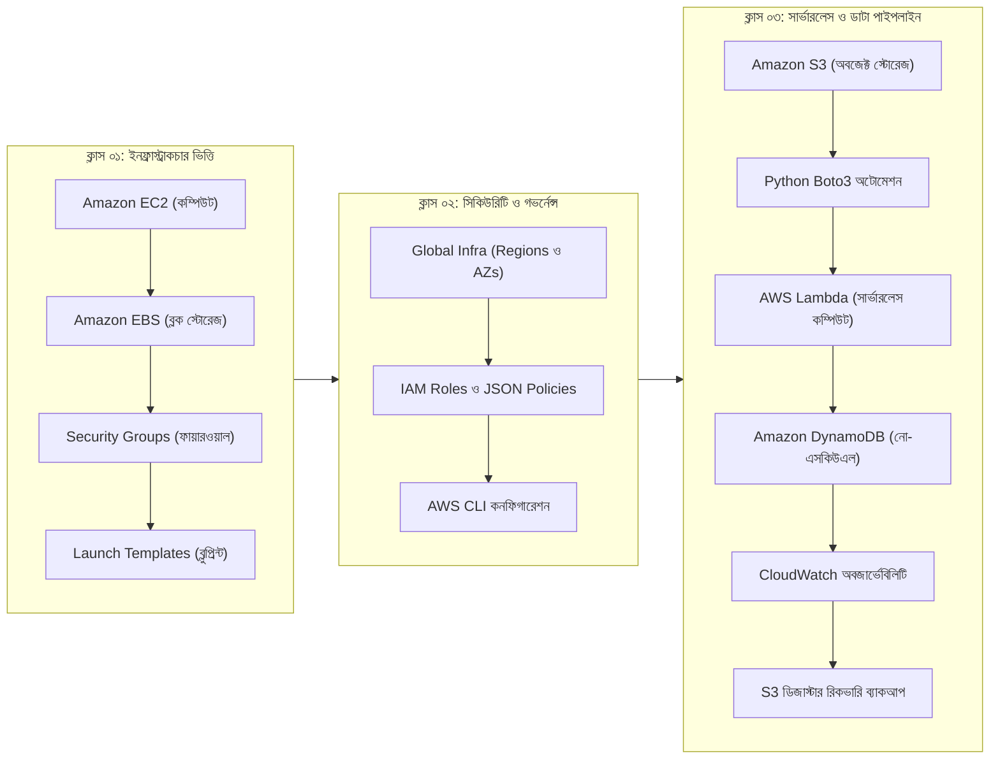

**ক্লাস ০৩-এর বিপ্লব:**
এখন পর্যন্ত আমরা শিখেছি কীভাবে সার্ভার তৈরি ও পরিচালনা করতে হয়। কিন্তু বাস্তব এন্টারপ্রাইজ সিস্টেমে ২৪ ঘণ্টা একটি ইসিটু সার্ভার চালু রেখে ছোটখাটো ফাইল প্রসেসিং বা ব্যাকআপ নেওয়া মারাত্মক অপচয়। ক্লাস ০৩-এ আমরা প্রবেশ করেছি **সার্ভারলেস ও ইভেন্ট-ড্রিভেন ক্লাউড আর্কিটেকচারে**। যেখানে সার্ভার ব্যাকগ্রাউন্ডে পুরোপুরি অদৃশ্য হয়ে যায়, কোড রান হয় মিলিসেকেন্ডের নিখুঁত হিসাবে, স্টোরেজ স্কেল করে অসীমে, এবং ডাটাবেস পরিচালিত হয় জিরো অ্যাডমিনিস্ট্রেশন ওভারহেডে।

---

## 2. স্টোরেজ প্যারাডাইম: ব্লক বনাম ফাইল বনাম অবজেক্ট স্টোরেজ

একজন দক্ষ ক্লাউড ও ডেভঅপস ইঞ্জিনিয়ার হতে হলে ক্লাউড স্টোরেজের তিনটি মৌলিক রূপের পার্থক্য স্পষ্টভাবে উপলব্ধি করতে হবে।

```mermaid
flowchart TD
    subgraph BS["১. ব্লক স্টোরেজ (Amazon EBS)"]
        direction TB
        B1["ভার্চুয়াল হার্ডডিস্ক যা একটি নির্দিষ্ট EC2 সার্ভারে যুক্ত থাকে"]
        B2["ডাটা ছোট ছোট ফিক্সড ব্লকে (Blocks) বিভক্ত থাকে"]
        B3["উচ্চগতির IOPS এবং সাব-মিলিসেকেন্ড লেটেন্সি"]
        B4["ব্যবহার: OS বুট ভলিউম, রিলেশনাল ডাটাবেস ফাইল"]
    end

    subgraph FS["২. ফাইল স্টোরেজ (Amazon EFS)"]
        direction TB
        F1["শেয়ার্ড নেটওয়ার্ক ফাইল সিস্টেম (NFSv4 প্রোটোকল)"]
        F2["হায়ারার্কিক্যাল ফোল্ডার ট্রি এবং পারমিশন স্ট্রাকচার"]
        F3["একসাথে শত শত EC2 সার্ভার থেকে রিড/রাইট করা যায়"]
        F4["ব্যবহার: শেয়ার্ড ওয়েব আপলোডস, লিগ্যাসি লিনাক্স ফাইল শেয়ার"]
    end

    subgraph OS["৩. অবজেক্ট স্টোরেজ (Amazon S3)"]
        direction TB
        O1["ফ্ল্যাট নেমস্পেস: বাকেট + অবজেক্ট কী (কোনো ড্রাইভ মাউন্ট নয়)"]
        O2["সরাসরি HTTP/HTTPS ওয়েব এপিআই দিয়ে সর্বত্র থেকে অ্যাক্সেসিবল"]
        O3["অসীম স্কেলেবিলিটি এবং ১১টি ৯-এর ডিউরেবিলিটি"]
        O4["ব্যবহার: ব্যাকআপ, মিডিয়া অ্যাসেটস, লগস, বিগ ডাটা লেক"]
    end
```

### 2.1 ইবিএস (EBS) কেন সব স্টোরেজ সমস্যার সমাধান নয়?

ক্লাস ০১-এ আমরা দেখেছি ইসিটু মেশিনের অপারেটিং সিস্টেম চালানোর জন্য ইবিএস ভলিউম অপরিহার্য। তবে বড় আকারের বা স্থায়ী ডাটা রাখার ক্ষেত্রে ইবিএস-এর কিছু সীমাবদ্ধতা রয়েছে:

1. **নির্দিষ্ট এজেড-এ সীমাবদ্ধতা (Single-AZ Bound):** একটি ইবিএস ভলিউম কেবল একটি নির্দিষ্ট অ্যাভেইলেবিলিটি জোনে অবস্থান করে। অন্য এজেডের সার্ভার থেকে সরাসরি তা অ্যাক্সেস করা যায় না।
2. **একক সার্ভার নির্ভরতা (Single Instance Attachment):** সচরাচর একটি ইবিএস ভলিউম একটি মাত্র ইসিটুর সাথেই যুক্ত হতে পারে।
3. **ক্যাপাসিটি অপচয়:** আপনি যদি ১০০ জিবি ইবিএস ভলিউম তৈরি করে মাত্র ২ জিবি ডাটা রাখেন, এডব্লিউএস আপনাকে পুরো ১০০ জিবির জন্যই প্রতি ঘণ্টার বিল চার্জ করবে।
4. **উচ্চ খরচ:** জেনারেল পারপাস এসএসডি (`gp3`) প্রতি জিবি প্রতি মাসে প্রায় $\$0.08$ ডলার চার্জ করে। শত শত টেরাবাইট হিস্টোরিক্যাল ব্যাকআপ ইবিএস-এ রাখা আর্থিকভাবে বিধ্বংসী।

### 2.2 অ্যামাজন এস৩ (Simple Storage Service) কী?

**অ্যামাজন সিম্পল স্টোরেজ সার্ভিস (Amazon S3)** হলো ২০০৬ সালে যাত্রা শুরু করা এডব্লিউএস-এর অন্যতম প্রাচীন ও জনপ্রিয় অবজেক্ট স্টোরেজ সার্ভিস। এস৩ কোনো ভার্চুয়াল মেশিনে ড্রাইভ হিসেবে ফরম্যাট বা মাউন্ট করা হয় না। এটি একটি গ্লোবাল, ওয়েব-স্কেল কি-ভ্যালু স্টোর যা ইন্টারনেটের মাধ্যমে সরাসরি কাজ করে।

এস৩-এর সাথে সব ডেটা আদান-প্রদান ঘটে **HTTP/HTTPS REST API**-এর মাধ্যমে:

- `GET`: অবজেক্ট রিড বা ডাউনলোড করতে
- `PUT`: নতুন অবজেক্ট আপলোড বা প্রতিস্থাপন করতে
- `DELETE`: অবজেক্ট অপসারণ করতে
- `HEAD`: অবজেক্টের সাইজ, মেটাডাটা ও হেডার ডাউনলোড ছাড়া দেখতে

### 2.3 এস৩-এর মূল উপাদান: বাকেট, অবজেক্ট, কী এবং মেটাডাটা

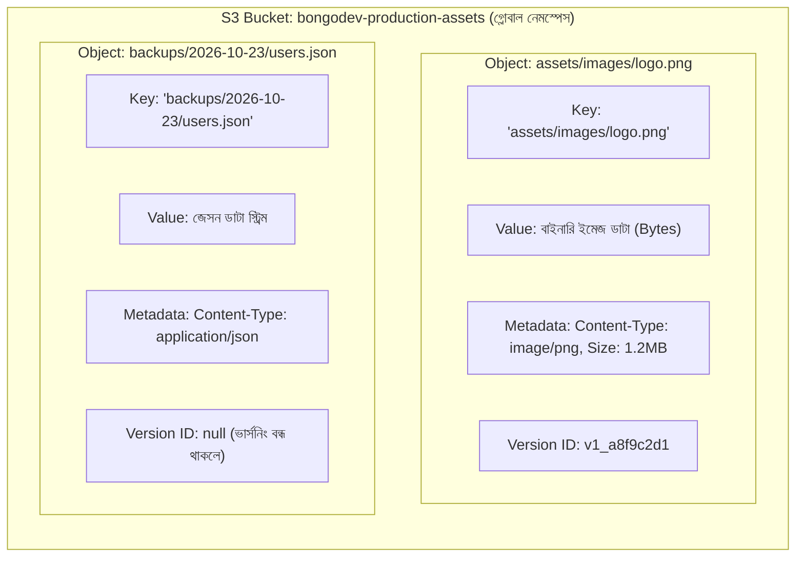

- **বাকেট (Bucket):** এস৩-এর মূল কন্টেইনার বা শীর্ষ ফোল্ডার সদৃশ সীমানা। আপনার অ্যাকাউন্টে একাধিক বাকেট থাকতে পারে, তবে বাকেটের নাম সমগ্র এডব্লিউএস-এর বিশ্বব্যাপী সিস্টেমে অনন্য (Unique) হতে হবে।
- **অবজেক্ট (Object):** বাকেটের ভেতরে সংরক্ষিত যেকোনো ফাইল (ইমেজ, ভিডিও, জেসন, ব্যাকআপ টারবল ইত্যাদি)। ফাইলের আকার ০ বাইট থেকে সর্বোচ্চ ৫ টেরাবাইট পর্যন্ত হতে পারে।
- **কী (Key):** বাকেটের মধ্যে ফাইলের পূর্ণ নাম ও পাথ। কনসোলে ফোল্ডার দেখালেও এস৩-এর কাছে `images/users/pic.png` পুরোটাই একটি একক স্ট্রিং বা কী (Key)।
- **মেটাডাটা (Metadata):** অবজেক্ট সম্পর্কিত তথ্য—যেমন আপলোডের সময়, ফাইলের সাইজ, MIME টাইপ (`image/png`), এনক্রিপশন স্ট্যাটাস ইত্যাদি।

### 2.4 বাকেট নামকরণের নীতিমালা ও গ্লোবাল ডিএনএস ইউনিকনেস

যেহেতু প্রতিটি এস৩ বাকেটের জন্য একটি পাবলিক ডিএনএস ইউআরএল (যেমন `https://my-bucket.s3.us-west-2.amazonaws.com`) তৈরি হয়, বাকেটের নামকে অবশ্যই বিশ্বমানের ডিএনএস নীতিমালা মেনে চলতে হয়:

| নীতিমালা (Rule)      | শর্ত ও বাধ্যবাধকতা (Requirement)                                 | অবৈধ উদাহরণ (Invalid)                   | বৈধ উদাহরণ (Valid)            |
| :------------------- | :--------------------------------------------------------------- | :-------------------------------------- | :---------------------------- |
| **গ্লোবাল ইউনিকনেস** | সারাবিশ্বের সমস্ত এডব্লিউএস অ্যাকাউন্টের মধ্যে অনন্য হতে হবে     | `my-test-bucket` (অলরেডি টেকেন)         | `bongodev-aws-class03-ns2026` |
| **দৈর্ঘ্য সীমা**     | ৩ থেকে ৬৩ অক্ষরের মধ্যে হতে হবে                                  | `ab` (খুব ছোট), `a...64chars`           | `bongodev-prod-bucket-01`     |
| **অনুমোদিত অক্ষর**   | শুধু ছোট হাতের ইংরেজি অক্ষর (lowercase), সংখ্যা এবং হাইফেন (`-`) | `MyBucket_Name` (বড় হাত বা `_` নিষিদ্ধ) | `bongodev-user-backups-2026`  |
| **শুরু ও শেষ অক্ষর** | অবশ্যই ছোট হাতের অক্ষর বা সংখ্যা দিয়ে শুরু ও শেষ হতে হবে         | `-bucket-name-`, `.bucket.`             | `bucket-name-01`              |
| **আইপি নিষিদ্ধ**     | কোনো আইপি অ্যাড্রেসের ফরম্যাটে নাম রাখা যাবে না                  | `192.168.1.1`                           | `server-ip-192-168-1-1`       |

> [!WARNING]
> আপনি যদি অরিগন (`us-west-2`) রিজিয়নে `demo-bucket` নামে বাকেট বানাতে চান এবং ফ্রাঙ্কফুর্টের কোনো ইউজার যদি ১০ বছর আগে সেই নামে বাকেট বানিয়ে থাকে, আপনি সেই নাম পাবেন না। এডব্লিউএস সঙ্গে সঙ্গে `BucketAlreadyExistsException` এরর ফেরত দেবে। তাই সবসময় নিজের প্রতিষ্ঠানের নাম ও ইউনিক আইডি প্রিফিক্স হিসেবে ব্যবহার করবেন।

### 2.5 ১১টি ৯-এর ডিউরেবিলিটি ($99.999999999\%$) বনাম অ্যাভেইলেবিলিটি ($99.99\%$)

শিক্ষার্থীদের মধ্যে সবচেয়ে বড় বিভ্রান্তি ঘটে **ডিউরেবিলিটি (Durability)** এবং **অ্যাভেইলেবিলিটি (Availability)**-এর মধ্যে:

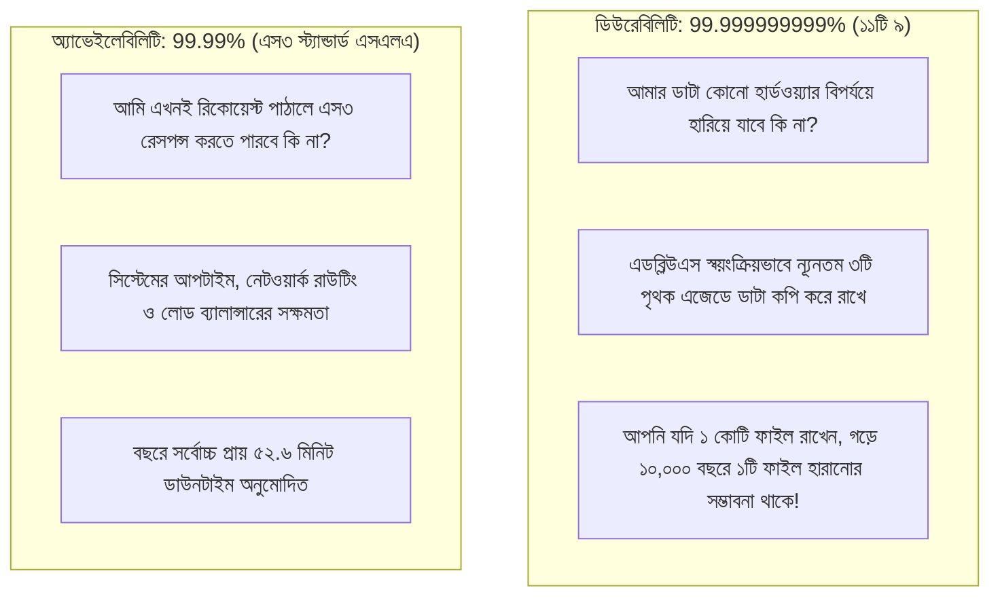

- **ডিউরেবিলিটি ($99.999999999\%$):** ডাটার অস্তিত্ব টিকে থাকার গ্যারান্টি। কোনো একটি ডেটা সেন্টার বন্যায় বা আগুনে সম্পূর্ণ ধ্বংস হয়ে গেলেও অন্য দুটি এজেডে ডাটা অক্ষত থাকে।
- **অ্যাভেইলেবিলিটি ($99.99\%$):** সার্ভিসের কার্যক্ষমতার অনুপাত। অর্থাৎ যেকোনো মুহূর্তে ফাইল ডাউনলোড বা আপলোডের জন্য এস৩ এপিআই সচল পাওয়ার সম্ভাবনা।

### 2.6 এস৩-তে স্ট্যাটিক ওয়েবসাইট হোস্টিং (Static Website Hosting)

যদি আপনার অ্যাপ্লিকেশনে কোনো ডাইনামিক ব্যাকএন্ড সার্ভার কোড (যেমন পিএইচপি বা পাইথন স্ক্রিপ্ট) না থাকে—শুধুমাত্র HTML, CSS, JavaScript, React/Vue প্রোডাকশন বিল্ড ফাইল থাকে—তবে **কোনো EC2 সার্ভার বা Nginx ছাড়াই** সরাসরি এস৩ বাকেট থেকে ওয়েবসাইট সার্ভ করা যায়।

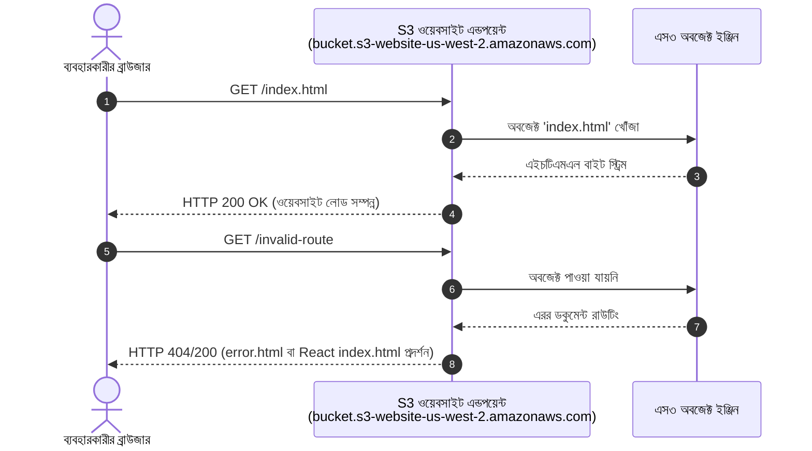

**কনসোল কনফিগারেশন:**

1. বাকেট প্রোপার্টিজ থেকে **Static website hosting** এনাবল করুন।
2. **Index document** হিসেবে `index.html` এবং **Error document** হিসেবে `error.html` দিন।
3. এস৩ একটি নির্দিষ্ট ওয়েবসাইট ইউআরএল তৈরি করবে: `http://<bucket-name>.s3-website-<region>.amazonaws.com`।

---

## 3. অ্যামাজন এস৩ স্টোরেজ ক্লাসেস ও ক্লাউড কস্ট অপ্টিমাইজেশন

একজন সিনিয়র ডেভঅপস ইঞ্জিনিয়ারের দায়িত্ব শুধু কোড চালানো নয়, বরং ক্লাউডের হাজার হাজার ডলার সাশ্রয় করা। এস৩ ডাটা অ্যাক্সেসের ধরণের ওপর ভিত্তি করে বিভিন্ন স্টোরেজ টিয়ার প্রদান করে।

### 3.1 খরচের ম্যাট্রিক্স: \$২৩/টিবি থেকে \$১/টিবি

ক্লাসে শিক্ষক যে বাস্তব আর্থিক হিসাব তুলে ধরেছিলেন তা প্রতিটি ক্লাউড ইঞ্জিনিয়ারের মস্তিষ্কে গেঁথে রাখা প্রয়োজন:

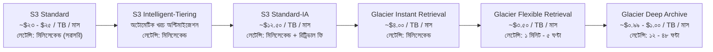

| স্টোরেজ ক্লাস               | ডিউরেবিলিটি     | অ্যাভেইলেবিলিটি | রিট্রিভাল সময়     | প্রতি টিবি প্রতি মাস খরচ | ডাটা রিট্রিভাল ফি | আদর্শ ব্যবহার ক্ষেত্র                                  |
| :-------------------------- | :-------------- | :-------------- | :---------------- | :----------------------- | :---------------- | :----------------------------------------------------- |
| **S3 Standard**             | ১১টি ৯          | ৯৯.৯৯%          | মিলিসেকেন্ড       | ~\$২৩.০০                 | নেই               | নিয়মিত ব্যবহৃত ফাইল, ওয়েবসাইট ইমেজ, অ্যাক্টিভ ডেটা     |
| **S3 Intelligent-Tiering**  | ১১টি ৯          | ৯৯.৯%           | মিলিসেকেন্ড       | পরিবর্তনশীল (অটো)        | নেই               | অনির্দিষ্ট বা পরিবর্তনশীল অ্যাক্সেস প্যাটার্নের ডাটা   |
| **S3 Standard-IA**          | ১১টি ৯          | ৯৯.৯%           | মিলিসেকেন্ড       | ~\$১২.৫০                 | প্রতি জিবি চার্জ  | ব্যাকআপ, দুর্যোগ পুনরুদ্ধারের ডাটা যা মাসে ১ বার লাগে  |
| **S3 One Zone-IA**          | ১১টি ৯ (১টি AZ) | ৯৯.৫%           | মিলিসেকেন্ড       | ~\$১০.০০                 | প্রতি জিবি চার্জ  | পুনরায় তৈরিযোগ্য সেকেন্ডারি কপি, থাম্বনেইল ক্যাশ       |
| **S3 Glacier Instant**      | ১১টি ৯          | ৯৯.৯%           | মিলিসেকেন্ড       | ~\$৪.০০                  | প্রতি জিবি চার্জ  | ত্রৈমাসিক অডিট রিপোর্ট, দ্রুত দরকারি আর্কাইভ ফাইল      |
| **S3 Glacier Flexible**     | ১১টি ৯          | ৯৯.৯%           | ১ মিনিট – ৫ ঘণ্টা | ~\$৩.৫০                  | প্রতি জিবি চার্জ  | বাৎসরিক ট্যাক্স ফাইল, পুরনো ডাটাবেস ব্যাকআপ            |
| **S3 Glacier Deep Archive** | ১১টি ৯          | ৯৯.৯%           | ১২ – ৪৮ ঘণ্টা     | ~\$০.৯৯ – \$১.০০         | প্রতি জিবি চার্জ  | ৭-১০ বছরের সরকারি কমপ্লায়েন্স রেকর্ড, লিগ্যাল আর্কাইভ |

### 3.2 এস৩ স্ট্যান্ডার্ড (S3 Standard)

ডিফল্ট স্টোরেজ টিয়ার। আপনি কোনো ক্লাস নির্ধারণ না করলে ডাটা এস৩ স্ট্যান্ডার্ডেই সংরক্ষিত হবে। অতিদ্রুত মিলিসেকেন্ড লেটেন্সি, রিট্রিভালে কোনো অতিরিক্ত ফি নেই, তবে প্রতি জিবির সংরক্ষণ খরচ তুলনামূলক বেশি।

### 3.3 এস৩ ইন্টেলিজেন্ট-টিয়ারিং (S3 Intelligent-Tiering)

যেসব ডেটার ব্যবহার সম্পর্কে আপনি নিশ্চিত নন, সেখানে এটি জাদুর মতো কাজ করে। এটি স্বয়ংক্রিয়ভাবে ডাটা পর্যবেক্ষণ করে:

- যদি কোনো ফাইল ৩০ দিন ধরে কেউ না ছুঁয়ে দেখে, এস৩ স্বয়ংক্রিয়ভাবে তাকে _ইনফ্রিকোয়েন্ট অ্যাক্সেস টিয়ারে_ পাঠিয়ে দেয় (৪০% খরচ সাশ্রয়)।
- যদি ৯০ দিন ধরে না লাগে, পাঠিয়ে দেয় _আর্কাইভ ইনস্ট্যান্ট টিয়ারে_ (৬৮% সাশ্রয়)।
- কেউ আবার ফাইলটি রিড করার সাথে সাথে কোনো জরিমানা ছাড়াই তা আবার ফ্রিকোয়েন্ট টিয়ারে ফিরে আসে!

### 3.4 এস৩ স্ট্যান্ডার্ড-ইনফ্রিকোয়েন্ট অ্যাক্সেস (Standard-IA) ও ওয়ান জোন-আইএ

- **Standard-IA:** স্ট্যান্ডার্ডের মতোই ৩টি এজেড-এ সংরক্ষিত থাকে, কিন্তু স্টোরেজ খরচ প্রায় অর্ধেক (\$১২.৫০/টিবি)। তবে ডাটা রিড বা ডাউনলোড করার সময় প্রতি জিবির জন্য আলাদা রিট্রিভাল ফি দিতে হয়।
- **One Zone-IA:** ডাটা মাত্র **একটি** এজেডে থাকে। খরচ আরও কম (\$১০/টিবি), কিন্তু সেই নির্দিষ্ট ডেটা সেন্টার ধ্বংস হলে ডাটা চিরতরে হারিয়ে যাবে।

### 3.5 এস৩ গ্লেশিয়ার: ইনস্ট্যান্ট বনাম ফ্লেক্সিবল রিট্রিভাল বনাম ডিপ আর্কাইভ

ক্লাসে শিক্ষক শীতপ্রধান দেশের ভালুকের হাইবারনেশনের চমৎকার উপমা দিয়েছিলেন:

> _"শীতের দেশে ভালুক যেমন শীতের ৬-৯ মাস গুহার ভেতরে ঘুমিয়ে পড়ে, গ্লেশিযার হলো এডব্লিউএস-এর ডিজিটাল ঘুমের জায়গা। সরকারি পুরনো রেকর্ড, ১০ বছর আগের ব্যাংকিং ট্রানজ্যাকশন যা সাধারণ সময়ে কেউ দেখে না—সেগুলো এস৩ স্ট্যান্ডার্ডে রেখে মাসে \$২৫ ডলার নষ্ট করার কোনো মানে নেই। সেগুলোকে আমরা গ্লেশিয়ার ডিপ আর্কাইভে ঘুম পাড়িয়ে রাখবো মাত্র \$১ ডলারে!"_

1. **গ্লেশিয়ার ইনস্ট্যান্ট রিট্রিভাল:** খুব কম অ্যাক্সেস হয় (বছরে ১-২ বার), কিন্তু যখন চাওয়া হবে তখন মিলিসেকেন্ডেই ফাইল ডেলিভারি দিতে হবে (যেমন হসপিটালের পুরনো এক্স-রে ফাইল)।
2. **গ্লেশিয়ার ফ্লেক্সিবল রিট্রিভাল:** ৩টি বিকল্প থাকে—এক্সপিডাইটেড (১-৫ মিনিট), স্ট্যান্ডার্ড (৩-৫ ঘণ্টা), এবং বাল্ক (৫-১২ ঘণ্টা)।
3. **গ্লেশিয়ার ডিপ আর্কাইভ:** পৃথিবীর সবচেয়ে সস্তা ক্লাউড স্টোরেজ। এটি উচ্চক্ষমতাসম্পন্ন ম্যাগনেটিক টেপ রোবোটিক্স সিস্টেমে লেখা হয়। ফাইল রিট্রিভ করতে **১২ থেকে ৪৮ ঘণ্টা** পর্যন্ত সময় লাগতে পারে।

### 3.6 এস৩ লাইফসাইকেল ট্রানজিশন রুলস (Lifecycle Management)

ম্যানুয়ালি ফাইল ট্রান্সফার না করে বাকেট পলিসিতে লাইফসাইকেল নিয়ম ডিক্লেয়ার করা যায়:

```mermaid
flowchart LR
    Day0["০ দিন: ফাইল তৈরি<br/>S3 Standard ($২৩/টিবি)"] -->|৩০ দিন পর| Day30["৩০ দিন: স্থানান্তর<br/>S3 Standard-IA ($১২.৫০/টিবি)"]
    Day30 -->|৯০ দিন পর| Day90["৯০ দিন: স্থানান্তর<br/>Glacier Flexible ($৩.৫০/টিবি)"]
    Day90 -->|৩৬৫ দিন পর| Day365["৩৬৫ দিন: স্থানান্তর<br/>Glacier Deep Archive ($১/টিবি)"]
    Day365 -->|২৫৫৫ দিন পর (৭ বছর)| Expire["২৫৫৫ দিন: স্থায়ী ডিলিট<br/>(কমপ্লায়েন্স সম্পন্ন)"]
```

---

## 4. এস৩ অ্যাডভান্সড অপারেশনস ও সিকিউরিটি আর্কিটেকচার

### 4.1 ব্লক পাবলিক অ্যাক্সেস (BPA): ডিফল্ট সিকিউরিটি প্রাচীর

অতীতে অনেক শীর্ষস্থানীয় কোম্পানির ডেটা লিক হয়েছিল বাকেট ভুলবশত পাবলিক করে দেওয়ার কারণে। তাই এডব্লিউএস এখন প্রতিটি নতুন বাকেটের জন্য **Block Public Access (BPA)** ডিফল্টভাবে সক্রিয় রাখে। এটি কেন্দ্রীয় সার্কিট ব্রেকারের মতো কাজ করে বাইরে থেকে আসা সমস্ত অননুমোদিত রিকোয়েস্ট আটকে দেয়।

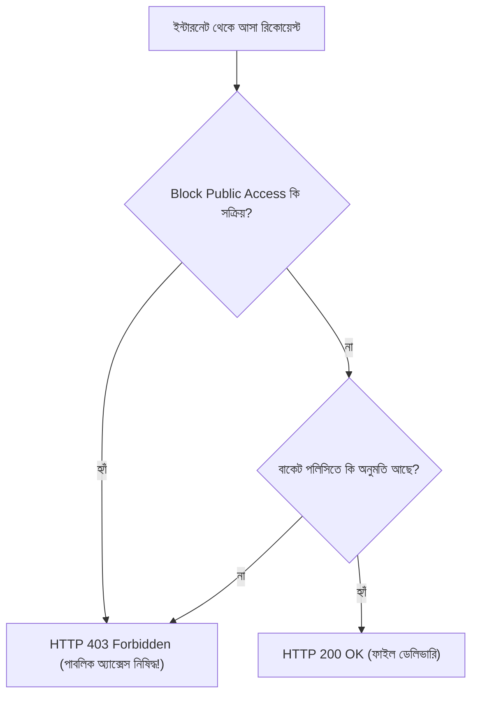

### 4.2 বাকেট ভার্সনিং (Versioning): ভুল ওভাররাইট ও ডিলিট প্রতিরোধ

ডিফল্টভাবে ভার্সনিং বন্ধ থাকে। ফলে একই নামের নতুন ফাইল আপলোড করলে আগের ফাইলটি চিরতরে মুছে প্রতিস্থাপিত হয়।

ভার্সনিং চালু থাকলে:

- প্রতিটি আপলোডের সাথে একটি ইউনিক `Version ID` যুক্ত হয়।
- ভুলবশত কোনো ফাইল ডিলিট করলে ফাইলটি প্রকৃতপক্ষে মোছে না, তার ওপরে একটি **Delete Marker** বসে যায়। মার্কারটি ডিলিট করলেই ফাইলটি স্বরূপে ফিরে আসে।

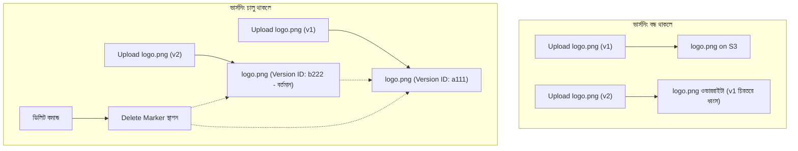

### 4.3 মাল্টিপার্ট আপলোড (Multipart Upload): বড় ফাইল প্রক্রিয়াকরণ

ক্লাসে একজন শিক্ষার্থী প্রশ্ন করেছিলেন: _"আমার যদি ৫০ জিবি বা ৫০০ জিবির ডেটাবেস ডাম্প ফাইল থাকে, সেটা কি এক টানে আপলোড হবে?"_

শিক্ষক ব্যাখ্যা করেন **এস৩ মাল্টিপার্ট আপলোড**:

1. সাধারণ একক পুট (Single `PUT`) পদ্ধতিতে সর্বোচ্চ **৫ জিবি** পর্যন্ত আপলোড সম্ভব।
2. **১০০ মেগাবাইট**-এর চেয়ে বড় ফাইলের ক্ষেত্রে এডব্লিউএস মাল্টিপার্ট আপলোড বাধ্যতামূলকভাবে সুপারিশ করে।
3. **কার্যপ্রণালী:**
   - স্ক্রিপ্ট বড় ফাইলকে ছোট ছোট টুকরোয় (চাঙ্ক বা পার্টস - ৫ এমবি থেকে ৫০০ এমবি) ভাগ করে।
   - টুকরোগুলো সমান্তরালভাবে (Parallel HTTP Streams) আপলোড হয়।
   - ৩ নম্বর পার্ট ফেইল করলে শুধু ৩ নম্বর পার্টই রিট্রাই হবে, পুরো ৫০ জিবি নয়!
   - শেষে এস৩ চেকসাম (Checksum) মিলিয়ে জোড়া দিয়ে একটি মূল ফাইলে রূপান্তর করে।

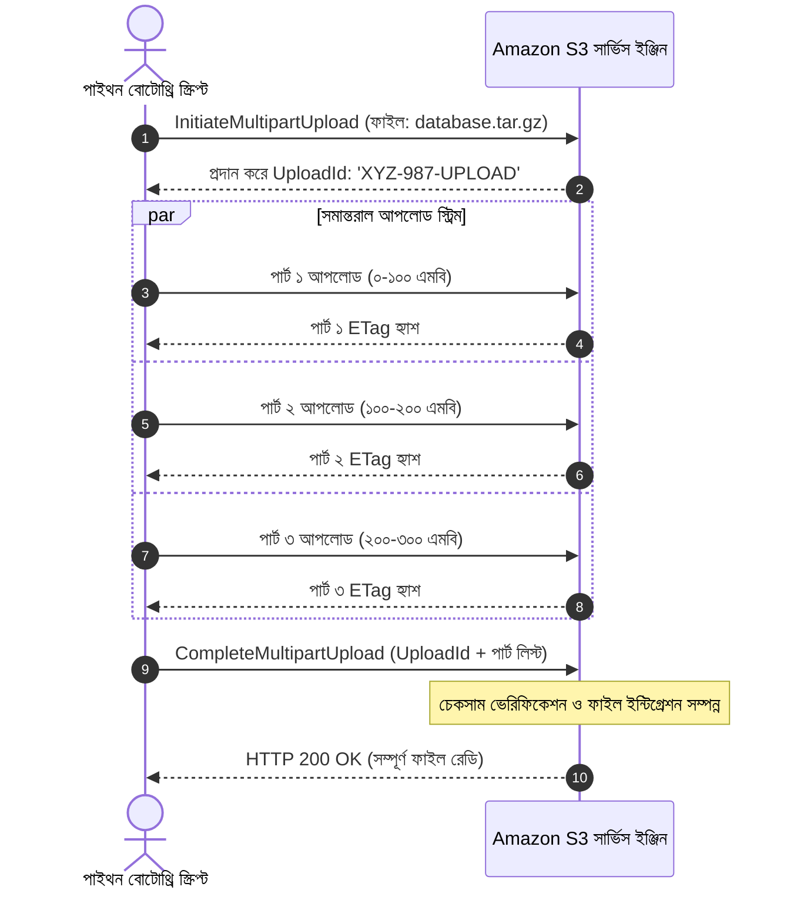

### 4.4 সার্ভার-সাইড এনক্রিপশন: SSE-S3 বনাম SSE-KMS

এস৩-তে ডাটা রেস্টে থাকা অবস্থায় স্বয়ংক্রিয়ভাবে এনক্রিপ্ট হয়:

- **SSE-S3 (`AES256`):** চাবি পরিচালনা করে সম্পূর্ণ এডব্লিউএস। একদম ফ্রি এবং জিরো কনফিগারেশন।
- **SSE-KMS (`aws:kms`):** এডব্লিউএস কি ম্যানেজমেন্ট সার্ভিসের (KMS) চাবি ব্যবহার করে। ক্লাউডট্রেইলে প্রতিটি ফাইল কে কখন ডিক্রিপ্ট করেছে তার অডিট ট্রেল পাওয়া যায়।

---

## 5. পাইথন এবং বোটোথ্রি (Boto3) দিয়ে প্রোগ্রামেটিক ক্লাউড অটোমেশন

### 5.1 একজন ডেভঅপস ইঞ্জিনিয়ারের জন্য পাইথন জানা কেন বাধ্যতামূলক?

ক্লাসে একজন শিক্ষার্থী অত্যন্ত চমৎকার প্রশ্ন তুলেছিলেন:

> _"ভাইয়া, আমরা তো ব্যাশ (Bash) স্ক্রিপ্টিং শিখেছি। তাহলে পাইথন কেন দরকার?"_

শিক্ষকের তাৎপর্যপূর্ণ উত্তর:

- **Bash স্ক্রিপ্টিং** টার্মিনালে এক লাইনের কমান্ড বা লিনাক্স ওএস কনফিগারেশনের জন্য চমৎকার।
- কিন্তু বাস্তব প্রোডাকশনে যখন আপনাকে কোনো থার্ড পার্টি রেস্ট এপিআই (REST API) কল করে কমপ্লেক্স জেসন পার্স করতে হবে, কন্ডিশনাল লজিক দিয়ে ডেটাবেসে পাঠাতে হবে এবং কোনো এরর হলে ট্রাই/ক্যাচ (`try/except`) দিয়ে ক্যাচ করতে হবে—তখন ব্যাশ দিয়ে তা করা অত্যন্ত জটিল ও ভঙ্গুর।
- পাইথনে **Boto3 SDK** ব্যবহার করে যেকোনো জটিল ক্লাউড পাইপলাইনকে শক্তিশালী ও মেইনটেইনেবল কোডে রূপান্তর করা যায়।

### 5.2 বোটোথ্রি (Boto3) ইনস্টলেশন ও এনভায়রনমেন্ট সেটআপ

**Boto3** হলো এডব্লিউএস-এর অফিশিয়াল পাইথন সফটওয়্যার ডেভেলপমেন্ট কিট (SDK)।

```bash
# পিপ আপগ্রেড করে Boto3 ইনস্টল করুন
python -m pip install --upgrade pip
pip install boto3
```

### 5.3 অথেনটিকেশন রেজোলিউশন: Boto3 যেভাবে `~/.aws/credentials` খুঁজে পায়

কোডের ভেতর কখনো নিজের সিক্রেট পাসওয়ার্ড বা অ্যাক্সেস কি হার্ডকোড করবেন না। বোটোথ্রি একটি নির্দিষ্ট ক্রমানুসারে স্বয়ংক্রিয়ভাবে ক্রেডেনশিয়াল খুঁজে নেয়:

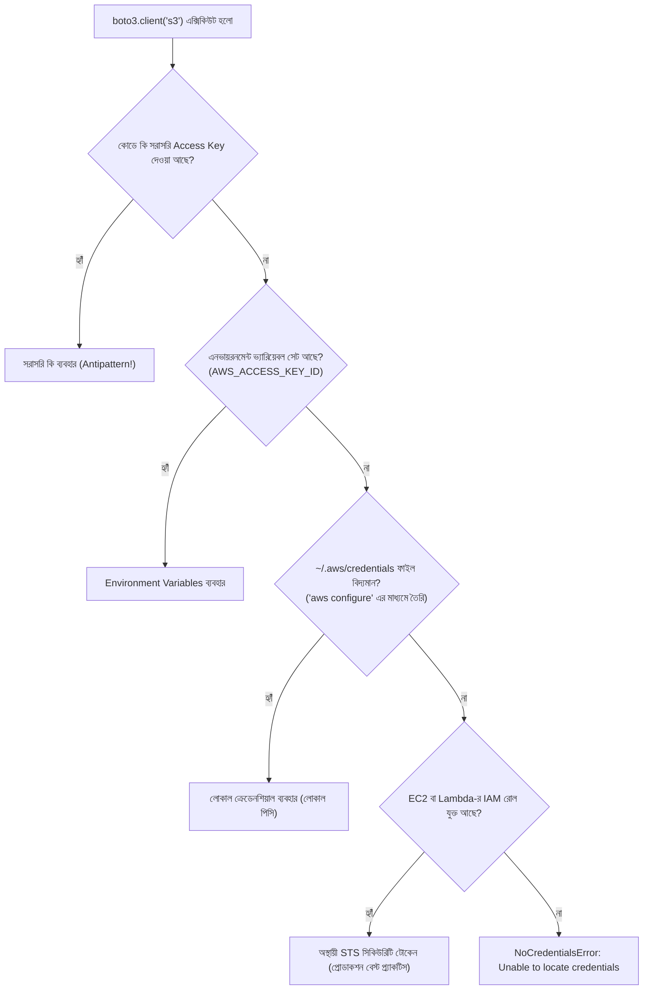

যেহেতু ক্লাস ০২-এ আমরা `aws configure` কমান্ড দিয়েছিলাম, আমাদের কম্পিউটারের `~/.aws/credentials` ও `~/.aws/config` ফাইলে কি ও রিজিয়ন সংরক্ষিত আছে। তাই Boto3 সরাসরি কানেক্ট হতে পারে।

### 5.4 বোটোথ্রি ক্লায়েন্ট (Client) বনাম রিসোর্স (Resource) মডেল

1. **Client (`boto3.client('s3')`):** লো-লেভেল এপিআই ইন্টারফেস। এডব্লিউএস-এর সমস্ত সার্ভিসের ১০০% ফিচার সরাসরি ডিকশনারি ফরম্যাটে রিটার্ন করে।
2. **Resource (`boto3.resource('dynamodb')`):** হাই-লেভেল অবজেক্ট ওরিয়েন্টেড ইন্টারফেস। এটি রেসপন্সকে অবজেক্টে র‍্যাপ করে সহজে কাজ করার সুযোগ দেয়।

### 5.5 স্বয়ংক্রিয় ফাইল আপলোড স্ক্রিপ্ট ডিপ-ডাইভ

ক্লাসে প্রদর্শিত লোকাল ফোল্ডার (`assets/`) থেকে এস৩ বাকেটে স্বয়ংক্রিয় ফাইল আপলোড স্ক্রিপ্ট:

```python
"""
স্ক্রিপ্ট: s3_upload.py
উদ্দেশ্য: Boto3 ব্যবহার করে লোকাল ডিরেক্টরি থেকে Amazon S3 বাকেটে স্বয়ংক্রিয় ফাইল আপলোড।
প্রশিক্ষক: নূরে সিদ্দিকী (ক্লাউড ও এডব্লিউএস ক্লাস ০৩)
"""

from pathlib import Path
import sys
import boto3
from botocore.exceptions import ClientError, NoCredentialsError

# বাকেট ও ফোল্ডার কনফিগারেশন
BUCKET_NAME = "bongodev-demo-bucket-ns2026"
LOCAL_FOLDER_PATH = Path("assets")


def upload_assets_to_s3(folder_path: Path, bucket_name: str) -> None:
    """লোকাল ফোল্ডার ট্রাভার্স করে এস৩ বাকেটে ফাইল আপলোড করে।"""
    if not folder_path.exists() or not folder_path.is_dir():
        print(
            f"ত্রুটি: নির্দেশিত ডিরেক্টরি '{folder_path}' খুঁজে পাওয়া যায়নি!",
            file=sys.stderr,
        )
        return

    # Boto3 S3 ক্লায়েন্ট ইনস্ট্যান্স তৈরি
    s3_client = boto3.client("s3")
    print(f"এডব্লিউএস এস৩ সংযোগ স্থাপিত... টার্গেট বাকেট: [{bucket_name}]")

    upload_count = 0
    for file_path in folder_path.iterdir():
        # শুধুমাত্র ফাইল আপলোড করবে (সাবফোল্ডার বাদ দিয়ে)
        if file_path.is_file():
            object_key = file_path.name

            try:
                print(f"আপলোড হচ্ছে: '{file_path}' -> এস৩ কী: '{object_key}'")

                # আপলোড এপিআই কল
                s3_client.upload_file(
                    Filename=str(file_path),
                    Bucket=bucket_name,
                    Key=object_key,
                )
                print(f"--> সফলভাবে আপলোড সম্পন্ন: {object_key}")
                upload_count += 1

            except ClientError as e:
                error_code = e.response["Error"]["Code"]
                if error_code == "NoSuchBucket":
                    print(
                        f"মারাত্মক ত্রুটি: বাকেট '{bucket_name}' নেই! আগে বাকেট তৈরি করুন।",
                        file=sys.stderr,
                    )
                else:
                    print(f"ক্লায়েন্ট এরর [{error_code}]: {e}", file=sys.stderr)
            except NoCredentialsError:
                print(
                    "মারাত্মক ত্রুটি: কোনো এডব্লিউএস ক্রেডেনশিয়াল পাওয়া যায়নি! 'aws configure' চালান।",
                    file=sys.stderr,
                )
                return

    print(
        f"\nসমস্ত অপারেশন সফল! মোট {upload_count}টি অ্যাসেট আপলোড হয়েছে।"
    )


if __name__ == "__main__":
    upload_assets_to_s3(LOCAL_FOLDER_PATH, BUCKET_NAME)
```

### 5.6 নেস্টেড ডিরেক্টরি আপলোডে রিকারসিভ ট্রাভার্সাল (Recursion)

ফোল্ডারের ভেতর ফোল্ডার থাকলে রিকারসিভ লুপ চালিয়ে আপলোড করতে হয়:

```python
"""
রিকারসিভ এস৩ আপলোড কোড স্নিপেট
সাবফোল্ডার স্ট্রাকচার বজায় রেখে এস৩-তে আপলোড নিশ্চিত করে।
"""

from pathlib import Path
import boto3

s3_client = boto3.client("s3")
root_dir = Path("my_assets")
bucket_name = "bongodev-demo-bucket-ns2026"

for item in root_dir.rglob("*"):
    if item.is_file():
        # আপেক্ষিক পাথ তৈরি (যেমন: "images/profile/avatar.png")
        relative_key = str(item.relative_to(root_dir)).replace("\\", "/")
        print(f"আপলোড হচ্ছে: {item} -> s3://{bucket_name}/{relative_key}")
        s3_client.upload_file(
            Filename=str(item), Bucket=bucket_name, Key=relative_key
        )
```

---

## 6. সার্ভারলেস কম্পিউট: এডব্লিউএস ল্যামডা (AWS Lambda) ডিপ-ডাইভ

### 6.1 সার্ভারলেস মানসিকতা: ফাংশন-অ্যাজ-আ-সার্ভিস (FaaS)

এখন পর্যন্ত আমরা কোড চালাতে সার্ভারের ওপর নির্ভর করেছি। কিন্তু **AWS Lambda** কম্পিউটেশনাল ধারণাকে আমূল বদলে দিয়েছে:

```mermaid
flowchart TD
    subgraph Trad["প্রচলিত EC2 সার্ভার মডেল"]
        VM["ভার্চুয়াল মেশিন (উবুন্টু লিনাক্স)"]
        OS["ওএস মেইনটেন্যান্স ও প্যাচিং"]
        Runtime["Python রানটাইম কনফিগারেশন"]
        Cost1["বিলিং: ২৪ ঘণ্টা প্রতি সেকেন্ডে, ট্রাফিক থাকুক বা না থাকুক"]
        Scaling1["স্কেলিং: ধীরগতির (নতুন সার্ভার চালু হতে মিনিট লাগে)"]
        VM --- OS --- Runtime --- Cost1 --- Scaling1
    end

    subgraph Serv["সার্ভারলেস FaaS মডেল (AWS Lambda)"]
        FaaS["ফাংশন-অ্যাজ-আ-সার্ভিস"]
        NoOS["জিরো ওএস ম্যানেজমেন্ট (সব দায়িত্ব এডব্লিউএস-এর)"]
        AutoR["ম্যানেজড রানটাইম (Python 3.12 / Node.js)"]
        Cost2["বিলিং: কোড রান হওয়ার নিখুঁত মিলি-সেকেন্ডে"]
        Scaling2["স্কেলিং: চোখের পলকে (০ থেকে হাজার হাজার রিকোয়েস্ট)"]
        FaaS --- NoOS --- AutoR --- Cost2 --- Scaling2
    end
```

- **সার্ভারহীন অভিজ্ঞতা:** আপনি কোনো সার্ভার বা অপারেটিং সিস্টেম দেখতে পাবেন না।
- **পে-পার-ইউজ বিলিং:** কোড ৬১ মিলি-সেকেন্ড চললে কেবল ৬১ মিলি-সেকেন্ডের বিল। কেউ এক সপ্তাহ ফাংশন কল না করলে বিল **\$০.০০**!
- **অটো স্কেলিং:** ১টি রিকোয়েস্ট আসলে ১টি এক্সিকিউশন স্যান্ডবক্স; একসাথে ১০,০০০ রিকোয়েস্ট আসলে এডব্লিউএস ব্যাকগ্রাউন্ডে নিমেষে ১০,০০০ কনটেইনার স্পিন-আপ করবে।

### 6.2 কখন ল্যামডা বনাম কখন ইসিটু ব্যবহার করবেন? (মশা মারতে কামান নীতি)

ক্লাসে শিক্ষকের অনবদ্য তুলনা:

> _"আপনার ঘরে একটা মশা ঢুকেছে। মশা মারার জন্য কি আপনি কামান দেগে ঘর উড়িয়ে দেবেন? নাকি একটি ইলেকট্রিক ব্যাট বা ফ্ল্যাপার দিয়ে মারবেন? ইসিটু সার্ভার হলো কামান। যদি একটি ছোট স্ক্রিপ্ট দিনে ৫ বার ডাটা ফেচ করে ডাটাবেসে সেভ করে, সেটার জন্য ২৪ ঘণ্টা সার্ভার চালিয়ে রাখা হলো মশা মারতে কামান দাগা। এই কাজের জন্য দরকার এডব্লিউএস ল্যামডা—যা চোখের পলকে কাজ শেষ করে মিলিয়ে যায়!"_

| বৈশিষ্ট্য            | Amazon EC2                                            | AWS Lambda                                               |
| :------------------- | :---------------------------------------------------- | :------------------------------------------------------- |
| **আর্কিটেকচার মডেল** | ইনফ্রাস্ট্রাকচার-অ্যাজ-আ-সার্ভিস (IaaS)               | ফাংশন-অ্যাজ-আ-সার্ভিস (FaaS) / সার্ভারলেস                |
| **সার্ভার পরিচালনা** | ওএস, নিরাপত্তা প্যাচিং, ওয়েব সার্ভার সব নিজের দায়িত্ব | এডব্লিউএস পরিচালিত; কোনো ওএস অ্যাক্সেস নেই               |
| **সর্বোচ্চ রানটাইম** | অনির্দিষ্টকাল (বছরের পর বছর একটানা চলতে পারে)         | **সর্বোচ্চ ১৫ মিনিট (৯০০ সেকেন্ড)** এর পর বন্ধ           |
| **মূল্য নির্ধারণ**   | সার্ভার `running` থাকা পর্যন্ত প্রতি সেকেন্ডে         | কোড এক্সিকিউশনের প্রতি মিলিসেকেন্ড অনুযায়ী               |
| **স্কেলিং সময়**      | ১ থেকে ৫ মিনিট (অটো স্কেলিং গ্রুপে নতুন ভিএম বুট হতে) | সাব-সেকেন্ড (মিলি-সেকেন্ডে কনকারেন্সি বৃদ্ধি)            |
| **স্টেটলেসনেস**      | স্টেটফুল (ইবিএস ডিস্কে ডাটা স্থায়ী থাকে)              | স্টেটলেস (ফাংশন শেষে কনটেইনার ধুয়েমুছে সাফ)              |
| **আদর্শ ক্ষেত্র**    | দীর্ঘমেয়াদী মনোলিথ অ্যাপ, ডকার ডেমন, ভারী প্রসেসিং    | মাইক্রোসার্ভিস, এপিআই ব্যাকএন্ড, ইভেন্ট ড্রাইভেন ব্যাকআপ |

### 6.3 ল্যামডা ফাংশনের অ্যানাটমি: হ্যান্ডলার, ইভেন্ট এবং কনটেক্সট

প্রতিটি পাইথন ল্যামডা ফাংশনের মূল চালিকাশক্তি হলো **হ্যান্ডলার (Handler)**:

```python
def lambda_handler(event, context):
    # আপনার বিজনেস লজিক এখানে এক্সিকিউট হবে
    return {"statusCode": 200, "body": "সফল!"}
```

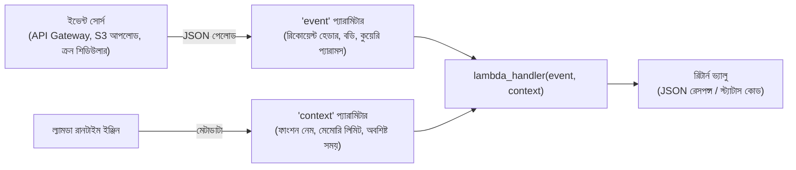

1. **`event` (পাইথন ডিকশনারি):** ফাংশনটি যার মাধ্যমে ট্রিগার হয়েছে তার সমস্ত ডাটা এতে থাকে।
2. **`context` (পাইথন অবজেক্ট):** রানটাইম সম্পর্কিত তথ্য—যেমন ফাংশন টাইমআউটের আর কত মিলিসেকেন্ড বাকি আছে (`context.get_remaining_time_in_millis()`)।

### 6.4 রানটাইম সেটিংস কনফিগারেশন: `<filename>.<handler_function>`

ক্লাসে দেখানো সবচেয়ে কমন ভুল:

```
Runtime Settings:
Handler: lambda_function.lambda_handler
```

- `lambda_function`: ডিস্কে অবস্থিত মূল পাইথন ফাইলের নাম (`.py` বাদ দিয়ে)।
- `lambda_handler`: ফাইলের ভেতরের নির্দিষ্ট মেথডের নাম।
- যদি আপনার ফাইলের নাম `app.py` হয় এবং ফাংশনের নাম `main` হয়, তবে রানটাইম সেটিংসে অবশ্যই `app.main` লিখতে হবে। না লিখলে `Runtime.HandlerNotFound` এরর খাবেন।

### 6.5 এক্সিকিউশন টাইমআউট এবং মেমোরি টিউনিং

- **ডিফল্ট টাইমআউট:** মাত্র **৩ সেকেন্ড**।
  - _বিপদ:_ ইন্টারনেটের থার্ড-পার্টি এপিআই কল করতে বা ডাটাবেসে লিখতে সামান্য নেটওয়ার্ক স্লো হলেই ৩.০১ সেকেন্ডে ল্যামডা জোরপূর্বক কোড বন্ধ করে দেবে (`Task timed out after 3.00 seconds`)।
  - _সমাধান:_ কনফিগারেশনে গিয়ে টাইমআউট বাড়িয়ে **১০ বা ১৫ সেকেন্ড** করে নিতে হবে।
- **মেমোরি:** ১২৮ মেগাবাইট থেকে ১০,২৪০ মেগাবাইট (১০ জিবি) পর্যন্ত নির্ধারণ করা যায়। মেমোরি বাড়ালে এডব্লিউএস আনুপাতিক হারে সিপিইউ পাওয়ার বাড়িয়ে দেয়।

### 6.6 কোড প্যাকেজিং: জিপ (.zip) ফাইল আপলোড ও ডিপেন্ডেন্সি

শুধুমাত্র স্ট্যান্ডার্ড লাইব্রেরি (`json`, `urllib.request`, `os`) ব্যবহার করলে কনসোলের ওয়েব কোড এডিটরেই কোড লেখা যায়। কিন্তু থার্ড পার্টি প্যাকেজ লাগলে লোকাল পিসিতে ভার্চুয়াল এনভায়রনমেন্ট বানিয়ে ডিপেন্ডেন্সিসহ পুরো ফোল্ডারটি জিপ (`.zip`) করে আপলোড করতে হয়।

---

## 7. সার্ভারলেস সিস্টেমে ক্লাউডওয়াচ অবজার্ভেবিলিটি ও লগিং

### 7.1 অবজার্ভেবিলিটির তিন স্তম্ভ: মেট্রিক্স, লগস এবং অ্যালার্মস

সার্ভারলেস সিস্টেমে কোনো ফিজিক্যাল মনিটর বা টার্মিনাল থাকে না। কোডে কোনো `print()` বা এরর হলে তা আমরা কোথায় দেখব? এর সমাধান হলো **Amazon CloudWatch**।

```mermaid
flowchart TD
    Lambda["ল্যামডা ফাংশন এক্সিকিউশন"] -->|print() স্টেটমেন্ট ও এরর ট্রেস| CWL["Amazon CloudWatch Logs<br/>(সেন্ট্রালাইজড লগ স্টোরেজ)"]
    Lambda -->|টেলিমেট্রি: কত মিলি-সেকেন্ড চলল, মেমোরি খরচ| CWM["Amazon CloudWatch Metrics<br/>(গ্রাফ ও চার্ট)"]
    CWM -->|এরর থ্রেশহোল্ড অতিক্রম করলে| CWA["CloudWatch Alarm"]
    CWA -->|সতর্কবার্তা প্রেরণ| SNS["Amazon SNS (ইমেইল বা স্ল্যাক নোটিফিকেশন)"]
```

### 7.2 আইএএম এক্সিকিউশন রোল: `AWSLambdaBasicExecutionRole`

ল্যামডা ফাংশন নিজে থেকে কোনো কাজ করতে পারে না। ক্লাউডওয়াচে লগ লেখার জন্যও তার পারমিশন লাগে। এই পারমিশন দেয় **`AWSLambdaBasicExecutionRole`**:

```json
{
  "Version": "2012-10-17",
  "Statement": [
    {
      "Effect": "Allow",
      "Action": [
        "logs:CreateLogGroup",
        "logs:CreateLogStream",
        "logs:PutLogEvents"
      ],
      "Resource": "arn:aws:logs:*:*:*"
    }
  ]
}
```

এই রোল ছাড়া ল্যামডায় দেওয়া কোনো `print()` স্টেটমেন্ট ক্লাউডওয়াচে জমা হবে না।

### 7.3 ক্লাউডওয়াচ লগ গ্রুপ, লগ স্ট্রিম এবং ইভেন্ট রেকর্ডস

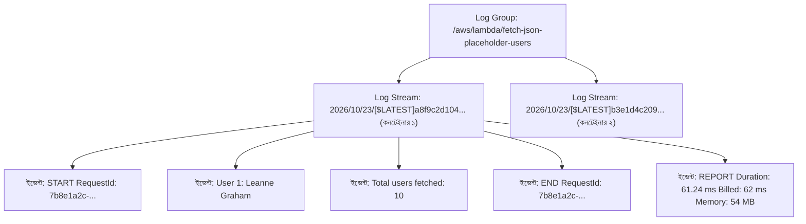

- **লগ গ্রুপ:** নির্দিষ্ট ফাংশনের সমস্ত লগের সংগ্রহশালা (`/aws/lambda/<ফাংশন-নাম>`)।
- **লগ স্ট্রিম:** নির্দিষ্ট কনটেইনার ইনস্ট্যান্সের লগের অনুক্রম।
- **রিপোর্ট (REPORT) লাইন:** এক্সিকিউশন শেষে ক্লাউডওয়াচ পরিষ্কার হিসাব দেয়—কত মিলিসেকেন্ড চলল এবং কত মেগাবাইট র‍্যাম খরচ হলো।

### 7.4 ক্লাউড বিল বাঁচাতে লগ রিটেনশন পিরিয়ড নির্ধারণ

> [!CAUTION]
> ডিফল্টভাবে ক্লাউডওয়াচ লগ গ্রুপের মেয়াদ থাকে **"Never Expire"**। লক্ষ লক্ষ রিকোয়েস্টের সিস্টেমে পুরনো লগ বছরের পর বছর জমা হয়ে বিশাল অনাকাঙ্ক্ষিত বিল তৈরি করে।

ক্লাসে শিক্ষক দেখিয়েছেন কীভাবে **CloudWatch $\rightarrow$ Log groups**-এ গিয়ে **Edit retention setting** থেকে সময়সীমা কমিয়ে **১ দিন, ৭ দিন বা ৩০ দিন** করে দিতে হয়। নির্দিষ্ট সময় পর অপ্রয়োজনীয় পুরনো লগ স্বয়ংক্রিয়ভাবে মুছে যায়।

---

## 8. ম্যানেজড নো-এসকিউএল ডাটাবেস: অ্যামাজন ডাইনামোডিবি

### 8.1 রিলেশনাল (SQL/RDS) বনাম ডকুমেন্ট / কি-ভ্যালু নো-এসকিউএল

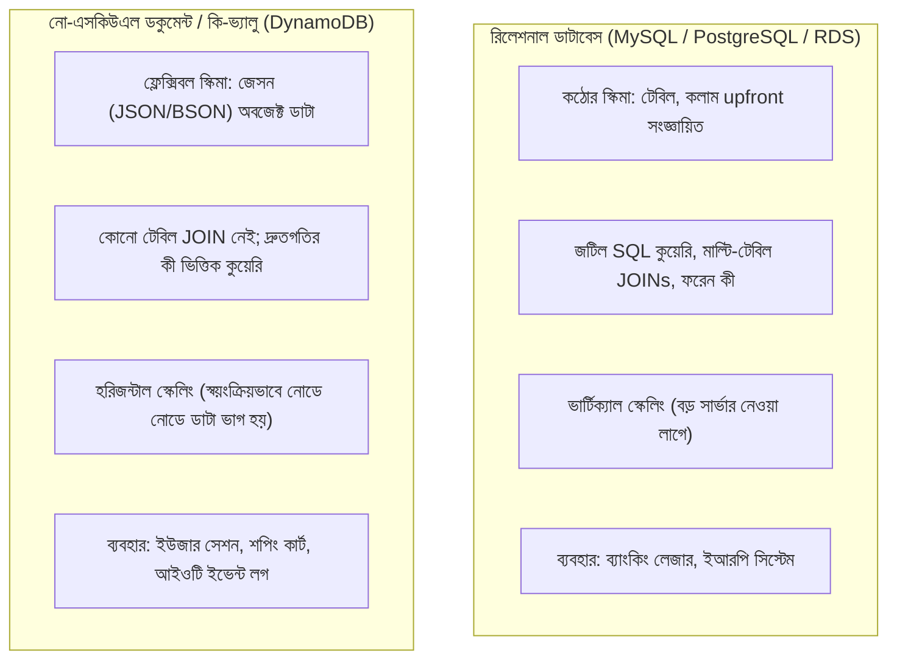

### 8.2 নিজস্ব ডাটাবেস সার্ভার (EC2) বনাম ক্লাউড ম্যানেজড ডাটাবেস

ক্লাসে শিক্ষক তুলে ধরেন:

- আপনি ইসিটু মেশিনে MongoDB ইনস্টল করতে পারেন। কিন্তু ওএস ক্র্যাশ করলে বা ব্যাকআপ ফেইল করলে দায়িত্ব আপনার।
- **Amazon DynamoDB হলো ফুল্লি ম্যানেজড ডাটাবেস-অ্যাজ-আ-সার্ভিস (DBaaS):**
  - জিরো সার্ভার ম্যানেজমেন্ট।
  - প্রতিটি ডাটা স্বয়ংক্রিয়ভাবে ৩টি এজেড-এ সিঙ্ক হয়ে যায়।
  - ট্রাফিকের চাপ যত কোটিই হোক না কেন, সিঙ্গেল-ডিজিট মিলিসেকেন্ড লেটেন্সি পাওয়া যায়।

### 8.3 ডাইনামোডিবির মূল একক: টেবিল, আইটেমস এবং অ্যাট্রিবিউটস

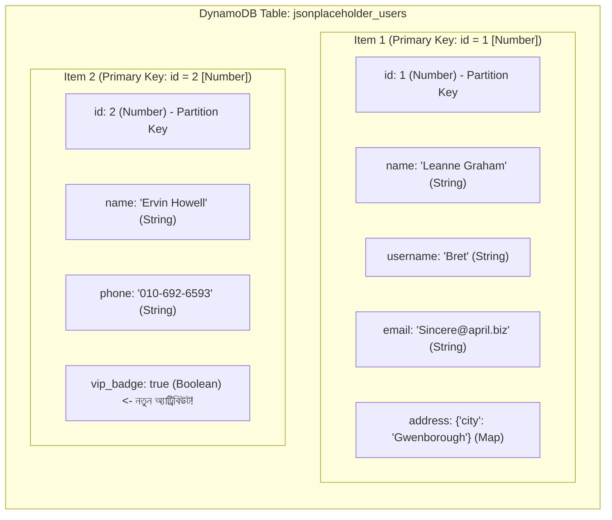

- **টেবিল (Table):** রেকর্ডের কালেকশন।
- **আইটেম (Item):** টেবিলের একেকটি রেকর্ড (এসকিউএলের Row বা মঙ্গোডিবির Document-এর মতো)।
- **অ্যাট্রিবিউট (Attribute):** আইটেমের ভেতরের ফিল্ড বা ডাটা (এসকিউএলের Column-এর মতো)।
- **স্কিমাহীন সৌন্দর্য:** প্রাইমারি কী ছাড়া অন্য কোনো অ্যাট্রিবিউট আগে থেকে ডিফাইন করতে হয় না। এক নম্বর আইটেমে ৫টি ফিল্ড থাকতে পারে, দুই নম্বর আইটেমে ২০টি ফিল্ড থাকতে পারে!

### 8.4 প্রাইমারি কী স্ট্র্যাটেজি: পার্টিশন কী বনাম কম্পোজিট কী

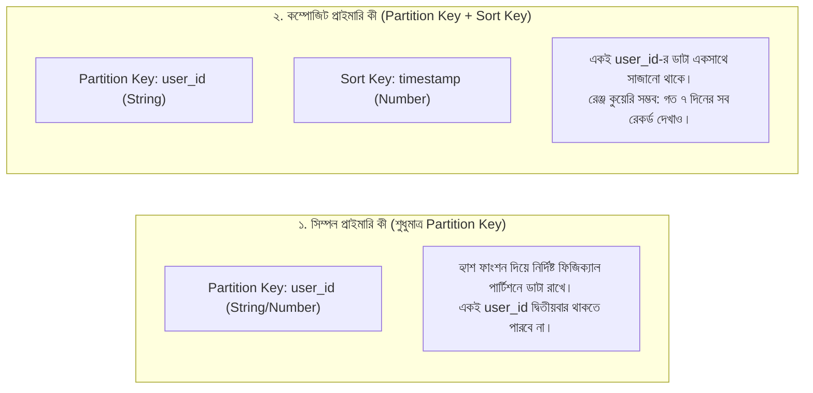

### 8.5 ক্যাপাসিটি মোড: অন-ডিমান্ড বনাম প্রোভিশন্ড (RCU / WCU)

1. **অন-ডিমান্ড মোড (On-Demand):** আগে থেকে কোনো ট্রাফিকের হিসাব দিতে হয় না। যতগুলো রিড বা রাইট রিকোয়েস্ট আসবে ঠিক ততগুলোর জন্য এডব্লিউএস বিল করবে।
2. **প্রোভিশন্ড মোড (Provisioned):** আপনি নির্দিষ্ট করে দেন প্রতি সেকেন্ডে কতগুলো **Read Capacity Units (RCU)** এবং **Write Capacity Units (WCU)** লাগবে। ২৪ ঘণ্টার নির্দিষ্ট ফ্ল্যাট ট্রাফিকের জন্য এটি সাশ্রয়ী।

---

## 9. হ্যান্ডস-অন লাইভ প্রজেক্ট: এন্ড-টু-এন্ড সার্ভারলেস ডাটা পাইপলাইন

ক্লাস ০৩-এর সবচেয়ে রোমাঞ্চকর অংশ ছিল একটি পূর্ণাঙ্গ প্রোডাকশন ডাটা পাইপলাইন তৈরি করা: **পাবলিক REST API থেকে JSON ফেচ করা $\rightarrow$ AWS Lambda-তে প্রসেস করা $\rightarrow$ IAM সিকিউরিটি সমাধান $\rightarrow$ Amazon DynamoDB-তে আইটেম ইনসার্ট $\rightarrow$ CloudWatch Logs ভেরিফিকেশন**।

### 9.1 প্রজেক্ট আর্কিটেকচার ও ওয়ার্কফ্লো টপোলজি

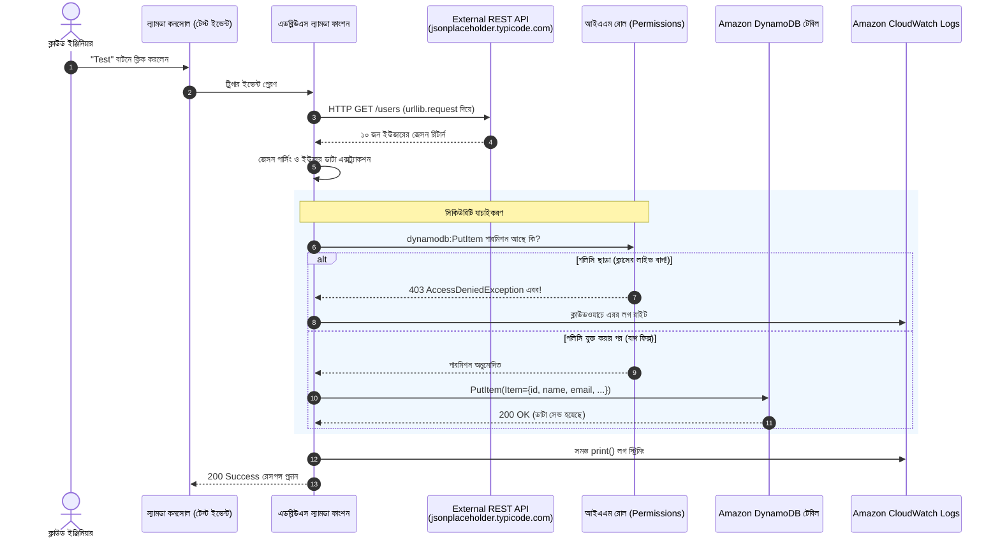

### 9.2 ধাপ ১: ডাইনামোডিবি টেবিল প্রোভিশনিং

1. **Amazon DynamoDB Console $\rightarrow$ Tables $\rightarrow$ Create table**-এ যান।
2. **Table name:** `jsonplaceholder_users`
3. **Partition key:** `id` (টাইপ নির্বাচন করুন **Number**)।
4. **Table settings:** **Default settings** (যা অন-ডিমান্ড মোডে তৈরি হয়)।
5. **Create table** চাপুন এবং স্ট্যাটাস **Active** হওয়া পর্যন্ত অপেক্ষা করুন।
6. টেবিল ওভারভিউ থেকে **Amazon Resource Name (ARN)** কপি করুন:
   - ফরম্যাট: `arn:aws:dynamodb:us-west-2:123456789012:table/jsonplaceholder_users`

### 9.3 ধাপ ২: এনভায়রনমেন্ট ভ্যারিয়েবল দিয়ে ইনফ্রাস্ট্রাকচার অ্যাবস্ট্রাকশন

প্রোডাকশন ডেভঅপসের সুবর্ণ নিয়ম: **কোডের ভেতর টেবিলের নাম হার্ডকোড করবেন না।**

1. **Lambda $\rightarrow$ Configuration $\rightarrow$ Environment variables**-এ যান।
2. **Edit $\rightarrow$ Add environment variable**:
   - **Key:** `TABLE_NAME`
   - **Value:** `jsonplaceholder_users`
3. সেভ করুন। পাইথনে এটি ডাইনামিকভাবে পড়বে `os.environ.get('TABLE_NAME')`।

### 9.4 ধাপ ৩: ল্যামডা পাইথন হ্যান্ডলার কোড ডেভেলপমেন্ট

ক্লাসে ব্যবহৃত সম্পূর্ণ পাইথন ল্যামডা স্ক্রিপ্ট:

```python
"""
ল্যামডা ফাংশন: fetch_and_store_users.py
উদ্দেশ্য: JSONPlaceholder থেকে ডাটা নিয়ে DynamoDB-তে ইনসার্ট করা।
রানটাইম: Python 3.12 / 3.13
প্রশিক্ষক: নূরে সিদ্দিকী (ক্লাউড ও এডব্লিউএস ক্লাস ০৩)
"""

import json
import os
import sys
import urllib.error
import urllib.request
import boto3
from botocore.exceptions import ClientError

# এনভায়রনমেন্ট ভ্যারিয়েবল ও এপিআই এন্ডপয়েন্ট
TABLE_NAME = os.environ.get("TABLE_NAME")
API_ENDPOINT = "https://jsonplaceholder.typicode.com/users"

# গ্লোবাল স্কোপে রিসোর্স ইনিশিয়ালাইজেশন (Warmed Container Reuse)
dynamodb = boto3.resource("dynamodb")


def lambda_handler(event, context):
    """এডব্লিউএস ল্যামডা দ্বারা এক্সিকিউট হওয়া প্রধান মেথড।"""
    print(f"--> এক্সিকিউশন শুরু... টার্গেট টেবিল: [{TABLE_NAME}]")

    if not TABLE_NAME:
        err = "মারাত্মক ত্রুটি: 'TABLE_NAME' এনভায়রনমেন্ট ভ্যারিয়েবল সেট করা নেই!"
        print(err, file=sys.stderr)
        return {"statusCode": 500, "body": json.dumps({"error": err})}

    table = dynamodb.Table(TABLE_NAME)

    # পাইথনের বিল্ট-ইন urllib দিয়ে এপিআই কল (কোনো থার্ড পার্টি প্যাকেজ লাগবে না)
    req = urllib.request.Request(
        API_ENDPOINT, headers={"User-Agent": "BongoDev-Lambda/1.0"}
    )

    try:
        print(f"এপিআই থেকে ডাটা আনা হচ্ছে: {API_ENDPOINT}")
        with urllib.request.urlopen(req, timeout=10) as response:
            if response.status != 200:
                print(f"এপিআই ফেইল করেছে: {response.status}", file=sys.stderr)
                return {
                    "statusCode": response.status,
                    "body": json.dumps({"error": "Upstream API Error"}),
                }

            raw_data = response.read().decode("utf-8")
            users_list = json.loads(raw_data)

    except urllib.error.URLError as e:
        print(f"নেটওয়ার্ক এরর: {e}", file=sys.stderr)
        return {"statusCode": 502, "body": json.dumps({"error": str(e)})}

    print(f"মোট {len(users_list)} জন ইউজারের তথ্য পাওয়া গেছে। ডাইনামোডিবির কাজ শুরু হচ্ছে...")

    # ডাইনামোডিবি টেবিলে আইটেম ইনসার্ট
    inserted_count = 0
    for idx, user in enumerate(users_list):
        user_id = int(user.get("id"))
        user_name = str(user.get("name"))
        user_username = str(user.get("username"))
        user_email = str(user.get("email"))
        user_phone = str(user.get("phone", "N/A"))
        user_website = str(user.get("website", "N/A"))

        company_dict = user.get("company", {})
        company_name = (
            str(company_dict.get("name", "N/A"))
            if isinstance(company_dict, dict)
            else "N/A"
        )

        db_item = {
            "id": user_id,  # Partition Key (Number)
            "name": user_name,
            "username": user_username,
            "email": user_email,
            "phone": user_phone,
            "website": user_website,
            "company_name": company_name,
        }

        try:
            # DynamoDB PutItem অপারেশন
            table.put_item(Item=db_item)
            print(f"[{idx+1}/{len(users_list)}] সেভ হয়েছে: ID {user_id} - {user_name}")
            inserted_count += 1

        except ClientError as e:
            error_code = e.response["Error"]["Code"]
            print(
                f"ডাইনামোডিবি এরর [{error_code}] ID {user_id}: {e}",
                file=sys.stderr,
            )
            if error_code == "AccessDeniedException":
                return {
                    "statusCode": 403,
                    "body": json.dumps(
                        {"error": "IAM পারমিশন নেই (dynamodb:PutItem)!"}
                    ),
                }

    summary = {
        "message": f"সফলভাবে {inserted_count} জন ইউজার ডাইনামোডিবিতে সংরক্ষিত হয়েছে।",
        "table": TABLE_NAME,
        "total_records": inserted_count,
    }
    print(f"--> অপারেশন সম্পন্ন: {json.dumps(summary)}")

    return {"statusCode": 200, "body": json.dumps(summary)}
```

### 9.5 ধাপ ৪: ক্লাসে লাইভ আইএএম পারমিশন এরর ডায়াগনোসিস

কোড ডেপ্লয় করার পর প্রথম টেস্ট রান করতেই ফাংশনটি লাল এরর দিয়ে ফেইল করে:

```
ClientError: An error occurred (AccessDeniedException) when calling the PutItem operation:
User: ...assumed-role/fetch_json_placeholder_role/fetch_json_placeholder
is not authorized to perform: dynamodb:PutItem on resource:
arn:aws:dynamodb:us-west-2:123456789012:table/jsonplaceholder_users
```

**কারণ:**
ল্যামডার সাথে যুক্ত ডিফল্ট রোলে শুধু ক্লাউডওয়াচে লগ লেখার পারমিশন ছিল (`AWSLambdaBasicExecutionRole`), ডাইনামোডিবিতে কোনো কিছু লেখার পারমিশন ছিল না।

### 9.6 ধাপ ৫: ইনলাইন আইএএম পলিসি তৈরি ও রোল অ্যাটাচমেন্ট

লিস্ট প্রিভিলেজ (Least Privilege) অনুসরণ করে সমাধান:

1. ল্যামডা কনসোলে **Configuration $\rightarrow$ Permissions**-এ গিয়ে রোলের নামের লিংকে ক্লিক করে IAM কনসোলে প্রবেশ করুন।
2. **Add permissions $\rightarrow$ Create inline policy**-তে যান।
3. **JSON** ট্যাব সিলেক্ট করে নির্দিষ্ট টেবিলের এআরএন (ARN) দিয়ে পলিসি লিখুন:

```json
{
  "Version": "2012-10-17",
  "Statement": [
    {
      "Sid": "AllowLambdaPutItemToUsersTable",
      "Effect": "Allow",
      "Action": ["dynamodb:PutItem"],
      "Resource": "arn:aws:dynamodb:us-west-2:123456789012:table/jsonplaceholder_users"
    }
  ]
}
```

4. পলিসির নাম দিন `LambdaWriteToDynamoDBPolicy` এবং **Create policy** চাপুন।

### 9.7 ধাপ ৬: টেস্ট ইভেন্ট রান ও ডাইনামোডিবির আইটেম পরিদর্শন

1. ল্যামডা কনসোলে ফিরে এসে **Test** ট্যাবে ক্লিক করে টেস্ট রান করুন।
2. **রেসপন্স:** `statusCode: 200`, `total_records: 10`।
3. **Amazon DynamoDB Console $\rightarrow$ Tables $\rightarrow$ jsonplaceholder_users $\rightarrow$ Explore table items**-এ যান।
4. **ফলাফল:** ১০ জন ইউজারের প্রত্যেকের নাম, ইউজারনেম, ইমেইল, ফোন এবং আইডি সুবিন্যস্তভাবে ডাইনামোডিবির আইটেমে দৃশ্যমান!

---

## 10. ডিজাস্টার রিকভারি ও ডেটাবেস ব্যাকআপ (হোমওয়ার্ক অ্যাসাইনমেন্ট)

### 10.1 ক্লাউডে ৩-২-১ ব্যাকআপ নীতিমালা

উৎপাদনমুখী সিস্টেমে ডাটা শুধু একটি ডাটাবেসে রাখা আত্মঘাতী। কোনো স্ক্রিপ্টের ভুল লজিকে টেবিলের সমস্ত ডাটা ডিলিট হয়ে যেতে পারে।

- **৩-২-১ ব্যাকআপ ফর্মুলা:**
  - ডাটার **৩টি** কপি থাকবে।
  - **২টি** ভিন্ন ভিন্ন স্টোরেজ মাধ্যমে থাকবে (যেমন DynamoDB ডাটাবেস + S3 অবজেক্ট ফাইল)।
  - **১টি** অফসাইট বা সেকেন্ডারি কোল্ড আর্কাইভে থাকবে (যেমন এস৩ গ্লেশিযার ডিপ আর্কাইভ)।

### 10.2 ডাইনামোডিবি পয়েন্ট-ইন-টাইম রিকভারি (PITR) ও অন-ডিমান্ড ব্যাকআপ

- **Point-in-Time Recovery (PITR):** সক্রিয় করলে বিগত ৩৫ দিনের যেকোনো সেকেন্ডের অবস্থায় ডাটাবেসকে হুবহু রিস্টোর করা যায়।
- **On-Demand Backups:** সম্পূর্ণ টেবিলের জিরো-ইমপ্যাক্ট স্ন্যাপশট যা ম্যানুয়ালি ডিলিট না করা পর্যন্ত অক্ষত থাকে।

### 10.3 হোমওয়ার্ক প্রজেক্ট: স্বয়ংক্রিয় DynamoDB $\rightarrow$ S3 ব্যাকআপ পাইপলাইন

ক্লাসের শেষে শিক্ষক এই হোমওয়ার্ক অ্যাসাইনমেন্টটি প্রদান করেন:

> _"আমরা ল্যামডা দিয়ে ডাটাবেসে ডাটা ঢুকিয়েছি। এবার দ্বিতীয় আরেকটি ল্যামডা ফাংশন তৈরি করুন, যা প্রতি রাতে ডাইনামোডিবি টেবিলটি স্ক্যান করবে, সমস্ত ডাটা জেসন ফাইলে রূপান্তর করবে এবং `bongodev-db-backups-<your-id>` নামক এস৩ বাকেটে তারিখ অনুযায়ী ব্যাকআপ রাখবে।"_

```mermaid
flowchart LR
    EventBridge["EventBridge Cron<br/>(প্রতি রাতে ১২:০০ টায়)"] -->|ট্রিগার| BackupLambda["AWS Lambda<br/>(ব্যাকআপ হ্যান্ডলার)"]
    BackupLambda -->|১. dynamodb:Scan| DDB["DynamoDB Table<br/>(jsonplaceholder_users)"]
    DDB -->>|২. সমস্ত আইটেম রিটার্ন| BackupLambda
    BackupLambda -->|৩. JSON ফরম্যাটিং| Ephemeral["মেমোরি বা /tmp ফাইল"]
    BackupLambda -->|৪. s3:PutObject| S3["Amazon S3 Bucket<br/>(bongodev-db-backups)"]
    S3 -->|৫. লাইফসাইকেল ট্রানজিশন| Glacier["Glacier Deep Archive<br/>($১/টিবি)"]
```

#### সম্পূর্ণ পাইথন ব্যাকআপ হ্যান্ডলার কোড:

```python
"""
ল্যামডা ফাংশন: export_dynamodb_to_s3.py
উদ্দেশ্য: হোমওয়ার্ক - ডাইনামোডিবি টেবিল স্ক্যান করে টাইমস্ট্যাম্পসহ জেসন ব্যাকআপ এস৩ বাকেটে পাঠানো।
রানটাইম: Python 3.12 / 3.13
"""

from datetime import datetime, timezone
from decimal import Decimal
import json
import os
import sys
import boto3
from botocore.exceptions import ClientError

SOURCE_TABLE = os.environ.get("SOURCE_TABLE", "jsonplaceholder_users")
BACKUP_BUCKET = os.environ.get(
    "BACKUP_BUCKET", "bongodev-db-backups-ns2026"
)

dynamodb = boto3.resource("dynamodb")
s3_client = boto3.client("s3")


class DecimalEncoder(json.JSONEncoder):
    """ডাইনামোডিবির Decimal সংখ্যাকে পাইথনের int/float এ রূপান্তর করে।"""

    def default(self, o):
        if isinstance(o, Decimal):
            return int(o) if o % 1 == 0 else float(o)
        return super().default(o)


def lambda_handler(event, context):
    print(f"ব্যাকআপ শুরু... টেবিল: [{SOURCE_TABLE}] -> এস৩: [{BACKUP_BUCKET}]")

    table = dynamodb.Table(SOURCE_TABLE)

    # ডাইনামোডিবি টেবিল স্ক্যান
    try:
        response = table.scan()
        items = response.get("Items", [])

        # পেজিনেশন হ্যান্ডলিং (যদি ডাটা ১ মেগাবাইটের বেশি হয়)
        while "LastEvaluatedKey" in response:
            response = table.scan(
                ExclusiveStartKey=response["LastEvaluatedKey"]
            )
            items.extend(response.get("Items", []))

        print(f"মোট {len(items)}টি রেকর্ড ডাইনামোডিবি থেকে রিড করা হয়েছে।")

    except ClientError as e:
        print(f"স্ক্যান এরর: {e}", file=sys.stderr)
        return {"statusCode": 500, "body": str(e)}

    # জেসনে রূপান্তর ও টাইমস্ট্যাম্প যুক্ত পাথ তৈরি
    timestamp = datetime.now(timezone.utc).strftime("%Y-%m-%d_%H-%M-%S")
    backup_key = f"dynamodb_backups/{SOURCE_TABLE}/backup_{timestamp}.json"
    json_payload = json.dumps(items, cls=DecimalEncoder, indent=2)

    # এস৩ বাকেটে ফাইল স্ট্রিম আপলোড
    try:
        s3_client.put_object(
            Bucket=BACKUP_BUCKET,
            Key=backup_key,
            Body=json_payload.encode("utf-8"),
            ContentType="application/json",
        )
        print(f"সফলভাবে ব্যাকআপ আপলোড হয়েছে: s3://{BACKUP_BUCKET}/{backup_key}")

    except ClientError as e:
        print(f"এস৩ আপলোড এরর: {e}", file=sys.stderr)
        return {"statusCode": 500, "body": str(e)}

    return {
        "statusCode": 200,
        "body": json.dumps(
            {
                "status": "SUCCESS",
                "table": SOURCE_TABLE,
                "s3_path": f"s3://{BACKUP_BUCKET}/{backup_key}",
                "records": len(items),
            }
        ),
    }
```

### 10.4 মাল্টি-সার্ভিস আইএএম পলিসি আর্কিটেকচার

এই ব্যাকআপ ল্যামডার জন্য একটি কম্বাইন্ড আইএএম পলিসি লাগবে যা একইসাথে ডাইনামোডিবি রিড এবং এস৩ রাইট করতে পারবে:

```json
{
  "Version": "2012-10-17",
  "Statement": [
    {
      "Sid": "AllowDynamoDBScan",
      "Effect": "Allow",
      "Action": ["dynamodb:Scan"],
      "Resource": "arn:aws:dynamodb:us-west-2:123456789012:table/jsonplaceholder_users"
    },
    {
      "Sid": "AllowS3PutBackupObject",
      "Effect": "Allow",
      "Action": ["s3:PutObject"],
      "Resource": "arn:aws:s3:::bongodev-db-backups-ns2026/dynamodb_backups/*"
    }
  ]
}
```

---

## 11. বাস্তব ক্লাউড অপারেশনে ট্র্যাপস, গ্লিচ ও ট্রাবলশুটিং

### ট্র্যাপ ১: এস৩ "NoSuchBucket" ক্র্যাশ

- **লক্ষণ:** পাইথন স্ক্রিপ্ট চালাতে গিয়ে `NoSuchBucket` এরর।
- **কারণ:** কোডে লেখা বাকেটের নাম আর কনসোলে তৈরি করা বাকেটের নামের মধ্যে বানান অমিল থাকা।
- **সমাধান:** কনসোল থেকে বাকেটের নাম হুবহু কপি করা অথবা কোডে `head_bucket` দিয়ে বাকেট আছে কি না যাচাই করা।

### ট্র্যাপ ২: ৩-সেকেন্ডের ল্যামডা টাইমআউট দেয়াল

- **লক্ষণ:** ল্যামডা টেস্ট ফেইল করে এবং মেসেজ দেয় `Task timed out after 3.00 seconds`।
- **কারণ:** এপিআই বা ইন্টারনেটের কল শেষ হতে ৩ সেকেন্ডের বেশি সময় লাগা।
- **সমাধান:** জেনারেল কনফিগারেশনে গিয়ে টাইমআউট বাড়িয়ে ১০ বা ১৫ সেকেন্ড সেট করা।

### ট্র্যাপ ৩: ডাইনামোডিবির Number বনাম String টাইপ অমিল

- **লক্ষণ:** ডাইনামোডিবিতে ইনসার্ট ফেইল বা `SerializationException`।
- **কারণ:** টেবিলের প্রাইমারি কী `id` তৈরি করা হয়েছিল **Number** হিসেবে, কিন্তু পাইথন থেকে পাঠানো হচ্ছিল স্ট্রিং হিসেবে (`"1"`).
- **সমাধান:** পাইথনে স্পষ্ট করে টাইপকাস্ট করা: `int(user["id"])`।

### ট্র্যাপ ৪: Boto3-র Decimal সিরিয়ালাইজেশন এরর

- **লক্ষণ:** ডাইনামোডিবি থেকে আনা ডাটা `json.dumps()` করতে গিয়ে `TypeError: Object of type Decimal is not JSON serializable`।
- **কারণ:** Boto3 ফ্লোটিং পয়েন্ট হিসাবের সুরক্ষায় ডাইনামোডিবির সংখ্যাগুলোকে সাধারণ `float`-এর বদলে বিশেষ `Decimal` অবজেক্ট হিসেবে ফেরত দেয়, যা সাধারণ `json` লাইব্রেরি চেনে না।
- **সমাধান:** কাস্টম `DecimalEncoder` ক্লাস ব্যবহার করা (সেকশন ১০.৩ দেখুন)।

### ট্র্যাপ ৫: রিজিয়ন অমিলের গোপন সমস্যা

- **লক্ষণ:** ল্যামডা অরিগন (`us-west-2`)-এ, কিন্তু টেবিল ভার্জিনিয়া (`us-east-1`)-এ। ফলে টেবিল খুঁজে না পেয়ে এরর দেয় `ResourceNotFoundException`।
- **সমাধান:** সর্বদা একই রিজিয়নে সমস্ত রিসোর্স তৈরি করা, অথবা Boto3-তে স্পষ্ট করে রিজিয়ন উল্লেখ করা: `boto3.resource('dynamodb', region_name='us-west-2')`।

---

## 12. ক্লাসে জিজ্ঞাসিত প্রশ্নোত্তর (Q&A)

### প্রশ্ন ১: আমরা কি এসএফটিপি (SFTP) দিয়ে এস৩-তে কানেক্ট করতে পারি?

**উত্তর:** হ্যাঁ। এডব্লিউএস-এর একটি বিশেষায়িত সার্ভিস রয়েছে যার নাম **AWS Transfer Family**। এর মাধ্যমে কোনো সার্ভার না চালিয়ে সরাসরি এস৩ বাকেটের সামনে সম্পূর্ণ সিকিউর SFTP/FTPS গেটওয়ে বসানো যায়। বহিরাগত ক্লায়েন্টরা FileZilla বা WinSCP দিয়ে ফাইল ফেললে তা সরাসরি এস৩ বাকেটে জমা হয়।

### প্রশ্ন ২: এস৩ কনসোলে ড্র্যাগ অ্যান্ড ড্রপ (Drag-and-Drop) করে আপলোড করা কি ভালো প্র্যাকটিস?

**উত্তর:** টেস্ট পারপাসে ২-৪টি ফাইলের জন্য ড্র্যাগ অ্যান্ড ড্রপ ঠিক আছে। কিন্তু প্রোডাকশন বা রিয়েল ইঞ্জিনিয়ারিংয়ে এটি **কখনোই গ্রহণযোগ্য নয়**। শত শত ফাইল থাকলে ব্রাউজার ক্র্যাশ করতে পারে, নেটওয়ার্ক ড্রপ হলে রিজিউম করা যায় না। প্রোডাকশনে সর্বদা AWS CLI (`aws s3 sync`), Python Boto3 স্ক্রিপ্ট অথবা মাল্টিপার্ট এপিআই ব্যবহার করতে হবে।

### প্রশ্ন ৩: মঙ্গোডিবি (MongoDB) থেকে ডাইনামোডিবিতে (DynamoDB) ডাটা মাইগ্রেশন কি খুব কঠিন?

**উত্তর:** দুটোই নো-এসকিউএল হলেও এদের কুয়েরি আর্কিটেকচার সম্পূর্ণ ভিন্ন। মঙ্গোডিবির যেকোনো ফিল্ডের ওপর কুয়েরি করা যায়। কিন্তু ডাইনামোডিবিতে কুয়েরি করতে হলে অবশ্যই **Partition Key এবং Sort Key** জানতে হয়। তাই মঙ্গোডিবি থেকে ডাইনামোডিবিতে আসতে হলে আপনার অ্যাপ্লিকেশনের অ্যাক্সেস প্যাটার্ন পুনরায় ডিজাইন করতে হবে। ডাটা শিফটিংয়ের জন্য **AWS DMS (Database Migration Service)** বা কাস্টম পাইথন স্ক্রিপ্ট ব্যবহৃত হয়।

### প্রশ্ন ৪: আমাদের পুরো পূর্ণাঙ্গ ওয়েব অ্যাপ্লিকেশন কি এডব্লিউএস ল্যামডায় চালানো সম্ভব?

**উত্তর:** যদিও Serverless Framework বা FastAPI-র Mangum অ্যাডাপ্টার দিয়ে পুরো অ্যাপ ল্যামডায় চালানো যায়, তবে সব ধরনের অ্যাপ্লিকেশনের জন্য এটি আদর্শ নয়। যে অ্যাপে দীর্ঘস্থায়ী WebSocket কানেকশন দরকার বা কোনো প্রসেস ১৫ মিনিটের বেশি চলে, তা ল্যামডায় চলবে না। সাধারণত ফ্রন্টএন্ড/ব্যাকএন্ড কনটেইনার হিসেবে EC2 বা ECS-এ চলে এবং ইভেন্ট প্রসেসিং, ব্যাকগ্রাউন্ড নোটিফিকেশন ও ব্যাকআপের কাজ ল্যামডায় করানো হয়।

---

## 13. সাধারণ ভুল ধারণা ও তার সঠিক ব্যাখ্যা

### ভুল ধারণা ১: "এস৩ হলো ভার্চুয়াল হার্ডডিস্কের সাধারণ ফোল্ডার।"

**সঠিক ব্যাখ্যা:** এস৩ কোনো সাধারণ ফাইল সিস্টেম নয়। এতে ফিজিক্যাল কোনো ফোল্ডার বা ইনোড থাকে না। এটি একটি ফ্ল্যাট কি-ভ্যালু অবজেক্ট স্টোর যা সরাসরি এইচটিটিপি এপিআই দিয়ে কাজ করে। কী-এর মাঝে থাকা স্ল্যাশ (`/`) হলো শুধুই স্ট্রিং প্রিফিক্স, যা কনসোল আমাদের সুবিধার্থে ফোল্ডারের মতো দেখায়।

### ভুল ধারণা ২: "সার্ভারলেস মানে ক্লাউডে কোনো সার্ভারই নেই।"

**সঠিক ব্যাখ্যা:** সার্ভারলেস মানে সার্ভার নেই তা নয়; এর অর্থ হলো **আপনাকে কোনো সার্ভার প্রভিশন, কনফিগার বা তদারকি করতে হয় না**। ব্যাকগ্রাউন্ডে এডব্লিউএস তাদের সুরক্ষিত ডেটা সেন্টারে হাজার হাজার ফিজিক্যাল সার্ভার ও লাইটওয়েট মাইক্রো-ভিএম পরিচালনা করে যাতে আপনার কোড চোখের পলকে রান হতে পারে।

### ভুল ধারণা ৩: "ডাইনামোডিবি অন-ডিমান্ড মোড সর্বদা প্রোভিশন্ড মোডের চেয়ে সস্তা।"

**সঠিক ব্যাখ্যা:** অনিয়মিত বা কম ট্রাফিকের জন্য অন-ডিমান্ড সস্তা। কিন্তু যদি আপনার ২৪ ঘণ্টা একটানা কোটি কোটি রিকোয়েস্টের প্রেডিক্টেবল ট্রাফিক থাকে, তবে অন-ডিমান্ড মোড প্রোভিশন্ড মোডের চেয়ে **৩ থেকে ৫ গুণ বেশি ব্যয়বহুল** হতে পারে।

### ভুল ধারণা ৪: "ল্যামডা ফাংশন একটানা যত খুশি সময় চলতে পারে।"

**সঠিক ব্যাখ্যা:** প্রতিটি ল্যামডা এক্সিকিউশনের জন্য সর্বোচ্চ হার্ড লিমিট হলো **১৫ মিনিট (৯০০ সেকেন্ড)**। কোনো ভিডিও রেন্ডারিং বা স্ক্রিপ্ট যদি ১৫ মিনিট ১ সেকেন্ড সময় নেয়, এডব্লিউএস সঙ্গে সঙ্গে ফাংশনটি কিল করে দেবে। দীর্ঘমেয়াদী কাজের জন্য **AWS Step Functions**, **AWS Fargate** অথবা **Amazon EC2** ব্যবহার করতে হবে।

---

## 14. হ্যান্ডস-অন ল্যাব ও অনুশীলনী

### ল্যাব ১: এস৩ স্বয়ংক্রিয় ক্লিন-আপ স্ক্রিপ্ট

একটি পাইথন Boto3 স্ক্রিপ্ট লিখুন যা আপনার টেস্ট বাকেটের সমস্ত অবজেক্ট পরীক্ষা করবে এবং যেসব ফাইলের নামের শেষে `.tmp` এক্সটেনশন রয়েছে বা যেগুলো ৭ দিনের পুরনো, সেগুলোকে স্বয়ংক্রিয়ভাবে মুছে দেবে।

### ল্যাব ২: এস৩ ইভেন্ট ট্রিগার্ড ল্যামডা

একটি এস৩ বাকেট তৈরি করুন যাতে কোনো নতুন `.jpg` বা `.png` ফাইল আপলোড হওয়া মাত্রই এডব্লিউএস ল্যামডা স্বয়ংক্রিয়ভাবে ট্রিগার হবে এবং আপলোড হওয়া ফাইলের নাম ও সাইজ ক্লাউডওয়াচ লগে প্রিন্ট করবে।

### ল্যাব ৩: ডাইনামোডিবি পূর্ণাঙ্গ CRUD অপারেশন

ক্লাসের ল্যামডা ফাংশনটি সম্প্রসারিত করে পূর্ণাঙ্গ CRUD ইন্টারফেস তৈরি করুন:

- `POST /users`: নতুন ইউজার ডাইনামোডিবিতে যুক্ত করবে।
- `GET /users/{id}`: নির্দিষ্ট আইডির ডাটা রিড করবে (`table.get_item(Key={'id': user_id})`)।
- `DELETE /users/{id}`: নির্দিষ্ট আইডির ডাটা মুছে ফেলবে (`table.delete_item(Key={'id': user_id})`)।

---

## 15. ডেভঅপস ইন্টারভিউ প্রস্তুতি কর্নার

### প্রশ্ন ১: অ্যামাজন এস৩ কীভাবে ১১টি ৯ ($99.999999999\%$) ডিউরেবিলিটি নিশ্চিত করে, এবং এস৩ স্ট্যান্ডার্ড ও গ্লেশিয়ার ডিপ আর্কাইভের পার্থক্য কী?

**মডেল উত্তর:**

> "অ্যামাজন এস৩ একটি এডব্লিউএস রিজিয়নের ভেতরে ভৌগোলিকভাবে সম্পূর্ণ পৃথক ন্যূনতম তিনটি অ্যাভেইলেবিলিটি জোনে (AZs) প্রতিটি অবজেক্টের স্বয়ংক্রিয় রিডানড্যান্ট কপি সংরক্ষণ করে ১১টি ৯-এর ডিউরেবিলিটি নিশ্চিত করে। এর ফলে একটি গোটা ডেটা সেন্টার ফিজিক্যালি ধ্বংস হয়ে গেলেও ডেটা অক্ষত থাকে।
>
> এস৩ স্ট্যান্ডার্ড ও গ্লেশিয়ার ডিপ আর্কাইভের মূল পার্থক্য হলো লেটেন্সি ও খরচে:
>
> - **S3 Standard:** অ্যাক্টিভ ও ঘন ঘন ব্যবহৃত ডেটার জন্য। কোনো রিট্রিভাল ফি ছাড়া মিলিসেকেন্ড লেটেন্সিতে ডেটা দেয়, খরচ প্রায় \$০.০২৩ প্রতি জিবি/মাস (\$২৩/টিবি)।
> - **S3 Glacier Deep Archive:** বহু বছর সংরক্ষিত থাকবে এমন কমপ্লায়েন্স ডেটার জন্য। খরচ অবিশ্বাস্য কম—মাত্র \$০.০০০৯৯ প্রতি জিবি/মাস (\$১/টিবি)। তবে ডেটা রিট্রিভ করতে ১২ থেকে ৪৮ ঘণ্টা পর্যন্ত সময় লাগে।"

### প্রশ্ন ২: এডব্লিউএস ল্যামডার এক্সিকিউশন লাইফসাইকেল কী, এবং 'Cold Start' বনাম 'Warm Start'-এর পার্থক্য বুঝিয়ে বলুন।

**মডেল উত্তর:**

> "এডব্লিউএস ল্যামডার লাইফসাইকেলের তিনটি ধাপ রয়েছে: **Init**, **Invoke**, এবং **Shutdown**।
>
> ১. **Cold Start (সম্পূর্ণ ইনিশিয়ালাইজেশন):** ফাংশন যখন প্রথমবার কল হয় অথবা অতিরিক্ত ট্রাফিকের কারণে নতুন কনটেইনার স্পিন-আপ করতে হয়, তখন ল্যামডাকে একটি ফায়ারক্র্যাকার মাইক্রো-ভিএম তৈরি করতে হয়, কোড ডাউনলোড করতে হয়, ল্যাঙ্গুয়েজ রানটাইম (যেমন পাইথন ৩.১২) বুট করতে হয় এবং হ্যান্ডলারের বাইরের গ্লোবাল কোড এক্সিকিউট করতে হয়। এতে কিছুটা বাড়তি লেটেন্সি (১০০ms থেকে ২ সেকেন্ড) যোগ হয়।
> ২. **Warm Start (কনটেইনার রিইউজ):** কোনো এক্সিকিউশন শেষ হওয়ার পর এডব্লিউএস কনটেইনারটি ৫ থেকে ১৫ মিনিট পর্যন্ত সক্রিয় রাখে। এই সময়ের মধ্যে পরবর্তী রিকোয়েস্ট আসলে Init ধাপটি সম্পূর্ণ বাইপাস হয়ে সরাসরি Invoke ধাপে চলে যায়।
>
> ডেভঅপস ইঞ্জিনিয়ার হিসেবে আমরা ডাটাবেস সংযোগ বা Boto3 ক্লায়েন্ট ইনিশিয়ালাইজেশন `lambda_handler()`-এর **বাইরে গ্লোবাল স্কোপে** রাখি যাতে তা Warm Start-এর সময় বারবার রিকানেক্ট না করে কনটেইনারেই ক্যাশ থাকে।"

### প্রশ্ন ৩: অ্যামাজন ডাইনামোডিবিতে পার্টিশন কী-র (Partition Key) ভূমিকা কী এবং এটি কীভাবে অনুভূমিক স্কেলিংকে প্রভাবিত করে?

**মডেল উত্তর:**

> "ডাইনামোডিবিতে পার্টিশন কী (বা হ্যাশ কী) হলো ফিজিক্যাল স্টোরেজ নোডে ডেটা বণ্টনের প্রধান ভিত্তি।
>
> যখন কোনো `PutItem` বা `GetItem` রিকোয়েস্ট আসে, ডাইনামোডিবি সেই পার্টিশন কী-র মানটিকে একটি অভ্যন্তরীণ ক্রিপ্টোগ্রাফিক হ্যাশ ফাংশনে পাঠায় এবং প্রাপ্ত ১২৮-বিট হ্যাশ মানের ওপর ভিত্তি করে নির্ধারণ করে কোন ফিজিক্যাল পার্টিশনে ডেটাটি জমা হবে।
>
> একটি আদর্শ পার্টিশন কী-র **হাই কার্ডিনালিটি (High Cardinality)** থাকতে হবে (যেমন ইউজার আইডি, ইউইউআইডি বা ট্রানজ্যাকশন আইডি)। যদি এমন কোনো কী বাছা হয় যার মান খুব সীমিত (যেমন স্ট্যাটাস `active`/`inactive`), তবে সমস্ত ট্রাফিক একই ফিজিক্যাল নোডে আঘাত হানবে। একে 'হট পার্টিশন (Hot Partition)' বলে। ফলে সেই নোডের ১০০০ WCU বা ৩০০০ RCU সীমা অতিক্রম করে `ProvisionedThroughputExceededException` দেখা দেবে, অথচ বাকি নোডগুলো অলস বসে থাকবে।"

### প্রশ্ন ৪: এডব্লিউএস ল্যামডাকে পারমিশন দেওয়ার ক্ষেত্রে আইএএম ইউজার এক্সেস কি এবং আইএএম এক্সিকিউশন রোলের পার্থক্য কী?

**মডেল উত্তর:**

> "আইএএম ইউজার মূলত দীর্ঘমেয়াদী স্ট্যাটিক ক্রেডেনশিয়াল (`AWS_ACCESS_KEY_ID` ও `SECRET_KEY`) ব্যবহার করে। কোডের ভেতর বা কনফিগারেশনে স্ট্যাটিক কি রাখা মারাত্মক সিকিউরিটি ঝুঁকি তৈরি করে, কারণ গিট বা লগের মাধ্যমে তা লিক হতে পারে।
>
> অপরদিকে, **IAM Execution Role** হলো এডব্লিউএস সিকিউরিটি টোকেন সার্ভিসের (STS) মাধ্যমে পরিচালিত অস্থায়ী ও স্বয়ংক্রিয়ভাবে রোটেট হওয়া ক্রেডেনশিয়াল। ল্যামডা ফাংশন চালু হওয়ার সময় এডব্লিউএস স্বয়ংক্রিয়ভাবে রোলটি অ্যাসিউম (Assume) করে কনটেইনারের মেটাডাটা সার্ভিসে শর্ট-লিভড টোকেন ইনজেক্ট করে দেয়। এই রোলের সাথে একটি **Trust Policy** থাকে যা নির্দেশ করে শুধু `lambda.amazonaws.com` সার্ভিসটিই এই রোল গ্রহণ করতে পারবে।"

### প্রশ্ন ৫: ডাইনামোডিবি টেবিলের পারফরম্যান্সে কোনো প্রভাব না ফেলে সবচেয়ে কম খরচে কীভাবে একটি দুর্যোগ পুনরুদ্ধার (Disaster Recovery) ব্যাকআপ সমাধান আর্কিটেক্ট করবেন?

**মডেল উত্তর:**

> "১. **Point-in-Time Recovery (PITR):** টেবিলে পিআইটিআর সক্রিয় রাখব। এটি ব্যাকগ্রাউন্ডে স্বয়ংক্রিয়ভাবে ট্রানজ্যাকশন লগ ব্যাকআপ রাখে, যার ফলে লাইভ প্রোডাকশনের রিড/রাইট ক্যাপাসিটিতে কোনো টান না ফেলেই বিগত ৩৫ দিনের যেকোনো সেকেন্ডের অবস্থায় টেবিল ফিরিয়ে নেওয়া যায়।
> ২. **লং-টার্ম অফসাইট ব্যাকআপ:** একটি শিডিউলড **Amazon EventBridge** ক্রন রুল দিয়ে নির্দিষ্ট সময় পর পর ল্যামডা বা নেটিভ S3 Export ট্রিগার করব, যা টেবিলের সমস্ত ডেটা সংকুচিত জেসন ফাইলে রূপান্তর করে একটি এস৩ বাকেটে রাখবে।
> ৩. **কস্ট অপ্টিমাইজেশন:** সেই এস৩ বাকেটে একটি **Lifecycle Policy** যুক্ত করব, যা ব্যাকআপ ফাইলগুলোকে ৩০ দিন পর **S3 Glacier Instant Retrieval**-এ এবং ৯০ দিন পর **S3 Glacier Deep Archive**-এ পাঠিয়ে দেবে। ফলে দীর্ঘমেয়াদী ব্যাকআপ খরচ প্রতি টেরাবাইটে মাত্র \$১ ডলারে নেমে আসবে এবং কমপ্লায়েন্স নীতিও অক্ষুণ্ণ থাকবে।"

---

## 16. ইংরেজি-বাংলা পারিভাষিক শব্দকোষ (Bilingual Glossary)

| ইংরেজি টেকনিক্যাল টার্ম          | বাংলা পারিভাষিক রূপ ও প্রেক্ষাপট                                 | বাস্তব ডেভঅপস ইঞ্জিনিয়ারিং ব্যাখ্যা                                                                         |
| :------------------------------- | :--------------------------------------------------------------- | :---------------------------------------------------------------------------------------------------------- |
| **Object Storage**               | **অবজেক্ট স্টোরেজ** (ফ্ল্যাট নেমস্পেস ডাটা স্টোরেজ)              | ফাইল সিস্টেমের ডিরেক্টরি ট্রি ছাড়া কি-ভ্যালু (Key-Value) ভিত্তিক অসীম স্কেলের ডাটা স্টোরেজ (Amazon S3)।     |
| **Block Storage**                | **ব্লক স্টোরেজ** (ভার্চুয়াল ডিস্ক ড্রাইভ)                        | কাঁচা বাইট ব্লকে বিভক্ত উচ্চগতির স্টোরেজ যা সরাসরি ভার্চুয়াল মেশিনের সাথে যুক্ত থাকে (Amazon EBS)।          |
| **Bucket**                       | **বাকেট** (এস৩ কনটেইনার)                                         | এস৩-তে অবজেক্ট সংরক্ষণের গ্লোবাল ইউনিক নামধারী শীর্ষস্থানীয় স্টোরেজ কনটেইনার।                               |
| **Durability**                   | **ডিউরেবিলিটি** (ডাটার স্থায়িত্ব বা অবিনশ্বরতা)                 | দুর্যোগ বা হার্ডওয়্যার ধ্বংসের মুখেও ডাটা অক্ষত থাকার সম্ভাব্যতা ($99.999999999\%$).                       |
| **Availability**                 | **অ্যাভেইলেবিলিটি** (সেবার প্রাপ্যতা বা আপটাইম)                  | যেকোনো মুহূর্তে সিস্টেম বা সার্ভিসের রিকোয়েস্টে সাড়া দেওয়ার সক্ষমতা ($99.99\%$).                          |
| **Storage Class**                | **স্টোরেজ ক্লাস** (ডাটা ব্যবহারের ধরনভিত্তিক স্তর)               | ডাটা অ্যাক্সেসের ফ্রিকোয়েন্সি ও খরচের ওপর ভিত্তি করে নির্ধারিত টিয়ার (Standard, Glacier Deep Archive)।    |
| **Lifecycle Transition**         | **লাইফসাইকেল ট্রানজিশন** (স্বয়ংক্রিয় ডাটা স্থানান্তর)            | নিয়মের ভিত্তিতে পুরনো ডাটা স্বয়ংক্রিয়ভাবে দামি স্টোরেজ থেকে সস্তা আর্কাইভে পাঠানোর প্রক্রিয়া।               |
| **Multipart Upload**             | **মাল্টিপার্ট আপলোড** (টুকরো করে সমান্তরাল আপলোড)                | বড় ফাইলকে ছোট ছোট চাঙ্কে (Chunks) ভাগ করে সমান্তরালে দ্রুত ও নির্ভরযোগ্যভাবে আপলোড করার আর্কিটেকচার।        |
| **Serverless Compute**           | **সার্ভারলেস কম্পিউট** (সার্ভারবিহীন অন-ডিমান্ড কম্পিউটেশন)      | কোনো সার্ভার প্রভিশন বা ওএস ম্যানেজমেন্ট ছাড়া অন-ডিমান্ড কোড চালানোর ক্লাউড মডেল (AWS Lambda)।              |
| **FaaS (Function as a Service)** | **ফাংশন-অ্যাজ-আ-সার্ভিস**                                        | ইভেন্টভিত্তিক ক্ষুদ্র কোড ব্লক বা ফাংশন এক্সিকিউট করার ক্লাউড কম্পিউট প্ল্যাটফর্ম।                          |
| **Handler**                      | **হ্যান্ডলার** (ফাংশনের প্রধান এন্ট্রি-পয়েন্ট)                  | ল্যামডা ফাংশন চালু হওয়ার সময় এডব্লিউএস রানটাইম যে নির্দিষ্ট পাইথন মেথডকে প্রথম কল করে।                      |
| **Execution Role**               | **এক্সিকিউশন রোল** (অস্থায়ী পারমিশন আইডেন্টিটি)                 | ল্যামডা বা কোনো সার্ভিসকে অন্যান্য এডব্লিউএস সার্ভিস ব্যবহারের সাময়িক অনুমতি প্রদানকারী আইএএম রোল।          |
| **Observability**                | **অবজার্ভেবিলিটি** (সিস্টেমের ভেতরের অবস্থা পর্যবেক্ষণের ক্ষমতা) | মেট্রিক্স, লগ ও ট্রেসের মাধ্যমে অ্যাপ্লিকেশনের অভ্যন্তরীণ স্বাস্থ্য ও ত্রুটি নির্ণয়ের আধুনিক আর্কিটেকচার।   |
| **NoSQL Database**               | **নো-এসকিউএল ডাটাবেস** (নন-রিলেশনাল ডকুমেন্ট স্টোর)              | রিলেশনাল টেবিল ও জয়েন মুক্ত ফ্লেক্সিবল স্কিমার অতিদ্রুত অনুভূমিকভাবে স্কেলযোগ্য ডাটাবেস (DynamoDB)।         |
| **Partition Key**                | **পার্টিশন কী** (হ্যাশ কী)                                       | ডাইনামোডিবিতে ডাটা কোন ফিজিক্যাল স্টোরেজ নোডে জমা হবে তা নির্ধারণকারী প্রাইমারি কী।                         |
| **On-Demand Capacity**           | **অন-ডিমান্ড ক্যাপাসিটি** (ব্যবহারভিত্তিক পে-অ্যাজ-ইউ-গো মোড)    | আগে থেকে ক্যাপাসিটি বরাদ্দ না করে হুবহু রিকোয়েস্ট সংখ্যার ওপর ভিত্তি করে বিল দেওয়ার পদ্ধতি।                |
| **Least Privilege (PoLP)**       | **লিস্ট প্রিভিলেজ নীতি** (সর্বনিম্ন প্রয়োজনীয় অনুমতি)          | কোনো সিস্টেম বা ইউজারকে তার কাজ সম্পাদনের জন্য ঠিক যতটুকু অনুমতি প্রয়োজন তার বেশি না দেওয়ার নিরাপত্তা নীতি। |

---

## 17. এক নজরে এস৩, ল্যামডা ও ডাইনামোডিবি চিটশিট

### গুরুত্বপূর্ণ এডব্লিউএস সিএলআই ও বোটোথ্রি কমান্ডসমূহ

```bash
# -------------------------------------------------------------
# Amazon S3 Management Commands
# -------------------------------------------------------------
# ১. গ্লোবালি ইউনিক বাকেট তৈরি
aws s3 mb s3://bongodev-demo-bucket-ns2026 --region us-west-2

# ২. একক ফাইল আপলোড
aws s3 cp document.pdf s3://bongodev-demo-bucket-ns2026/docs/

# ৩. লোকাল ডিরেক্টরির সাথে এস৩ সিঙ্ক (Sync)
aws s3 sync ./assets s3://bongodev-demo-bucket-ns2026/assets/

# ৪. বাকেটের সমস্ত অবজেক্ট তালিকাভুক্তি
aws s3 ls s3://bongodev-demo-bucket-ns2026/ --human-readable

# ৫. বাকেট ভার্সনিং সক্রিয়করণ
aws s3api put-bucket-versioning \
    --bucket bongodev-demo-bucket-ns2026 \
    --versioning-configuration Status=Enabled
```

```python
# -------------------------------------------------------------
# Python Boto3 কুইক রেফারেন্স স্নিপেট
# -------------------------------------------------------------
import boto3

# ক্লায়েন্ট ও রিসোর্স তৈরি
s3 = boto3.client("s3")
dynamodb = boto3.resource("dynamodb")

# S3: ফাইল আপলোড
s3.upload_file(
    Filename="local.txt", Bucket="my-bucket", Key="remote/path.txt"
)

# S3: ফাইল ডাউনলোড
s3.download_file(
    Bucket="my-bucket", Key="remote/path.txt", Filename="downloaded.txt"
)

# DynamoDB: নতুন আইটেম ইনসার্ট
table = dynamodb.Table("my_table")
table.put_item(
    Item={"id": 101, "name": "Nure Siddiqui", "role": "DevOps Lead"}
)

# DynamoDB: প্রাইমারি কী দিয়ে আইটেম রিড
response = table.get_item(Key={"id": 101})
item = response.get("Item")
```

### গুরুত্বপূর্ণ আর্কিটেকচারাল লিমিট ও থ্রেশহোল্ডসমূহ

```mermaid
flowchart TD
    subgraph S3Limits["Amazon S3 এর সীমারেখা"]
        S1["একক অবজেক্টের সর্বোচ্চ আকার: ৫ টেরাবাইট"]
        S2["একক PUT আপলোডের সর্বোচ্চ আকার: ৫ গিগাবাইট"]
        S3["মাল্টিপার্ট আপলোড বাধ্যতামূলক: > ১০০ মেগাবাইট থেকে ৫ টিবি"]
        S4["প্রতি অ্যাকাউন্টে বাকেট লিমিট: ১০০টি (সফট), ১০০০টি (হার্ড)"]
    end

    subgraph LambdaLimits["AWS Lambda এর সীমারেখা"]
        L1["সর্বোচ্চ এক্সিকিউশন টাইমআউট: ১৫ মিনিট (৯০০ সেকেন্ড)"]
        L2["মেমোরি বরাদ্দ সীমা: ১২৮ এমবি থেকে ১০,২৪০ এমবি (১০ জিবি)"]
        L3["এফিমেরাল /tmp ডিস্ক স্টোরেজ: ৫১২ এমবি থেকে ১০,২৪০ এমবি"]
        L4["ডেপ্লয়মেন্ট প্যাকেজ সাইজ: ৫০ এমবি (জিপ), ২৫০ এমবি (আনজিপ)"]
    end

    subgraph DDBLimits["Amazon DynamoDB এর সীমারেখা"]
        D1["একক আইটেমের সর্বোচ্চ সাইজ: ৪০০ কিলোবাইট (অ্যাট্রিবিউট + ভ্যালু)"]
        D2["প্রতি ফিজিক্যাল নোডে ক্যাপাসিটি: ১,০০০ WCU / ৩,০০০ RCU"]
        D3["একক Query / Scan এ সর্বোচ্চ রিটার্ন সাইজ: ১ মেগাবাইট"]
    end
```
