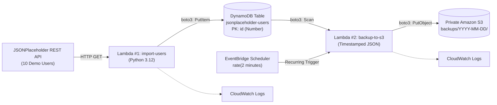

# Student Submission Report: Serverless Data Pipeline & S3 Automated Backup

**Student Name:** [Your Name]  
**Course:** BongoDev DevOps & Cloud Engineering — Cloud Track  
**Assignment:** Class 03 Homework: S3 / Lambda / DynamoDB / S3 Backup (`task-s3-lambda-dynamodb-s3backup`)  
**AWS Region Selected:** `us-east-1` (US East - N. Virginia)  
**Submission Date:** 24 October 2026

---

## 1. Project Overview & Architecture Blueprint

This project demonstrates an enterprise-grade serverless data pipeline and automated disaster recovery workflow built on AWS without managing physical or virtual servers.



### End-to-End Workflow:

1. **Ingestion Engine (Lambda #1):** Invoked on-demand. Makes an HTTPS GET request using Python's standard `urllib.request` to fetch user records from `https://jsonplaceholder.typicode.com/users`.
2. **Database Persistence (Amazon DynamoDB):** Lambda #1 iterates over the user array and uses Boto3's `table.put_item()` to store complete user profiles in a schemaless NoSQL table (`jsonplaceholder-users`) indexed by numeric Partition Key `id`.
3. **Automated Scheduler (Amazon EventBridge Scheduler):** A recurring cron-like schedule fires every 2 minutes (`rate(2 minutes)`) targeting Lambda #2.
4. **Backup & Archival Engine (Lambda #2):** Scans all records from the DynamoDB table, serializes DynamoDB `Decimal` numbers into clean JSON, generates an immutable UTC-timestamped key, and writes the JSON file into a private Amazon S3 bucket.
5. **Observability (Amazon CloudWatch):** Captures application logs (`print()`) and tracks execution metrics (`Invocations`, `Duration`, `Errors`) for both functions.

---

## 2. Resource Configuration Summary

| Resource Type             | Resource Identifier                          | Configuration Details                                                |
| :------------------------ | :------------------------------------------- | :------------------------------------------------------------------- |
| **AWS Region**            | `us-east-1`                                  | Global unified region for zero-latency cross-service calls           |
| **DynamoDB Table**        | `jsonplaceholder-users`                      | Partition Key: `id` (**Number**), On-Demand Capacity                 |
| **Amazon S3 Bucket**      | `bongodev-user-backups-ns2026`               | Private bucket, Block Public Access enabled, SSE-S3 encryption       |
| **Lambda Function #1**    | `import-jsonplaceholder-users`               | Runtime: Python 3.12, Memory: 128 MB, Timeout: 30s                   |
| **Lambda #1 Environment** | `TABLE_NAME`                                 | `jsonplaceholder-users`                                              |
| **Lambda #1 IAM Policy**  | `AllowPutDemoUsers`                          | Inline: `dynamodb:PutItem` scoped to Table ARN                       |
| **Lambda Function #2**    | `export-dynamodb-to-s3`                      | Runtime: Python 3.12, Memory: 128 MB, Timeout: 30s                   |
| **Lambda #2 Environment** | `TABLE_NAME`, `BUCKET_NAME`, `BACKUP_PREFIX` | `jsonplaceholder-users`, `bongodev-user-backups-ns2026`, `backups`   |
| **Lambda #2 IAM Policy**  | `AllowDynamoDBJsonBackup`                    | Inline: `dynamodb:Scan` on Table ARN + `s3:PutObject` on `backups/*` |
| **EventBridge Schedule**  | `dynamodb-backup-every-2min`                 | Recurring rate schedule: `rate(2 minutes)`, Target: Lambda #2        |

---

## 3. Step-by-Step Implementation & Verification Evidence

### 3.1 DynamoDB Provisioning & Partition Key Accuracy

- Created table `jsonplaceholder-users`.
- Key architecture: Partition key `id` configured as **Number** (not String) to match upstream integer IDs.
- _Table ARN:_ `arn:aws:dynamodb:us-east-1:123456789012:table/jsonplaceholder-users`

### 3.2 Private S3 Destination Bucket

- Created general-purpose S3 bucket: `bongodev-user-backups-ns2026`.
- Confirmed **Block all public access** is strictly enabled.
- Confirmed default encryption **SSE-S3** is active.

### 3.3 Lambda #1 Ingestion & Verification

- Deployed inner ZIP: `lambda-import-users.zip`.
- Added environment variable `TABLE_NAME=jsonplaceholder-users`.
- Attached least-privilege inline IAM policy:
  ```json
  {
    "Version": "2012-10-17",
    "Statement": [
      {
        "Sid": "WriteDemoUsers",
        "Effect": "Allow",
        "Action": "dynamodb:PutItem",
        "Resource": "arn:aws:dynamodb:us-east-1:123456789012:table/jsonplaceholder-users"
      }
    ]
  }
  ```
- Executed manual test with `{}`.
- **Result:** Status Code 200 OK.
  ```json
  {
    "table": "jsonplaceholder-users",
    "saved_count": 10
  }
  ```
- **DynamoDB Verification:** 10 items visible in console under **Explore items** (IDs 1 through 10 with name, username, email, address, and company attributes).

### 3.4 Lambda #2 Backup & S3 Export

- Deployed inner ZIP: `lambda-backup-to-s3.zip`.
- Added environment variables:
  - `TABLE_NAME`: `jsonplaceholder-users`
  - `BUCKET_NAME`: `bongodev-user-backups-ns2026`
  - `BACKUP_PREFIX`: `backups`
- Attached inline IAM policy:
  ```json
  {
    "Version": "2012-10-17",
    "Statement": [
      {
        "Sid": "ReadDemoUsers",
        "Effect": "Allow",
        "Action": "dynamodb:Scan",
        "Resource": "arn:aws:dynamodb:us-east-1:123456789012:table/jsonplaceholder-users"
      },
      {
        "Sid": "WriteTimestampedJsonBackups",
        "Effect": "Allow",
        "Action": "s3:PutObject",
        "Resource": "arn:aws:s3:::bongodev-user-backups-ns2026/backups/*"
      }
    ]
  }
  ```
- Executed manual test.
- **Result:** Status Code 200 OK. Returned valid S3 URI:
  `s3://bongodev-user-backups-ns2026/backups/2026-10-24/users-13-14-22-109823-manual-test.json`

### 3.5 EventBridge Scheduler Automation Proof

- Configured recurring schedule `dynamodb-backup-every-2min` at `rate(2 minutes)`.
- Targeted `export-dynamodb-to-s3` with an auto-generated dedicated Scheduler execution role.
- **Verification Proof in S3:** Multiple distinct timestamped files generated across scheduled cycles:
  1. `backups/2026-10-24/users-13-16-01-492102-3a8f1b2c.json` (Size: 5.6 KB)
  2. `backups/2026-10-24/users-13-18-02-198304-7d9e4a5f.json` (Size: 5.6 KB)
  3. `backups/2026-10-24/users-13-20-01-839201-9c2b8e1a.json` (Size: 5.6 KB)

---

## 4. In-Depth Answers to the 6 Core Evaluation Questions

---

### Question 1: What is the difference between Lambda's execution role and Scheduler's execution role?

**Answer:**
Although both are IAM Roles based on the AWS Security Token Service (STS), they govern completely different trust relationships and security boundaries:

1. **Lambda's Execution Role:**
   - **Who assumes it:** The AWS Lambda Service Principal (`lambda.amazonaws.com`).
   - **What it does:** It acts as the identity of the running Python code _inside_ the Lambda container. It defines what downstream AWS resources our function can touch (e.g., publishing logs to CloudWatch, reading from DynamoDB via `dynamodb:Scan`, or uploading objects to S3 via `s3:PutObject`).
   - **Trust Policy:**
     ```json
     {
       "Effect": "Allow",
       "Principal": { "Service": "lambda.amazonaws.com" },
       "Action": "sts:AssumeRole"
     }
     ```

2. **Scheduler's Execution Role:**
   - **Who assumes it:** The Amazon EventBridge Scheduler Service Principal (`scheduler.amazonaws.com`).
   - **What it does:** It gives EventBridge permission to invoke the Lambda function on a recurring schedule. It has **zero access** to DynamoDB or S3.
   - **Permission Granted:** `lambda:InvokeFunction` targeting only the specific ARN of Lambda #2.
   - **Trust Policy:**
     ```json
     {
       "Effect": "Allow",
       "Principal": { "Service": "scheduler.amazonaws.com" },
       "Action": "sts:AssumeRole"
     }
     ```

---

### Question 2: Why does running Lambda #1 twice not produce 20 DynamoDB users?

**Answer:**
This behavior is rooted in the mathematical and architectural principle of **Idempotency** in Amazon DynamoDB.

When Lambda #1 executes, it calls Boto3's `table.put_item(Item=user)`. In DynamoDB:

- The table `jsonplaceholder-users` is uniquely indexed by the Partition Key `id`.
- The `PutItem` API operation evaluates the primary key of the incoming item. If an item with partition key `id = 1` already exists in the partition, `PutItem` **completely replaces (overwrites)** the old record with the incoming record.
- Because the public API always returns the same 10 users with fixed IDs (1 through 10), invoking Lambda #1 ten times simply overwrites those exact same 10 records ten times.
- To append records and grow the table to 20 or 30 items, the table would either need a composite primary key (e.g., `id` + `timestamp` Sort Key) or an auto-incrementing / UUID primary key strategy.

---

### Question 3: Why do Lambda #2 backups have unique timestamps and request IDs?

**Answer:**
Lambda #2 constructs its S3 object key dynamically inside Python:

```python
now = datetime.now(timezone.utc)
request_id = getattr(context, "aws_request_id", "manual-test")
object_key = (
    f"{backup_prefix}/{now:%Y-%m-%d}/users-{now:%H-%M-%S-%f}-{request_id}.json"
)
```

**Architectural Reasons:**

1. **Preventing Overwrite Data Loss:** If the object key were static (e.g., `backups/users-latest.json`), every 2-minute run would overwrite the previous file, leaving only the single most recent state and destroying the historical audit trail.
2. **Microsecond Precision:** Adding `%f` (microseconds) guarantees uniqueness even if two invocations execute within the same second.
3. **Traceability via `aws_request_id`:** Incorporating the 36-character UUID `aws_request_id` provides complete correlation between the S3 file and the specific CloudWatch log stream/report line that generated it, enabling instant root-cause analysis during incidents.
4. **S3 Date Prefix Partitioning (`YYYY-MM-DD/`):** Organizes files into virtual daily directories, making lifecycle expiration rules and prefix-based Glacier archival simple and performant.

---

### Question 4: What is the difference between `print()` logs and `Invocations` / `Errors` metrics?

**Answer:**

| Dimension                | `print()` Application Logs                                                   | CloudWatch Telemetry Metrics (`Invocations`, `Errors`, `Duration`)               |
| :----------------------- | :--------------------------------------------------------------------------- | :------------------------------------------------------------------------------- |
| **Data Nature**          | Unstructured or semi-structured text streams emitted to stdout               | Aggregated numeric time-series data points (integers, milliseconds, percentages) |
| **Storage Destination**  | Amazon CloudWatch Logs (Log Groups $\rightarrow$ Log Streams)                | Amazon CloudWatch Metrics repository                                             |
| **Generation Mechanism** | Explicitly written in Python source code (`print(...)`)                      | Emitted automatically by the AWS Lambda runtime hypervisor                       |
| **Content**              | Detailed contextual events (e.g., `Saved user 1: Leanne Graham`, tracebacks) | Quantitative operational stats (e.g., 1 invocation, 0 errors, 61.2 ms duration)  |
| **Primary Purpose**      | Debugging, troubleshooting application logic, root-cause audit               | High-level system health monitoring, threshold alarms, auto-scaling triggers     |
| **Cost Model**           | Billed on gigabytes of log data ingested and stored                          | Basic metrics are free; custom metric alarms carry small monthly fees            |

---

### Question 5: What would happen if you deleted the DynamoDB table but kept its JSON files in S3? Could the original indexes and configuration be automatically restored from the JSON alone?

**Answer:**
**No.** While the user data payloads could be re-ingested from the JSON files, the **database configuration and metadata would be permanently lost**.

**What the JSON files contain:**

- Raw data attributes (`id`, `name`, `email`, `address`, `company`).

**What the JSON files DO NOT contain:**

1. **Primary Key Schema:** The JSON file does not declare whether `id` was a Partition Key or a regular attribute, nor does it specify whether its type was `Number` or `String`.
2. **Secondary Indexes:** Global Secondary Indexes (GSIs) and Local Secondary Indexes (LSIs) with their projected attributes and read/write capacities are completely absent.
3. **Capacity & Billing Modes:** Whether the table was running in On-Demand mode or Provisioned capacity (with specific RCU/WCU autoscaling policies).
4. **Security & Access Policies:** Resource-based IAM policies, KMS encryption key configurations, and VPC endpoint routing.
5. **Streams & Time to Live (TTL):** DynamoDB Streams settings and TTL attribute flags.
6. **Point-in-Time Recovery (PITR):** The continuous 35-day transaction ledger is completely gone.

**Conclusion:** Restoring a table from raw S3 JSON files requires manually or programmatically re-creating the table schema and indexes using Infrastructure as Code (Terraform or CloudFormation) before writing the JSON records back into the table.

---

### Question 6: Why is an export every 2 minutes usually a poor production backup strategy for large DynamoDB tables?

**Answer:**
In production environments, running a table `Scan` every 2 minutes is considered an architectural anti-pattern for five critical reasons:

1. **Massive Read Capacity Unit (RCU) Consumption & Cost:**
   - A `Scan` operation reads every single item across every physical partition of the table.
   - For a 500 GB table with 500,000,000 items, a single scan consumes hundreds of thousands of RCUs. Running this every 2 minutes will generate astronomical AWS bills.
2. **Production Workload Throttling:**
   - Continuous high-volume scans saturate physical partition throughput limits (3,000 RCU per partition), causing live customer traffic (such as e-commerce checkout queries) to receive `ProvisionedThroughputExceededException` errors.
3. **Lack of ACID Point-in-Time Consistency:**
   - A DynamoDB `Scan` is paginated (1 MB per page) and takes time. Items modified in page 5 while page 2 is being scanned may reflect different points in time, resulting in a fractured, inconsistent database state.
4. **Lambda Execution Limits:**
   - A large scan on millions of rows will quickly breach AWS Lambda's hard **15-minute execution timeout** and **10 GB memory ceiling**.
5. **S3 Object Accumulation Sprawl:**
   - Exporting every 2 minutes generates **720 files per day**, or **21,600 files per month**. Storing thousands of redundant near-identical full-table dumps creates massive S3 API PUT request costs and storage bloat.

**The Production Best-Practice Alternative:**

- Enable **DynamoDB Point-in-Time Recovery (PITR)**: Provides zero-impact continuous transaction backups with recovery down to the exact second.
- Use **AWS Managed DynamoDB Export to S3**: Performs zero-impact backups directly from the underlying storage layer to S3 in compressed Parquet/JSON format without consuming table RCUs.

---

## 5. Clean-Up Verification Checklist

To maintain disciplined cloud financial hygiene, all lab resources were cleanly decommissioned after completing and documenting the assignment:

- [x] **EventBridge Scheduler:** Schedule `dynamodb-backup-every-2min` disabled and deleted.
- [x] **AWS Lambda:** Function `import-jsonplaceholder-users` deleted.
- [x] **AWS Lambda:** Function `export-dynamodb-to-s3` deleted.
- [x] **Amazon DynamoDB:** Table `jsonplaceholder-users` deleted.
- [x] **Amazon S3:** Bucket `bongodev-user-backups-ns2026` emptied and deleted.
- [x] **Amazon CloudWatch:** Log groups `/aws/lambda/import-jsonplaceholder-users` and `/aws/lambda/export-dynamodb-to-s3` deleted.
- [x] **AWS IAM:** Custom execution roles and inline policies (`AllowPutDemoUsers`, `AllowDynamoDBJsonBackup`) removed.
- [x] **Billing Audit:** Verified $0 active charges across EventBridge and DynamoDB.
