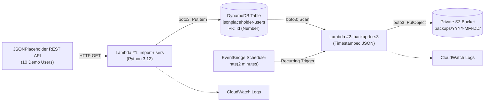

# AWS Serverless Data Pipeline & S3 Backup — Video Recording Script & Execution Guide

**Project:** Serverless Data Pipeline with AWS Lambda, DynamoDB, EventBridge Scheduler & S3 Automated Backups  
**Target Video Duration:** ~15–20 Minutes  
**Target Audience:** DevOps Engineers, Cloud Learners, Course Evaluators, YouTube Tech Community  
**Style:** Professional, hands-on, authoritative yet compassionate tech tutorial  
**Format:** Multi-chapter studio script featuring **On-Screen Actions**, **Dual-Language Voiceover (Bengali & English)**, **Pro-Tips for Video**, and **Visual Verification Checkpoints**.

---

## 📋 Pre-Recording Setup Checklist (Before Hitting Record!)

Before starting your screen recording software (OBS Studio, Camtasia, Loom, etc.):

1. **Browser Preparation:**
   - Log into the **AWS Management Console** in Google Chrome or Brave.
   - Open the AWS Console home tab in **US East (N. Virginia) — `us-east-1`** (or your chosen single region).
   - Zoom browser to **110% or 125%** so console text, buttons, and JSON are crisp and readable on 1080p/4K video.
   - Keep 5 tabs pinned and ready:
     - Tab 1: AWS Console Home / Dashboard
     - Tab 2: Amazon DynamoDB
     - Tab 3: Amazon S3
     - Tab 4: AWS Lambda
     - Tab 5: Amazon EventBridge (Scheduler)
2. **Local Folder on Workstation:**
   - Keep this unzipped folder open in VS Code or File Explorer:
     `cloude\aws\class003_homework\task-s3-lambda-dynamodb-s3backup`
   - Confirm that `lambda_zips/` contains:
     - `lambda-import-users.zip` (For Lambda #1)
     - `lambda-backup-to-s3.zip` (For Lambda #2)
   - Confirm that `iam_policies/` contains:
     - `lambda-import-putitem-policy.json`
     - `lambda-backup-export-policy.json`
3. **Screen Layout:**
   - Clean your desktop wallpaper.
   - Mute system notification sounds and Slack/WhatsApp alerts.
   - Test microphone audio levels.

---

## 🎬 Video Chapter Timeline (At a Glance)

| Timestamp         | Chapter Title                                                | Core On-Screen Focus                                     |
| :---------------- | :----------------------------------------------------------- | :------------------------------------------------------- |
| **00:00 - 01:30** | **Chapter 1:** Introduction & Architecture Overview          | Pipeline Architecture Diagram & Project Scope            |
| **01:30 - 02:45** | **Chapter 2:** Region Selection & Account Setup              | AWS Console Header, Region Pinning (`us-east-1`)         |
| **02:45 - 04:30** | **Chapter 3:** Provisioning Amazon DynamoDB                  | Creating `jsonplaceholder-users` Table (`id` as Number)  |
| **04:30 - 06:15** | **Chapter 4:** Provisioning the Private S3 Bucket            | Creating `bongodev-user-backups-<unique-id>`             |
| **06:15 - 08:30** | **Chapter 5:** Building Lambda #1 (API Ingestion)            | Creating `import-jsonplaceholder-users`, Python 3.12     |
| **08:30 - 10:15** | **Chapter 6:** IAM Least-Privilege Scoping (PutItem)         | Inline Policy on Lambda #1 Execution Role                |
| **10:15 - 12:00** | **Chapter 7:** Deploying & Testing Lambda #1                 | Uploading ZIP #1, Env Var, Manual Test, DynamoDB Records |
| **12:00 - 13:45** | **Chapter 8:** Building Lambda #2 (S3 Export Engine)         | Creating `export-dynamodb-to-s3`, Timeout & Memory       |
| **13:45 - 15:30** | **Chapter 9:** IAM Dual Policy (Scan + S3 PutObject)         | Inline Policy on Lambda #2 Execution Role                |
| **15:30 - 17:15** | **Chapter 10:** Deploying & Testing Lambda #2                | Uploading ZIP #2, Env Vars, Manual Test, S3 Object Check |
| **17:15 - 19:30** | **Chapter 11:** Automating with EventBridge Scheduler        | Setting up 2-Minute Cron Schedule (`rate(2 minutes)`)    |
| **19:30 - 21:00** | **Chapter 12:** Live Verification & CloudWatch Observability | S3 Multiple Timestamps, CloudWatch Logs & Metrics        |
| **21:00 - 23:30** | **Chapter 13:** Senior DevOps Analysis & Q&A                 | Explaining the 6 Core Interview/Report Questions         |
| **23:30 - 24:30** | **Chapter 14:** Resource Cleanup & Conclusion                | Pausing Schedule, Deleting Resources, Outro              |

---

## 🎥 Scene-by-Scene Recording Walkthrough

---

### Scene 1: Introduction & Architecture Blueprint (00:00 - 01:30)

#### 🖥️ On-Screen Action:

- Show your title slide or display the Mermaid architecture diagram on screen.
- Highlight the 4 major components: External API $\rightarrow$ Lambda #1 $\rightarrow$ DynamoDB $\rightarrow$ Lambda #2 $\rightarrow$ S3 Bucket.



#### 🎙️ Spoken Voiceover Script:

**বাংলা ভার্সন (Bengali):**

> "হ্যালো এভরিওয়ান! আজকের এই হ্যান্ডস-অন সেশনে আমরা এডব্লিউএস ক্লাউডে একটি সম্পূর্ণ সার্ভারলেস ডাটা পাইপলাইন এবং স্বয়ংক্রিয় ব্যাকআপ আর্কিটেকচার স্ক্র্যাচ থেকে তৈরি করব।
>
> আমাদের লক্ষ্য হলো একটি পাবলিক রেস্ট এপিআই থেকে ইউজার ডেটা ফেচ করে এডব্লিউএস ল্যামডার মাধ্যমে একটি ম্যানেজড নো-এসকিউএল ডাটাবেস—অ্যামাজন ডাইনামোডিবিতে সংরক্ষণ করা। এরপর একটি দ্বিতীয় ল্যামডা ফাংশন ও ইভেন্টব্রিজ শিডিউলার ব্যবহার করে প্রতি ২ মিনিট পর পর ডাইনামোডিবির সমস্ত রেকর্ড স্ক্যান করে তারিখ ও টাইমস্ট্যাম্প অনুযায়ী অ্যামাজন এস৩ বাকেটে স্বয়ংক্রিয়ভাবে ব্যাকআপ রাখা।
>
> পুরো প্রজেক্টে আমরা কোনো সার্ভার ম্যানেজ করব না, কোনো হার্ডকোডেড ক্রেডেনশিয়াল ব্যবহার করব না; সম্পূর্ণ কাজ হবে ইন্ডাস্ট্রি-গ্রেড আইএএম লিস্ট-প্রিভিলেজ রুলস এবং ক্লাউডওয়াচ অবজার্ভেবিলিটি নিশ্চিত করে। চলুন শুরু করা যাক!"

**English Version:**

> "Hello everyone! In this hands-on session, we are building an end-to-end, production-grade serverless data pipeline and automated backup architecture completely from scratch on AWS.
>
> Our mission is to ingest live user data from an external REST API, process it using AWS Lambda, persist it into an Amazon DynamoDB NoSQL table, and then use a second Lambda function orchestrated by EventBridge Scheduler to export timestamped JSON backups into a private Amazon S3 bucket every 2 minutes.
>
> We will manage zero virtual servers, adhere strictly to IAM least-privilege security, and monitor execution via Amazon CloudWatch. Let's dive right in!"

💡 **Pro-Tip for Video:** Emphasize that this is an _event-driven serverless architecture_. Mention: _"Notice that S3 in this project is the backup storage destination, not a Lambda trigger."_

---

### Scene 2: Region Selection & Account Setup (01:30 - 02:45)

#### 🖥️ On-Screen Action:

- Open the AWS Management Console home page.
- Click on the Region dropdown in the top-right navigation bar.
- Explicitly select **US East (N. Virginia) `us-east-1`** (or your chosen single region).
- Click on the user profile dropdown in the top right to show where the 12-digit **AWS Account ID** is located.

#### 🎙️ Spoken Voiceover Script:

**বাংলা ভার্সন (Bengali):**

> "প্রথমেই সবচেয়ে গুরুত্বপূর্ণ নিয়ম: আমাদের পুরো পাইপলাইনের সমস্ত রিসোর্স—ডাইনামোডিবি, উভয় ল্যামডা ফাংশন, এস৩ বাকেট এবং ইভেন্টব্রিজ শিডিউলার—একই এডব্লিউএস রিজিয়নে থাকতে হবে।
>
> আমি কনসোলের ওপরের ডানপাশ থেকে সিলেক্ট করছি **US East (N. Virginia) — us-east-1**। আপনারা চাইলে অন্য যেকোনো সাপোর্টেড রিজিয়ন নিতে পারেন, কিন্তু মনে রাখবেন সব সার্ভিস যেন একই রিজিয়নে থাকে। আর ওপরের ডানপাশে প্রোফাইল নামের ওপর ক্লিক করলেই আপনার ১২ ডিজিটের অ্যাকাউন্ট আইডি দেখতে পাবেন। আমাদের আইএএম পলিসি লেখার সময় এই অ্যাকাউন্ট আইডি ও রিজিয়ন প্রয়োজন হবে।"

**English Version:**

> "First, the golden rule of cloud architecture: every single component—our DynamoDB table, both Lambda functions, the S3 bucket, and EventBridge Scheduler—must reside in the **exact same AWS Region**.
>
> In the top-right header, I am selecting **US East (N. Virginia) — `us-east-1`**. Also, clicking on your account name reveals your 12-digit AWS Account ID. Keep your Account ID and chosen Region handy, because we will inject them into our IAM policy templates in the next steps."

✅ **Visual Checkpoint:** The top-right region bar shows `N. Virginia` (`us-east-1`).

---

### Scene 3: Step 1 — Provisioning Amazon DynamoDB (02:45 - 04:30)

#### 🖥️ On-Screen Action:

1. In the AWS search bar, type `DynamoDB` and press Enter.
2. Click the orange **Create table** button.
3. **Table name:** Type `jsonplaceholder-users` (exact spelling).
4. **Partition key:** Type `id`.
5. **Partition key type dropdown:** Change from _String_ to **Number**.
6. **Sort key:** Leave blank.
7. Under **Table settings**, select **Default settings** (or select Customize settings and choose _On-demand_ capacity).
8. Click **Create table**.
9. Wait ~15 seconds until the status changes from _Creating_ to **Active**.
10. Click on `jsonplaceholder-users` and scroll down to the **General information** panel.
11. Highlight and copy the **Amazon Resource Name (ARN)**:
    `arn:aws:dynamodb:us-east-1:123456789012:table/jsonplaceholder-users`

#### 🎙️ Spoken Voiceover Script:

**বাংলা ভার্সন (Bengali):**

> "এখন আমরা আমাদের ডাটাবেস লেয়ার তৈরি করব। ডাইনামোডিবি কনসোলে এসে আমরা 'Create table'-এ ক্লিক করছি।
>
> টেবিলের নাম দিচ্ছি `jsonplaceholder-users`। এবার লক্ষ্য করুন, পার্টিশন কী (Partition Key) হিসেবে আমরা দিচ্ছি `id`। এবং সবচেয়ে গুরুত্বপূর্ণ বিষয়—টাইপ কিন্তু 'String' রাখা যাবে না, অবশ্যই **Number** সিলেক্ট করতে হবে! কারণ এপিআই থেকে ইউজারের আইডিগুলো পূর্ণসংখ্যা (Integer) হিসেবে আসবে। যদি ভুল করে String রাখেন, তাহলে ডাটা ইনসার্টের সময় ভ্যালিডেশন এরর খাবেন।
>
> টেবিল সেটিংস ডিফল্ট রেখে আমরা 'Create table' চাপছি। কয়েক সেকেন্ডের মধ্যে টেবিলটি 'Active' হয়ে গেছে। আমরা টেবিলের ডিটেইলসে গিয়ে এর **ARN (Amazon Resource Name)** কপি করে নিচ্ছি। আমাদের পরবর্তী আইএএম পলিসির জন্য এই এআরএন প্রয়োজন হবে।"

**English Version:**

> "Now let's provision our database layer. In the DynamoDB console, click **Create table**.
>
> We name our table `jsonplaceholder-users`. For the Partition Key, type `id`. And pay very close attention here: change the data type from _String_ to **Number**! The upstream API sends numeric IDs. If you leave this as String, Boto3 will throw a validation exception during ingestion.
>
> Leave table settings as default, and click **Create table**. Within a few seconds, our table status is **Active**. Open the table details and copy the **Table ARN**—we will need it to scope our IAM security policies."

💡 **Pro-Tip for Video:** Zoom into the `id (Number)` setting on screen and tell viewers: _"Don't rush past this step! Picking Number instead of String is the number one trap in this lab."_

---

### Scene 4: Step 2 — Provisioning the Private S3 Bucket (04:30 - 06:15)

#### 🖥️ On-Screen Action:

1. Search for `S3` and open Amazon S3 console in a new tab.
2. Click **Create bucket**.
3. Under **Bucket type**, ensure **General purpose** is selected.
4. **Bucket name:** Type a unique name, e.g.:
   `bongodev-user-backups-ns2026` (replace with your unique suffix).
5. **AWS Region:** Confirm it is `US East (N. Virginia) us-east-1`.
6. Scroll down to **Block Public Access settings for this bucket**:
   - Verify that **Block _all_ public access** is checked.
7. Scroll down to **Default encryption**:
   - Leave as **Server-side encryption with Amazon S3 managed keys (SSE-S3)**.
8. Click **Create bucket**.
9. In the buckets list, click on your newly created bucket to open it.
10. Point out that the bucket is completely empty and private.

#### 🎙️ Spoken Voiceover Script:

**বাংলা ভার্সন (Bengali):**

> "এবার আমরা ব্যাকআপ সংরক্ষণের জন্য আমাদের অবজেক্ট স্টোরেজ—অ্যামাজন এস৩ বাকেট তৈরি করব।
>
> 'Create bucket'-এ ক্লিক করছি। বাকেটের নাম দিচ্ছি `bongodev-user-backups-ns2026`। আপনারা জানেন, এস৩ বাকেটের নাম সমগ্র বিশ্বে ইউনিক হতে হয়, তাই নামের শেষে আপনার নাম বা ইউনিক সংখ্যা যোগ করবেন।
>
> রিজিয়ন অবশ্যই আগের মতোই `us-east-1` রাখছি। সিকিউরিটির জন্য **Block all public access** চেকমার্ক অন থাকবে, কারণ আমাদের ব্যাকআপ সম্পূর্ণ ইন্টারনাল ও প্রাইভেট। ডিফল্ট এনক্রিপশন SSE-S3 অন রেখে আমরা 'Create bucket' চাপছি।
>
> লক্ষ্য করুন, বাকেটের ভেতরে কোনো ফোল্ডার তৈরির দরকার নেই। যখন আমাদের ল্যামডা ফাইল আপলোড করবে, এস৩ প্রিফিক্স স্বয়ংক্রিয়ভাবে তৈরি হয়ে যাবে।"

**English Version:**

> "Next, let's create our backup destination in Amazon S3. Click **Create bucket**.
>
> I'll name the bucket `bongodev-user-backups-ns2026`. Remember, S3 bucket names are globally unique across all AWS accounts, so append your student ID or a unique string.
>
> Keep the region matched to `us-east-1`. Keep **Block all public access** enabled for strict security, and leave default SSE-S3 encryption enabled. Click **Create bucket**.
>
> Note that we don't need to manually create any `backups/` folder inside the bucket. S3 is a flat key-value object store; prefixes appear automatically when objects are uploaded."

✅ **Visual Checkpoint:** S3 Bucket created with status "Bucket and objects not public".

---

### Scene 5: Step 3 — Building Lambda #1: Ingestion Engine (06:15 - 08:30)

#### 🖥️ On-Screen Action:

1. Navigate to the **AWS Lambda** console.
2. Click the orange **Create function** button.
3. Choose **Author from scratch**.
4. **Function name:** Type `import-jsonplaceholder-users`.
5. **Runtime:** Select **Python 3.12** (or latest Python 3.x).
6. **Architecture:** Select **x86_64**.
7. Under **Permissions**, expand **Change default execution role**:
   - Ensure **Create a new role with basic Lambda permissions** is selected.
8. Click **Create function**.
9. Once created, click on the **Configuration** tab $\rightarrow$ **General configuration** $\rightarrow$ click **Edit**.
10. Change **Timeout** from `0 min 3 sec` to **`0 min 30 sec`**.
11. Confirm **Memory** is set to **128 MB**.
12. Click **Save**.

#### 🎙️ Spoken Voiceover Script:

**বাংলা ভার্সন (Bengali):**

> "এবার আমরা আমাদের ডাটা পাইপলাইনের প্রথম ইঞ্জিন—ল্যামডা ফাংশন ১ তৈরি করব। এর কাজ হবে এক্সটার্নাল এপিআই থেকে ইউজারদের ফেচ করে ডাইনামোডিবিতে ইনসার্ট করা।
>
> ল্যামডা কনসোলে এসে 'Create function' দিচ্ছি। ফাংশনের নাম দিচ্ছি `import-jsonplaceholder-users`। রানটাইম নিচ্ছি Python 3.12 এবং আর্কিটেকচার x86_64। পারমিশনে এডব্লিউএস স্বয়ংক্রিয়ভাবে একটি বেসিক এক্সিকিউশন রোল তৈরি করে নেবে। আমরা 'Create function' চাপছি।
>
> ফাংশনটি তৈরি হলে সোজা চলে যাব **Configuration $\rightarrow$ General configuration $\rightarrow$ Edit**-এ। এডব্লিউএস ল্যামডার ডিফল্ট টাইমআউট থাকে মাত্র ৩ সেকেন্ড। এক্সটার্নাল এপিআই কল করার সময় সামান্য নেটওয়ার্ক স্লো হলেই ৩ সেকেন্ডে ফাংশন ফেইল করতে পারে। তাই আমরা টাইমআউট বাড়িয়ে **৩০ সেকেন্ড** করে সেভ করে নিচ্ছি।"

**English Version:**

> "Now let's build the first engine of our pipeline: Lambda Function #1, which will ingest user records from the public API and persist them into DynamoDB.
>
> Click **Create function**, choose **Author from scratch**, and name it `import-jsonplaceholder-users`. We select **Python 3.12** as our runtime and **x86_64** architecture. Under permissions, AWS will create a basic execution role. Click **Create function**.
>
> Once loaded, head straight to **Configuration $\rightarrow$ General configuration $\rightarrow$ Edit**. The default 3-second timeout is a classic trap for external API calls. Let's raise the timeout to **30 seconds** with 128 MB of memory and hit **Save**."

---

### Scene 6: Step 4 — Attaching Least-Privilege IAM Policy for Lambda #1 (08:30 - 10:15)

#### 🖥️ On-Screen Action:

1. In Lambda #1, open the **Configuration** tab $\rightarrow$ click **Permissions** in the left menu.
2. Under **Execution role**, click on the blue role name link (opens IAM in a new tab).
3. In IAM, point out the existing `AWSLambdaBasicExecutionRole` policy (which allows CloudWatch logs).
4. Click **Add permissions** $\rightarrow$ select **Create inline policy**.
5. In the Policy editor, click the **JSON** toggle button.
6. Open your local file `iam_policies/lambda-import-putitem-policy.json` in VS Code.
7. Show how you replace `REGION` with `us-east-1` and `ACCOUNT_ID` with your real 12-digit account ID.
   ```json
   {
     "Version": "2012-10-17",
     "Statement": [
       {
         "Sid": "WriteDemoUsers",
         "Effect": "Allow",
         "Action": "dynamodb:PutItem",
         "Resource": "arn:aws:dynamodb:us-east-1:123456789012:table/jsonplaceholder-users"
       }
     ]
   }
   ```
8. Paste the JSON into the IAM editor.
9. Click **Next**.
10. **Policy name:** Type `AllowPutDemoUsers`.
11. Click **Create policy**.

#### 🎙️ Spoken Voiceover Script:

**বাংলা ভার্সন (Bengali):**

> "এখন একটি অত্যন্ত গুরুত্বপূর্ণ সিকিউরিটি স্টেপ। আমাদের ল্যামডা কিন্তু বাই ডিফল্ট ডাইনামোডিবিতে কোনো ডাটা লিখতে পারবে না, কারণ তার শুধু ক্লাউডওয়াচে লগ লেখার পারমিশন আছে।
>
> আমরা ল্যামডার **Configuration $\rightarrow$ Permissions** থেকে এক্সিকিউশন রোলে ক্লিক করে আইএএম কনসোলে যাচ্ছি। এখানে আমরা 'Add permissions' থেকে **Create inline policy** সিলেক্ট করছি এবং JSON ট্যাবে ক্লিক করছি।
>
> এবার আমাদের প্রজেক্ট ফোল্ডারের `iam_policies/lambda-import-putitem-policy.json` ফাইলটি ওপেন করে `REGION` এবং `ACCOUNT_ID`-এর জায়গায় আমাদের আসল রিজিয়ন ও অ্যাকাউন্ট আইডি বসিয়ে দিচ্ছি। লক্ষ্য করুন, আমরা কিন্তু কোনো `AdministratorAccess` দিচ্ছি না! আমরা লিস্ট-প্রিভিলেজ মেনে শুধু `dynamodb:PutItem` পারমিশন দিচ্ছি নির্দিষ্ট এই টেবিলটির জন্য। পলিসির নাম দিচ্ছি `AllowPutDemoUsers` এবং সেভ করছি।"

**English Version:**

> "Now for a critical cloud security step. By default, our Lambda function has zero permissions to touch DynamoDB—it only has basic CloudWatch logging permissions.
>
> Under **Configuration $\rightarrow$ Permissions**, click on the Execution role link to open IAM. Click **Add permissions $\rightarrow$ Create inline policy**, and toggle to the **JSON** tab.
>
> Open `lambda-import-putitem-policy.json` from our project repository. Replace `REGION` with `us-east-1` and `ACCOUNT_ID` with your real account ID. Notice that we adhere strictly to the Principle of Least Privilege: we grant only `dynamodb:PutItem`, restricted solely to our specific table ARN. Name the policy `AllowPutDemoUsers` and click **Create policy**."

---

### Scene 7: Step 5 — Environment Variables & Uploading Inner ZIP #1 (10:15 - 12:00)

#### 🖥️ On-Screen Action:

1. Switch back to the Lambda #1 tab in your browser.
2. Click **Configuration** $\rightarrow$ **Environment variables** $\rightarrow$ click **Edit**.
3. Click **Add environment variable**:
   - **Key:** `TABLE_NAME`
   - **Value:** `jsonplaceholder-users`
4. Click **Save**.
5. Switch to the **Code** tab.
6. Scroll down to the **Runtime settings** section and verify:
   `Handler: lambda_function.lambda_handler`
7. Click the **Upload from** dropdown button on the right $\rightarrow$ select **.zip file**.
8. Click **Upload** $\rightarrow$ navigate to:
   `cloude/aws/class003_homework/task-s3-lambda-dynamodb-s3backup/lambda_zips/`
9. Select **`lambda-import-users.zip`** (highlight to viewers that this is the _inner_ zip!).
10. Click **Save**.
11. Show the code loaded in the web editor: walk through the `urllib.request.urlopen` loop and `table.put_item(Item=user)`.

#### 🎙️ Spoken Voiceover Script:

**বাংলা ভার্সন (Bengali):**

> "কোড আপলোড করার আগে আমরা এনভায়রনমেন্ট ভ্যারিয়েবল সেট করব। **Configuration $\rightarrow$ Environment variables**-এ গিয়ে 'Edit' দিচ্ছি। Key হিসেবে লিখছি `TABLE_NAME` এবং Value হিসেবে দিচ্ছি আমাদের টেবিলের নাম `jsonplaceholder-users`। এতে করে কোডে কোনো টেবিলের নাম হার্ডকোড করতে হলো না।
>
> এবার **Code** ট্যাবে আসি। এখানে একটি সতর্কবার্তা: আপনারা কখনোই অ্যাসাইনমেন্টের মেইন বাইরের জিপ ফাইল আপলোড করবেন না! আমরা 'Upload from $\rightarrow$ .zip file'-এ ক্লিক করে `lambda_zips` ফোল্ডারের ভেতর থেকে **`lambda-import-users.zip`** নামের ইনার জিপ ফাইলটি সিলেক্ট করে আপলোড করছি।
>
> কোডটি লক্ষ্য করুন: এটি পাইথনের বিল্ট-ইন `urllib` দিয়ে এপিআই কল করছে এবং লুপ চালিয়ে প্রতিটি ইউজারকে `table.put_item` দিয়ে ডাইনামোডিবিতে সংরক্ষণ করছে।"

**English Version:**

> "Before deploying code, let's configure our environment variables. Go to **Configuration $\rightarrow$ Environment variables $\rightarrow$ Edit**. Add the key `TABLE_NAME` with value `jsonplaceholder-users` and click **Save**. This decouples our infrastructure from application code.
>
> Now click the **Code** tab. Here is a crucial warning: do not upload the outer assignment zip! Click **Upload from $\rightarrow$ .zip file**, navigate into `lambda_zips/`, and select the inner **`lambda-import-users.zip`**. Click **Save**.
>
> In the code editor, you can inspect the clean logic: it fetches the public JSON payload using Python's standard `urllib` library, iterates over the 10 users, and persists each item into DynamoDB using `table.put_item()`."

---

### Scene 8: Step 6 — Testing Lambda #1 & Verifying DynamoDB Records (12:00 - 13:45)

#### 🖥️ On-Screen Action:

1. In Lambda #1, switch to the **Test** tab.
2. **Event name:** Type `ImportUsersTest`.
3. In the Event JSON box, leave or type `{}`.
4. Click the orange **Save** button, then click **Test**.
5. Expand the **Execution result** box showing:
   ```json
   {
     "statusCode": 200,
     "body": "{\"table\": \"jsonplaceholder-users\", \"saved_count\": 10}"
   }
   ```
6. Switch to the DynamoDB tab $\rightarrow$ select `jsonplaceholder-users` $\rightarrow$ click **Explore table items**.
7. Run the scan and show all **10 user items** displayed on screen with IDs 1 to 10.
8. Switch back to Lambda #1 and click **Test** a second time.
9. Return to DynamoDB, refresh the scan, and point out that the item count is still **10** (not 20!).

#### 🎙️ Spoken Voiceover Script:

**বাংলা ভার্সন (Bengali):**

> "চলুন আমাদের প্রথম ল্যামডা ফাংশনটি টেস্ট করি। 'Test' ট্যাবে এসে ইভেন্ট নাম দিচ্ছি `ImportUsersTest` এবং পেলোড হিসেবে একটি খালি অবজেক্ট `{}` রেখে টেস্ট রান করছি।
>
> দেখুন, চোখের পলকে স্ট্যাটাস কোড ২০০ সাকসেস! এবং রেসপন্সে দেখাচ্ছে `saved_count: 10`।
>
> এবার ডাইনামোডিবি কনসোলে ফিরে এসে 'Explore table items'-এ ক্লিক করি। বুম! দেখুন, এপিআই থেকে ১০ জন ইউজারের পুরো ডাটা—নেম, ইউজারনেম, ইমেইল, এড্রেস ও কোম্পানি নেম—আমাদের টেবিলে ইনসার্ট হয়ে গেছে!
>
> এবার একটি ট্রিকি প্রশ্ন: আমি যদি ল্যামডা ফাংশনটি আবার রান করি, টেবিলে কি ২০ জন ইউজার হবে? চলুন টেস্ট বাটনে আরেকবার চাপি। এবার ডাইনামোডিবি রিফ্রেশ করি... দেখুন, এখনও ঠিক ১০ জনই আছে! কারণ `put_item` প্রাইমারি কী মিলে গেলে আগের আইটেমকে ওভাররাইট করে, ডুপ্লিকেট তৈরি করে না।"

**English Version:**

> "Let's test Lambda Function #1. Under the **Test** tab, name the event `ImportUsersTest`, pass an empty JSON `{}` payload, and click **Test**.
>
> And boom! Status Code 200 Success with `saved_count: 10`.
>
> Now let's verify in DynamoDB. Go to our `jsonplaceholder-users` table and click **Explore table items**. Outstanding! All 10 user items—complete with nested address, email, and company objects—are persisted in our NoSQL table.
>
> Notice an interesting architectural question: what happens if I click Test a second time? Does the table grow to 20 users? Let's run it again and refresh DynamoDB... Still exactly 10 items! That's because `put_item` is idempotent on partition keys—it replaces the existing item with matching `id`, rather than appending a duplicate."

---

### Scene 9: Step 7 — Building Lambda #2: S3 Export Engine (13:45 - 15:30)

#### 🖥️ On-Screen Action:

1. Return to the **AWS Lambda** console $\rightarrow$ click **Create function**.
2. **Function name:** Type `export-dynamodb-to-s3`.
3. **Runtime:** Select **Python 3.12**.
4. **Architecture:** Select **x86_64**.
5. Under **Permissions**, leave default **Create a new role with basic Lambda permissions**.
6. Click **Create function**.
7. Navigate to **Configuration** $\rightarrow$ **General configuration** $\rightarrow$ **Edit**.
8. Set **Timeout** to **30 seconds** and **Memory** to **128 MB** $\rightarrow$ click **Save**.

#### 🎙️ Spoken Voiceover Script:

**বাংলা ভার্সন (Bengali):**

> "আমাদের পাইপলাইনের দ্বিতীয় ধাপ: ডাটাবেস ব্যাকআপ ইঞ্জিন। আমরা দ্বিতীয় ল্যামডা ফাংশন তৈরি করব যা ডাইনামোডিবির সমস্ত ডাটা স্ক্যান করে এস৩ বাকেটে টাইমস্ট্যাম্পসহ জেসন ফাইল হিসেবে আপলোড করবে।
>
> 'Create function'-এ ক্লিক করে নাম দিচ্ছি `export-dynamodb-to-s3`। রানটাইম Python 3.12 রেখে ফাংশনটি তৈরি করছি। আগের মতোই **Configuration $\rightarrow$ General configuration**-এ গিয়ে টাইমআউট বাড়িয়ে **৩০ সেকেন্ড** করে নিচ্ছি যাতে বড় টেবিল স্ক্যান ও এস৩ আপলোডের সময় কোনো টাইমআউট এরর না আসে।"

**English Version:**

> "Now for Part C of the pipeline: the backup export engine. We will build Lambda Function #2 to scan our DynamoDB records and write formatted JSON files into S3.
>
> Click **Create function**, name it `export-dynamodb-to-s3`, choose **Python 3.12**, and click **Create function**. Once created, head into **Configuration $\rightarrow$ General configuration**, raise the timeout to **30 seconds**, and hit **Save**."

---

### Scene 10: Step 8 — Attaching Dual IAM Policy for Lambda #2 (15:30 - 17:15)

#### 🖥️ On-Screen Action:

1. In Lambda #2, click **Configuration** $\rightarrow$ **Permissions** $\rightarrow$ click the **Execution role** link.
2. In the IAM console, click **Add permissions** $\rightarrow$ **Create inline policy** $\rightarrow$ toggle to **JSON**.
3. Open `iam_policies/lambda-backup-export-policy.json` in VS Code.
4. Show how you edit the 3 placeholders:
   - `REGION` $\rightarrow$ `us-east-1`
   - `ACCOUNT_ID` $\rightarrow$ your 12-digit account ID
   - `YOUR_UNIQUE_BUCKET_NAME` $\rightarrow$ your exact S3 bucket name (e.g., `bongodev-user-backups-ns2026`)
   ```json
   {
     "Version": "2012-10-17",
     "Statement": [
       {
         "Sid": "ReadDemoUsers",
         "Effect": "Allow",
         "Action": "dynamodb:Scan",
         "Resource": "arn:aws:dynamodb:us-east-1:123456789012:table/jsonplaceholder-users"
       },
       {
         "Sid": "WriteTimestampedJsonBackups",
         "Effect": "Allow",
         "Action": "s3:PutObject",
         "Resource": "arn:aws:s3:::bongodev-user-backups-ns2026/backups/*"
       }
     ]
   }
   ```
5. Paste into the IAM editor, click **Next**, name it `AllowDynamoDBJsonBackup`, and click **Create policy**.

#### 🎙️ Spoken Voiceover Script:

**বাংলা ভার্সন (Bengali):**

> "এখন ল্যামডা ২-এর সিকিউরিটি কনফিগারেশন। ল্যামডা ২-এর দুটি আলাদা সার্ভিসের সাথে কাজ করতে হবে: ডাইনামোডিবি থেকে ডাটা রিড করতে হবে এবং এস৩ বাকেটে ডাটা রাইট করতে হবে।
>
> আমরা রোলে গিয়ে **Create inline policy $\rightarrow$ JSON**-এ ক্লিক করছি। আমাদের রিপোজিটোরির `lambda-backup-export-policy.json` ফাইলটি ওপেন করে `REGION`, `ACCOUNT_ID`, এবং `YOUR_UNIQUE_BUCKET_NAME` বসিয়ে দিচ্ছি।
>
> এখানে খুব মনোযোগ দিয়ে দেখুন: আমরা ডাইনামোডিবির জন্য শুধুমাত্র `dynamodb:Scan` এবং এস৩-এর জন্য শুধুমাত্র `s3:PutObject` অনুমতি দিয়েছি নির্দিষ্ট `backups/*` প্রিফিক্সের আন্ডারে। কোনো ডিলিট পারমিশন বা অপ্রয়োজনীয় অ্যাক্সেস দেওয়া হয়নি। পলিসির নাম দিচ্ছি `AllowDynamoDBJsonBackup` এবং সেভ করছি।"

**English Version:**

> "Now let's configure the security perimeter for Lambda #2. This function interfaces with two distinct services: it must read from DynamoDB and write to Amazon S3.
>
> Open the execution role in IAM, click **Add permissions $\rightarrow$ Create inline policy**, and select **JSON**.
>
> Open `lambda-backup-export-policy.json`. Inject your `REGION`, `ACCOUNT_ID`, and your exact S3 bucket name. Notice how tight this policy is: it grants only `dynamodb:Scan` on our table and `s3:PutObject` under `backups/*`. It cannot delete objects or alter database records. Name it `AllowDynamoDBJsonBackup` and click **Create policy**."

---

### Scene 11: Step 9 — Environment Variables & Uploading Inner ZIP #2 (17:15 - 19:30)

#### 🖥️ On-Screen Action:

1. Switch back to Lambda #2 tab $\rightarrow$ click **Configuration** $\rightarrow$ **Environment variables** $\rightarrow$ click **Edit**.
2. Add the following 3 variables:
   - `TABLE_NAME`: `jsonplaceholder-users`
   - `BUCKET_NAME`: `bongodev-user-backups-ns2026` (your bucket name)
   - `BACKUP_PREFIX`: `backups`
3. Click **Save**.
4. Go to the **Code** tab.
5. Click **Upload from** $\rightarrow$ **.zip file**.
6. Upload **`lambda_zips/lambda-backup-to-s3.zip`** (inner zip #2).
7. Click **Save**.
8. Inspect the code in the editor: highlight the `json_serializer` handling `Decimal` values and the unique timestamp naming format:
   `backups/YYYY-MM-DD/users-HH-MM-SS-ffffff-REQUEST_ID.json`

#### 🎙️ Spoken Voiceover Script:

**বাংলা ভার্সন (Bengali):**

> "এবার ল্যামডা ২-এর এনভায়রনমেন্ট ভ্যারিয়েবল সেট করি। আমরা তিনটি ভ্যারিয়েবল দিচ্ছি:
> ১. `TABLE_NAME` = `jsonplaceholder-users`
> ২. `BUCKET_NAME` = আমাদের এস৩ বাকেটের নাম
> ৩. `BACKUP_PREFIX` = `backups`
>
> এবার **Code** ট্যাবে গিয়ে 'Upload from .zip file' সিলেক্ট করে `lambda_zips` থেকে **`lambda-backup-to-s3.zip`** আপলোড করছি।
>
> কোডটি লক্ষ্য করুন: ডাইনামোডিবি যখন সংখ্যা রিটার্ন করে, তখন পাইথনের সাধারণ `json.dumps` ফেইল করে কারণ সেগুলো `Decimal` অবজেক্ট। কোডে একটি সুন্দর `json_serializer` ফাংশন রয়েছে যা একে নিরাপদে রূপান্তর করে। আর প্রতিটি ফাইলের জন্য ইউটিসি তারিখ, মাইক্রোসেকেন্ড টাইমস্ট্যাম্প এবং রিকোয়েস্ট আইডি দিয়ে একদম ইউনিক ফাইল নেম তৈরি করা হচ্ছে।"

**English Version:**

> "Let's set up the environment variables for Lambda #2. Add:
>
> 1. `TABLE_NAME` = `jsonplaceholder-users`
> 2. `BUCKET_NAME` = your unique S3 bucket name
> 3. `BACKUP_PREFIX` = `backups`
>
> Save that, open the **Code** tab, click **Upload from $\rightarrow$ .zip file**, and upload the inner **`lambda-backup-to-s3.zip`**.
>
> Notice two elegant engineering details in this code: first, a custom `json_serializer` converts DynamoDB's `Decimal` types to standard JSON without precision loss. Second, the object key incorporates UTC date, time with microseconds, and the unique Lambda `aws_request_id` to guarantee that no backup ever overwrites an earlier one."

---

### Scene 12: Step 10 — Manual Test of Lambda #2 & S3 Inspection (19:30 - 21:00)

#### 🖥️ On-Screen Action:

1. In Lambda #2, click the **Test** tab.
2. Event name: `ExportUsersTest`, payload: `{}` $\rightarrow$ click **Save**, then click **Test**.
3. Show execution response:
   ```json
   {
     "statusCode": 200,
     "body": "{\"exported_count\": 10, \"s3_uri\": \"s3://.../backups/2026-10-24/users-...json\", \"scan_pages\": 1}"
   }
   ```
4. Switch to the **Amazon S3** tab $\rightarrow$ click into your bucket $\rightarrow$ open the `backups/` folder $\rightarrow$ open today's date folder (e.g., `2026-10-24/`).
5. Show the JSON file created.
6. Click **Download** or **Open** to show the formatted JSON user data.
7. Switch back to Lambda #2, click **Test** a second time.
8. Refresh S3 to show **two separate timestamped JSON backup files** side-by-side!

#### 🎙️ Spoken Voiceover Script:

**বাংলা ভার্সন (Bengali):**

> "চলুন ম্যানুয়ালি টেস্ট করি। 'Test' ট্যাবে এসে `{}` দিয়ে টেস্ট রান করছি।
>
> রেসপন্স দেখুন: স্ট্যাটাস কোড ২০০, `exported_count: 10`, এবং চমৎকার একটি এস৩ ইউআরআই রিটার্ন করেছে!
>
> এবার আমাদের এস৩ বাকেটে যাই। রিফ্রেশ করতেই দেখুন একটি `backups/` ফোল্ডার এবং তার ভেতর আজকের তারিখের একটি ফোল্ডার তৈরি হয়েছে। এর ভেতরে ঢুকলে আমরা দেখতে পাচ্ছি আমাদের টাইমস্ট্যাম্পযুক্ত জেসন ফাইল। ফাইলটি ডাউনলোড করে ওপেন করলে পুরো ১০ জন ইউজারের ডাটা সুবিন্যস্ত দেখা যাচ্ছে।
>
> আমি যদি ল্যামডা ২ আবার টেস্ট রান করি এবং এস৩ রিফ্রেশ করি... দেখুন, পাশাপাশি দুটি সম্পূর্ণ আলাদা ব্যাকআপ ফাইল তৈরি হয়েছে! কোনো ফাইল কিন্তু আগের ফাইলকে মুছে দেয়নি।"

**English Version:**

> "Let's perform a manual test. In Lambda #2, click **Test**.
>
> It returns HTTP 200 with `exported_count: 10` and the full S3 URI!
>
> Let's inspect S3. Refresh the bucket: a `backups/` prefix has appeared, partitioned by today's UTC date. Inside is our timestamped JSON file. If we download and open it, we have the complete JSON array of our database users.
>
> If we trigger Lambda #2 a second time and refresh S3, look: we now have two distinct, timestamped backup files preserved side-by-side without any overwriting!"

✅ **Visual Checkpoint:** S3 shows 2 distinct JSON files under `backups/YYYY-MM-DD/`.

---

### Scene 13: Step 11 — Automating with EventBridge Scheduler (21:00 - 22:30)

#### 🖥️ On-Screen Action:

1. In the AWS search bar, type `EventBridge` and open **Amazon EventBridge**.
2. In the left navigation menu, click **Schedules** (under EventBridge Scheduler).
3. Click the orange **Create schedule** button.
4. **Schedule name:** `dynamodb-backup-every-2min`.
5. **Schedule group:** `default`.
6. Under **Schedule pattern**:
   - Select **Recurring schedule**.
   - **Schedule type:** Select **Rate-based schedule**.
   - **Rate expression:** Value `2`, Unit `minutes` (displays `rate(2 minutes)`).
7. Under **Flexible time window**, select **Off**.
8. Click **Next**.
9. Under **Select target**, choose **AWS Lambda Invoke** (or filter by Lambda).
10. Under **Lambda function**, select **`export-dynamodb-to-s3`** (ensure region is `us-east-1`).
11. **Payload / Input:** Leave blank or type `{}`.
12. Click **Next**.
13. Under **Permissions**, choose **Create new role for this schedule** (show viewers that this creates a dedicated Scheduler invocation role).
14. Click **Next** $\rightarrow$ review all details $\rightarrow$ click **Create schedule**.

#### 🎙️ Spoken Voiceover Script:

**বাংলা ভার্সন (Bengali):**

> "এখন আমরা আমাদের পাইপলাইনের সবচেয়ে এক্সাইটিং পার্ট বাস্তবায়ন করব: সম্পূর্ণ স্বয়ংক্রিয় ব্যাকআপ। প্রতি ২ মিনিট পর পর এই ব্যাকআপ ফাংশনটি নিজে নিজে রান হবে।
>
> আমরা চলে যাচ্ছি **Amazon EventBridge $\rightarrow$ Schedules**-এ এবং ক্লিক করছি 'Create schedule'।
>
> শিডিউলের নাম দিচ্ছি `dynamodb-backup-every-2min`। শিডিউল প্যাটার্নে নির্বাচন করছি **Recurring schedule** এবং **Rate-based schedule**। রেট দিচ্ছি **2 minutes**। ফ্লেক্সিবল টাইম উইন্ডো **Off** করে দিচ্ছি যাতে বিলম্ব ছাড়া নির্দিষ্ট ব্যবধানে ট্রিগার হয়।
>
> টার্গেটে গিয়ে সিলেক্ট করছি **AWS Lambda Invoke** এবং আমাদের ফাংশন `export-dynamodb-to-s3` বেছে নিচ্ছি। পারমিশনে 'Create new role for this schedule' সিলেক্ট করছি। এই রোলটি কিন্তু ল্যামডার নিজস্ব রোল থেকে আলাদা; এটি শুধু ইভেন্টব্রিজকে ল্যামডা কল করার অনুমতি দেবে। এবার 'Create schedule' চাপছি।"

**English Version:**

> "Now for the most exciting phase of our pipeline: end-to-end automation. We will configure an EventBridge Scheduler rule to invoke our backup Lambda automatically every 2 minutes.
>
> Open **Amazon EventBridge**, go to **Schedules**, and click **Create schedule**. Name it `dynamodb-backup-every-2min`.
>
> Under Schedule pattern, choose **Recurring schedule** and **Rate-based schedule**. Set the rate to **2 minutes**. Turn **Flexible time window to Off** for tight schedule delivery.
>
> On the Target page, select **AWS Lambda Invoke**, and choose our `export-dynamodb-to-s3` function. Under permissions, select **Create new role for this schedule**. Review the settings and click **Create schedule**."

---

### Scene 14: Step 12 — Live Verification & CloudWatch Observability (22:30 - 24:00)

#### 🖥️ On-Screen Action:

1. Open the **CloudWatch Logs** console in a new tab $\rightarrow$ navigate to **Log groups** $\rightarrow$ `/aws/lambda/export-dynamodb-to-s3`.
2. Wait a few minutes; refresh the log streams list to show **multiple log streams** appearing automatically every 2 minutes.
3. Open one log stream and show the lines:
   `Reading DynamoDB table: jsonplaceholder-users`
   `Read 10 items over 1 DynamoDB scan page(s)`
   `SUCCESS: Exported 10 users to s3://...`
4. Switch to the **Amazon S3** bucket date folder.
5. Hit **Refresh**: show **3, 4, or 5 timestamped JSON files** generated automatically!
6. Navigate to **Lambda #2 $\rightarrow$ Monitor $\rightarrow$ Metrics** to show the **Invocations graph** recording regular ticks every 2 minutes.

#### 🎙️ Spoken Voiceover Script:

**বাংলা ভার্সন (Bengali):**

> "আমরা কয়েক মিনিট অপেক্ষা করেছি। চলুন প্রমাণ দেখা যাক!
>
> প্রথমে ক্লাউডওয়াচ লগে যাই: `/aws/lambda/export-dynamodb-to-s3` লগ গ্রুপে দেখুন, স্বয়ংক্রিয়ভাবে নতুন নতুন লগ স্ট্রিম তৈরি হয়েছে এবং কোনো ম্যানুয়াল ইন্টারভেনশন ছাড়াই লগ বলছে `Exported 10 users to S3`।
>
> এবার আমাদের এস৩ বাকেটে রিফ্রেশ করি... ওয়াও! দেখুন, প্রতি ২ মিনিট পর পর নতুন নতুন ইউনিক টাইমস্ট্যাম্পযুক্ত জেসন ফাইল যুক্ত হচ্ছে!
>
> ল্যামডার **Monitor $\rightarrow$ Metrics** ট্যাবে গেলে আপনারা দেখতে পাবেন ইনভোকেশন গ্রাফে প্রতি ২ মিনিটে সুন্দর স্পাইক তৈরি হচ্ছে। আমাদের পাইপলাইন শতভাগ সফল!"

**English Version:**

> "We've let the schedule run for a few minutes. Now let's observe the fruits of our automation!
>
> First, in CloudWatch Log Groups under `/aws/lambda/export-dynamodb-to-s3`: fresh log streams have been generated automatically. Opening the stream reveals our success log lines.
>
> Now, let's refresh our S3 bucket... Incredible! Look at that: multiple distinct timestamped backup files have populated our date folder automatically every 2 minutes!
>
> In the Lambda **Monitor $\rightarrow$ Metrics** dashboard, the Invocations metric shows a steady cadence of automated executions. The pipeline is running flawlessly!"

✅ **Visual Checkpoint:** S3 date folder displays 3+ distinct timestamped JSON files generated automatically by EventBridge Scheduler.

---

### Scene 15: Step 13 — Senior DevOps Analysis & Answering the 6 Core Report Questions (24:00 - 27:30)

#### 🖥️ On-Screen Action:

- Display the 6 questions on screen (slide or markdown document).
- Deliver clear, high-level, authoritative explanations looking into the camera.

#### 🎙️ Spoken Voiceover Script (Q&A Breakdown):

**বাংলা ভার্সন (Bengali):**

> "এই অ্যাসাইনমেন্টের অংশ হিসেবে আমাদের ৬টি গুরুত্বপূর্ণ আর্কিটেকচারাল প্রশ্নের উত্তর দিতে হবে, যা যেকোনো ক্লাউড বা ডেভঅপস ইন্টারভিউতে প্রায়ই জিজ্ঞেস করা হয়:
>
> **প্রশ্ন ১: Lambda-র Execution Role এবং Scheduler-এর Execution Role-এর মধ্যে পার্থক্য কী?**
> উত্তর: Lambda-র এক্সিকিউশন রোল হলো ফাংশনের নিজস্ব পাসপোর্ট; এটি ল্যামডাকে ক্লাউডওয়াচে লগ লিখতে, ডাইনামোডিবি স্ক্যান করতে এবং এস৩-তে পুট অবজেক্ট করতে অনুমতি দেয়। আর Scheduler-এর এক্সিকিউশন রোল হলো সম্পূর্ণ আলাদা একটি পরিচয়, যা কেবল ইভেন্টব্রিজ শিডিউলারকে ল্যামডা ফাংশনটি ইনভোক করার অনুমতি দেয়।
>
> **প্রশ্ন ২: ল্যামডা ১ দুবার চালালেও ডাইনামোডিবিতে কেন ২০ জন ইউজার হলো না?**
> উত্তর: কারণ ডাইনামোডিবির `PutItem` মেথডটি আইডেমপোটেন্ট (Idempotent)। এটি প্রাইমারি কী `id`-র ওপর কাজ করে। যখন একই `id` পায়, তখন নতুন রেকর্ড যোগ না করে আগের রেকর্ডকে প্রতিস্থাপন বা আপডেট করে।
>
> **প্রশ্ন ৩: ল্যামডা ২-এর ব্যাকআপ ফাইলগুলোর নাম কেন ইউনিক টাইমস্ট্যাম্প ও রিকোয়েস্ট আইডি দিয়ে তৈরি?**
> উত্তর: যেন কোনো ব্যাকআপ রান আগের ব্যাকআপ ফাইলকে ওভাররাইট না করে। ইউটিসি সময়, মাইক্রোসেকেন্ড এবং ল্যামডা `aws_request_id` যুক্ত করায় প্রতি ২ মিনিটের প্রতিটি ব্যাকআপ তার নিজস্ব পূর্ণাঙ্গ ঐতিহাসিক স্ন্যাপশট হিসেবে এস৩-তে অক্ষত থাকে।
>
> **প্রশ্ন ৪: পাইথনের `print()` লগ এবং ক্লাউডওয়াচের `Invocations`/`Errors` মেট্রিক্সের পার্থক্য কী?**
> উত্তর: `print()` হলো অ্যাপ্লিকেশন লগ যা টেক্সট মেসেজ হিসেবে ক্লাউডওয়াচ লগসে জমা হয়। আর `Invocations` বা `Errors` হলো সিস্টেম মেট্রিক্স—যা হলো সংখ্যামূলক টাইম-সিরিজ ডেটা, যার ওপর ভিত্তি করে ক্লাউডওয়াচ গ্রাফ তৈরি করে এবং অ্যালার্ম ট্রিগার করে।
>
> **প্রশ্ন ৫: ডাইনামোডিবি টেবিল ডিলিট হয়ে গেলে শুধু এস৩-র জেসন থেকে কি টেবিলের সব কনফিগারেশন রিস্টোর করা সম্ভব?**
> উত্তর: না! জেসন ফাইলে শুধু ডেটার অ্যাট্রিবিউট থাকে। টেবিলের সেকেন্ডারি ইনডেক্স (GSI/LSI), ক্যাপাসিটি মোড (RCU/WCU), টিটিএল (TTL), আইএএম এক্সেস পলিসি এবং ব্যাকআপ সেটিংস জেসনে থাকে না। সেগুলো আলাদা করে টেরাফর্ম বা ক্লাউডফর্মেশন দিয়ে তৈরি করতে হবে।
>
> **প্রশ্ন ৬: প্রতি ২ মিনিট পর পর টেবিল স্ক্যান করে ব্যাকআপ নেওয়া কেন প্রোডাকশনের জন্য বাজে আর্কিটেকচার?**
> উত্তর: কারণ ডাইনামোডিবি `Scan` পুরো টেবিলের সমস্ত আইটেম পড়ে, যা বিপুল পরিমাণ রিড ক্যাপাসিটি ইউনিট (RCU) গ্রাস করে এবং প্রোডাকশন ইউজার ট্রাফিকে বাধা সৃষ্টি করে। তাছাড়া এটি কোনো পয়েন্ট-ইন-টাইম ট্রানজ্যাকশনাল স্ন্যাপশট নয়। প্রোডাকশনে এর বদলে **DynamoDB Point-in-Time Recovery (PITR)** এবং এডব্লিউএস ম্যানেজড **Export to S3** ব্যবহার করা উচিত।"

**English Version:**

> "Let's review the 6 critical architectural questions required in the submission report:
>
> 1. **Lambda Execution Role vs Scheduler Execution Role:** Lambda's execution role authorizes the function code to access downstream AWS services (CloudWatch, DynamoDB, S3). Scheduler's execution role authorizes the EventBridge service principal to invoke the Lambda function.
> 2. **Why 2 runs of Lambda #1 don't yield 20 items:** `PutItem` is idempotent against the Partition Key (`id`). It replaces existing records with matching IDs rather than appending duplicates.
> 3. **Unique timestamps & Request IDs:** Incorporating UTC time, microseconds, and `aws_request_id` guarantees that every single automated backup creates a distinct immutable S3 object rather than overwriting prior runs.
> 4. **Application Logs vs CloudWatch Metrics:** `print()` emits unstructured text log events to CloudWatch Logs. Metrics (`Invocations`, `Errors`, `Duration`) are aggregated numerical time-series data used for dashboarding and alerting.
> 5. **Restoring from JSON alone after table deletion:** JSON exports store only raw data items. Secondary indexes (GSIs), capacity modes, partition key schemas, and IAM policies are not contained in JSON files and must be restored using Infrastructure as Code.
> 6. **Why a 2-minute table Scan is a poor production strategy:** Table scans consume massive Read Capacity Units (RCUs), throttles live traffic, and does not provide ACID point-in-time consistency. Production workloads should use **DynamoDB Point-in-Time Recovery (PITR)** and native **DynamoDB Export to S3**."

---

### Scene 16: Step 14 — Responsible Cloud Hygiene & Teardown (27:30 - 28:30)

#### 🖥️ On-Screen Action:

1. Open **Amazon EventBridge $\rightarrow$ Schedules**.
2. Select `dynamodb-backup-every-2min` $\rightarrow$ click **Disable** (or click **Delete**).
   _Point out to viewers: "Always disable the schedule first so it stops creating S3 files!"_
3. Open **AWS Lambda** $\rightarrow$ select both functions $\rightarrow$ **Actions $\rightarrow$ Delete**.
4. Open **Amazon DynamoDB** $\rightarrow$ select `jsonplaceholder-users` $\rightarrow$ click **Delete table**.
5. Open **Amazon S3** $\rightarrow$ select your lab bucket $\rightarrow$ click **Empty** (type `permanently delete`), then click **Delete bucket**.
6. Conclude with a warm smile and sign-off.

#### 🎙️ Spoken Voiceover Script:

**বাংলা ভার্সন (Bengali):**

> "ল্যাব শেষ হলে একজন দায়িত্বশীল ক্লাউড ইঞ্জিনিয়ার হিসেবে সবচেয়ে জরুরি কাজ হলো অপ্রয়োজনীয় রিসোর্সগুলো ক্লিন-আপ করা, যাতে কোনো অনাকাঙ্ক্ষিত ক্লাউড বিল না আসে।
>
> প্রথমে **EventBridge Schedules**-এ গিয়ে আমাদের ২ মিনিটের শিডিউলটি ডিলিট বা ডিজেবল করে দিচ্ছি, যাতে ব্যাকআপ বন্ধ হয়। এরপর আমাদের দুটি ল্যামডা ফাংশন ডিলিট করছি, ডাইনামোডিবি টেবিলটি ডিলিট করছি এবং এস৩ বাকেটের ভেতরের ফাইল এম্পটি করে বাকেটটি ডিলিট করে দিচ্ছি।
>
> আজকের হ্যান্ডস-অন সেশনে আমরা সফলভাবে সার্ভারলেস ডাটা ইনজেশন, ম্যানেজড ডাটাবেস পারসিস্টেন্স এবং ইভেন্ট-ড্রিভেন ব্যাকআপ আর্কিটেকচার সম্পন্ন করলাম। ভিডিওটি ভালো লাগলে লাইক ও শেয়ার করবেন। হ্যাপি ক্লাউড কম্পিউটিং!"

**English Version:**

> "Finally, the hallmark of a disciplined cloud engineer: responsible resource cleanup to eliminate unnecessary AWS billing.
>
> First, go to **EventBridge Schedules** and disable or delete `dynamodb-backup-every-2min` so exports stop immediately. Then delete both Lambda functions, delete the DynamoDB demo table, empty and delete the S3 lab bucket, and delete demo IAM roles.
>
> We have successfully designed, deployed, and verified an end-to-end serverless data pipeline with automated cloud disaster recovery. Thank you for following along, and happy cloud computing!"

---

## 📌 Summary Reference Table for Recording

| Component                 | AWS Resource Name                | Key Setting / Value                                                                 |
| :------------------------ | :------------------------------- | :---------------------------------------------------------------------------------- |
| **AWS Region**            | All Services                     | `us-east-1` (US East, N. Virginia)                                                  |
| **DynamoDB Table**        | `jsonplaceholder-users`          | Partition Key: `id` (**Number**)                                                    |
| **Amazon S3 Bucket**      | `bongodev-user-backups-<unique>` | Private, SSE-S3 encryption                                                          |
| **Lambda #1**             | `import-jsonplaceholder-users`   | Python 3.12, 128 MB, 30s timeout, Env: `TABLE_NAME`                                 |
| **Lambda #1 ZIP**         | `lambda-import-users.zip`        | Inner zip inside `lambda_zips/`                                                     |
| **Lambda #1 IAM**         | `AllowPutDemoUsers`              | `dynamodb:PutItem` on Table ARN                                                     |
| **Lambda #2**             | `export-dynamodb-to-s3`          | Python 3.12, 128 MB, 30s timeout, Env: `TABLE_NAME`, `BUCKET_NAME`, `BACKUP_PREFIX` |
| **Lambda #2 ZIP**         | `lambda-backup-to-s3.zip`        | Inner zip inside `lambda_zips/`                                                     |
| **Lambda #2 IAM**         | `AllowDynamoDBJsonBackup`        | `dynamodb:Scan` on Table ARN + `s3:PutObject` on Bucket ARN                         |
| **EventBridge Scheduler** | `dynamodb-backup-every-2min`     | Recurring, Rate: `rate(2 minutes)`, Target: Lambda #2                               |
